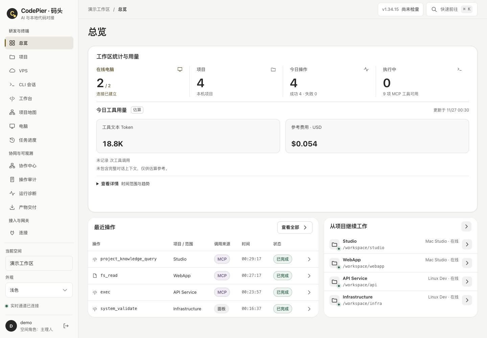
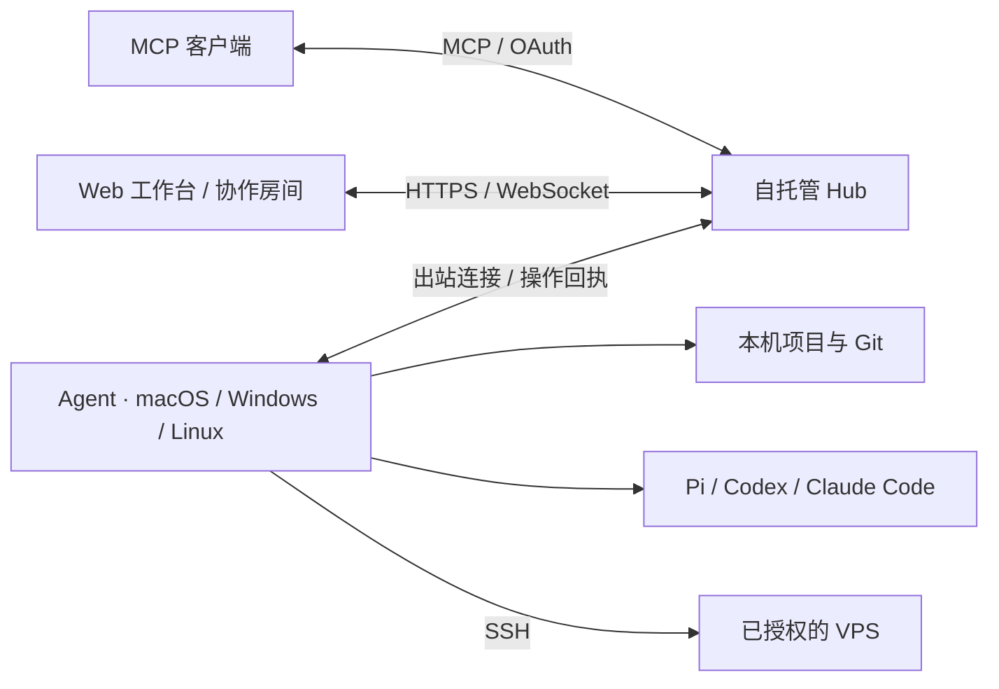

# CodePier · 码头

**让 AI 在你的真实开发环境中工作。**

[](RELEASE.json)
[](LICENSE)

CodePier 是一个自托管的 AI 开发与远程运维工作台。将 ChatGPT 等 MCP 客户端、Pi / Codex / Claude Code 原生会话、开发电脑、VPS 和团队协作接入同一个面板，在明确授权的范围内读取项目、修改代码、运行测试、交付任务并核对结果。

源码与工具保留在原有电脑上；开发电脑无需开放公网入站端口。**Hub** 负责连接、权限、任务与回执，**Agent** 在 macOS、Windows 或 Linux 上执行实际操作。读取的源码、命令输出、附件和会话记录会按相应工作流程传给 Hub 或客户端。

[快速开始](#5-分钟快速开始) · [核心能力](#核心能力) · [工作原理](#工作原理) · [使用示例](#使用示例) · [文档](docs/README.md) · [下载正式版本](https://github.com/cyeinfpro/codepier/releases/latest)



*界面示例使用独立合成数据；实际界面随版本更新。*

## 工作原理



Hub 管理身份、项目映射、设备、任务状态与审计；Agent 调用本机文件系统、Git、Shell 和原生 CLI。VPS 通过已授权的 SSH 连接访问，不需要在每台 VPS 安装 CodePier Agent。浏览器和桌面能力按需接入并独立授权。

CodePier **不提供模型服务，也不是远程沙箱**。MCP 文件与命令工具不依赖模型 CLI；原生编程会话需要在 Agent 所在电脑安装并登录相应 CLI，模型与费用沿用原有配置。

## 5 分钟快速开始

下面是最短接入流程。首次镜像构建、下载和 HTTPS 配置可能需要更久；已有 Hub 可从第 2 步开始。

### 1. 安装 Hub

服务器需准备 Git、Bash、Python 3.9+、Docker 和支持 `up --wait` 的 Docker Compose v2。以下命令从 [Releases](https://github.com/cyeinfpro/codepier/releases/latest) 获取最新正式版本：

```bash
release_tag=$(python3 -c 'import json, re, urllib.request; tag = json.load(urllib.request.urlopen("https://api.github.com/repos/cyeinfpro/codepier/releases/latest", timeout=20))["tag_name"]; assert re.fullmatch(r"v[0-9]+\.[0-9]+\.[0-9]+", tag); print(tag)') &&
git clone --branch "$release_tag" --depth 1 https://github.com/cyeinfpro/codepier.git &&
cd codepier &&
bash install.sh
```

按提示设置地址和管理员账号，完成后打开面板登录。没有默认管理员密码。

以上默认生成 HTTP 配置，仅适合可信网络。**公网使用前先配置 HTTPS，不要通过裸公网 HTTP 输入密码或配对设备。** 详细步骤见[安装教程](docs/START-HERE.md)。

### 2. 接入开发电脑

在面板打开 **电脑 → 接入电脑**，选择系统，填写设备名称和已有的授权目录，将生成的命令复制到这台电脑的终端执行。

完成后确认设备在线。命令含一次性配对票据，不要公开分享。只需文件访问时，取消勾选“Shell 与目录任务”。[各系统安装说明](docs/AGENT_INSTALL.md)

### 3. 添加项目

在 **项目** 中选择电脑，填写项目名称（如 `demo`）和授权目录内的实际路径。先开启读取，确认能打开一个文件；需要改代码、跑测试时，再开启写入和执行权限。

### 4. 连接 MCP 客户端

在 **设置 → 公开地址** 保存实际 HTTPS 基地址，再通过 ChatGPT、Gemini、Antigravity、Claude 或 Grok 的 MCP 接入入口添加：

```text
https://你的域名/mcp
```

通过 OAuth 登录 CodePier，确认项目和工具权限。在新对话里启用 CodePier，试试：

> 打开 demo 项目，读取 README，告诉我项目结构和测试入口。先不要修改文件或运行命令。

具体客户端入口、私有 Hub 和其他 MCP 客户端的配置见[连接指南](docs/CHATGPT.md)。只使用网页里的 CLI 会话或 VPS 终端，可跳过这一步。

### 5. 开始工作

- **写代码**：在已连接的 MCP 客户端中指定项目与任务，或在面板打开该项目的原生 CLI 会话。
- **管理服务器**：在 VPS 中添加服务器、核对连接与授权，再打开终端。需要经 MCP 操作时为项目分配 VPS。
- **团队协作**：启用协作中心，建立房间、保存权限范围，再按向导接入 dot 或微信。

## 核心能力

### 真实项目开发与原生编程会话

- **MCP 接入**：通过 ChatGPT、Gemini、Antigravity、Claude、Grok 等支持相应 MCP 接入方式的客户端打开授权项目，搜索代码、批量读取文件、按 SHA 校验修改、审阅差异、执行命令和测试。
- **原生 CLI 工作台**：在网页使用 Pi、Codex、Claude Code，查看会话历史、流式输出、附件、模型配置与审批；断线后按原会话状态恢复。
- **项目知识地图与 Git 工作区**：根据当前源码 SHA 维护结构与摘要，过期内容不作为当前结论；需要隔离修改时创建 Git worktree，保留原工作区的未提交变更。
- **任务调度与结果核对**：管理并发与长任务，使用原操作编号查询进度、日志、退出码和输出完整性；网络断开或回执未知时，不盲目重复写入和部署。

[原生 CLI 会话](docs/CLI_SESSIONS.md) · [MCP 工具](docs/CORE_TOOLS.md) · [项目知识地图](docs/PROJECT_KNOWLEDGE.md) · [并发调度](docs/ADAPTIVE_SCHEDULER.md) · [长任务恢复](docs/LONG_OPERATIONS.md)

### 多电脑、VPS 与 Web SSH

- **设备与项目管理**：一个 Hub 接入多台开发电脑，按实际目录映射项目，管理 Agent 安装、升级、在线状态及项目与 VPS 的绑定。
- **浏览器 SSH 工作区**：打开已保存 VPS 的终端，支持多标签、锁定标签、双分屏、搜索、复制、粘贴预览、全屏、主题、移动端辅助键和连接诊断。
- **持续终端会话**：自动探测 tmux；满足条件时使用持久会话，明确缺失或版本不支持时回退普通 SSH。重新连接需原会话仍存在且授权有效；关闭标签不等于结束远端任务。
- **环境准备与交付**：后台检查 SSH 和 tmux 就绪状态，管理员可对符合条件的 VPS 批量安装 tmux；MCP 支持经授权的托管 VPS 连接以 SFTP 暂存项目中的发布包，SHA-256 校验后落盘，并可在后续 VPS 命令中作为标准输入使用。文件暂存与命令执行分别授权，不自动安装。

> **托管 VPS 的连接边界：** 已保存 VPS 的托管连接入口使用配置的地址、端口、账号和密码，不校验 SSH 主机指纹。地址错误或网络遭劫持可能泄露密码，只应在可信网络中使用；普通系统 SSH 与通用执行仍遵循各自的主机信任规则。相关功能需要匹配版本的 Hub 与 Agent。

[VPS 管理](docs/VPS.md) · [Web SSH 运维手册](docs/WEB_SSH_OPERATIONS.md) · [Agent 安装与升级](docs/AGENT_INSTALL.md)

### 房间协作与持续工作

- **协作房间**：先建房聊天，再关联一个或多个项目；统一管理成员、项目读写执行范围和具体执行位置。
- **多 dot 协作**：加入已验证的 dot，指定主责、分配工作、补充要求、查看步骤与回传证据；可以暂停、恢复原工作或由满足条件的成员接替。
- **微信接入**：在原房间通过扫码完成本人配对，微信可跟随房间权限或使用更窄的独立范围。成员、渠道、宿主和项目授权仍须实际验证。
- **状态可追踪**：消息已保存、连接已验证、工作已领取、操作已执行与最终结果已回传是不同状态；关闭面板不会取消已经保存的工作。

协作中心默认关闭，须先开启并完成接入验证。新版房间的 Telegram 原生任务接入尚不可用，不将策略配置视为功能已接通。

[协作中心](docs/COLLABORATION_CENTER.md) · [dot 协作](docs/DOT_COLLABORATION.md) · [协作恢复与维护](docs/COLLABORATION_CENTER_OPERATIONS.md)

### 权限、运行环境与运维

| 能力 | 说明 |
| --- | --- |
| **细粒度授权** | Space、项目、工具、执行位置及 OAuth / PAT 访问范围；动态角色和授权撤销。 |
| **项目执行环境** | 默认清洁模式、兼容模式与符合条件的 Linux 容器模式；配置和实际生效分别核对。 |
| **浏览器与桌面** | 浏览器、桌面操作按需配置，独立授权；不能由普通项目读写权限自动开启。 |
| **文件与证据** | 文件入站、操作审计、原始回执、Git 差异及输出完整性核对。 |
| **更新与备份** | 面板与 Hub 更新、受管 Agent 分发及升级、数据库与密钥备份；各组件实际运行版本分别核对。 |

清洁模式使用独立 HOME、缓存和非登录 Shell，并默认复用 Agent 执行账号已有的 GitHub CLI 登录、Git 全局配置和 SSH Agent。可在项目的 **执行环境 → 复用已有登录** 中逐项关闭。它不是操作系统沙箱；Shell 仍以 Agent 账号权限运行。

[运行环境](docs/PROJECT_RUNTIMES.md) · [权限配置](docs/ACCESS_PROFILES.md) · [浏览器与桌面](docs/COMPUTER_USE.md) · [文件入站](docs/FILE_IMPORT_INGRESS.md) · [面板更新](docs/PANEL_UPDATE.md)

## 最近版本

当前 `main` 源码版本为 **v1.34.15**（2026-11-26）。

| 版本 | 变化 |
| --- | --- |
| **1.34.15** | 修复项目内 VPS 绑定管理、全局 VPS 搜索、项目与任务对话入口、协作入口以及首次打开角色政策摘要的问题。 |
| **1.34.14** | 增加受授权的 VPS 发布包 SFTP 暂存与 SHA-256 校验，支持后续命令从已暂存包读取标准输入。 |
| **1.34.13** | 区分命令退出和日志收集状态，限制大文件及会话快照开销；改进终端恢复、协作事件交付及缓存清理。 |
| **1.34.x** | Web SSH、tmux 持久会话、VPS 管理与环境检查、移动端布局、原生会话有界恢复及发布包兼容性。 |

源码版本不等于已发布安装包或已部署版本。[完整更新记录](CHANGELOG.md) · [正式版本下载](https://github.com/cyeinfpro/codepier/releases/latest)

## 使用示例

在已连接 CodePier 并授权项目的对话里，可以直接交办以下任务：

> 打开 demo 项目，先阅读 README 和项目规则，再告诉我结构与测试入口。不要修改文件。

> 检查 demo 项目的 Git 状态，修复指定问题，运行相关测试；只提交你修改的文件，并报告 commit 与推送结果。

> 查询 demo 项目已分配的 VPS，检查磁盘和服务状态；如果返回 pending，继续查询原操作编号，不要重新执行命令。

协作中心启用并完成 dot 订阅后，也可在面板中选择 `@dot` 交办任务。消息发送、订阅连接、实际领取和最终回传是不同状态。[dot 协作指南](docs/DOT_COLLABORATION.md)

> 将项目内现有的发布包暂存到已授权 VPS，核对 SHA-256 和暂存回执；在明确确认安装步骤后再执行部署命令。

## 使用前了解

- **Shell 和原生 CLI 使用 Agent 运行账号的系统权限，不是项目目录沙箱。** 只授权必要目录；互不信任的用户应使用独立系统账号、容器或虚拟机。[安全说明](SECURITY.md)
- 浏览器与桌面控制需另行配置和授权。桌面控制当前已验证 macOS，Windows / Linux 桌面后端尚未验证。[配置说明](docs/COMPUTER_USE.md)
- 文件入站未配置时默认开启，显式关闭会保留；来源授权不会自动扩大。支持范围、大小限制和客户端验收状态见[文件入站指南](docs/FILE_IMPORT_INGRESS.md)。协作中心默认关闭，启用前阅读[协作中心指南](docs/COLLABORATION_CENTER.md)。

## 遇到问题时

| 现象 | 先检查 |
| --- | --- |
| Agent 离线或项目打不开 | 电脑是否在线、Hub 地址、本机授权目录与项目映射；不要先删除配对配置。 |
| 能读文件却无法运行命令 | 项目与客户端 `execute` 权限、Agent 本机 Shell 开关，以及清洁模式下的工具 PATH。 |
| GitHub/SSH 凭据在清洁模式不可用 | 确认实际 Agent 运行账号已有登录，并查看项目「复用已有登录」是否被显式关闭。 |
| VPS 登录失败 | 检查地址、端口、账号/密码、Agent 网络与 `ssh_diagnostics`；普通系统 SSH 还需核对主机信任，不把远端命令失败当作 SSH 认证失败。 |
| 操作显示 `pending`、`queued` 或 `unknown` | 使用原 `operation_id` 查询；不能以新幂等键盲目重跑写入、部署或远程命令。 |
| dot 收不到任务 | 核对协作功能开关、加入范围、实际宿主事件订阅及消费状态；消息已发送不等于任务已执行。 |

[常见问题](docs/FAQ.md) · [连接诊断](docs/CHATGPT.md) · [操作恢复](docs/LONG_OPERATIONS.md)

## 更新与备份

发布新版本不会自动更新你的部署。面板顶部的快捷更新只更新面板、Hub 与 Agent 分发文件，**不会自动更新或重启已安装的 Agent**。如需同步更新当前空间已授权的受管 Agent，请在更新详情或设置中选择范围并确认，也可在电脑页单独升级。

更新前备份 Hub 数据库及其**匹配的密钥文件**（视加密格式包含 `master.key`、`master.keys.json`），重要的 Agent 状态、journal、原生 CLI 历史和部署配置还需单独备份。回退必须使用与程序和数据库格式匹配的备份；不要通过删除数据卷或重新配对解决升级故障。

[更新 Hub](docs/PANEL_UPDATE.md) · [升级 Agent](docs/AGENT_INSTALL.md) · [备份 Hub 数据](docs/PANEL_UPDATE.md#备份-hub-数据)

## 更多文档

- [文档导航](docs/README.md) · [完整入门](docs/START-HERE.md) · [ChatGPT / MCP 连接](docs/CHATGPT.md)
- [项目执行环境](docs/PROJECT_RUNTIMES.md) · [MCP 工具](docs/CORE_TOOLS.md) · [协作中心](docs/COLLABORATION_CENTER.md)
- [VPS 管理](docs/VPS.md) · [Web SSH](docs/WEB_SSH_OPERATIONS.md) · [原生 CLI](docs/CLI_SESSIONS.md)
- [安全说明](SECURITY.md) · [开发与验证](docs/DEVELOPMENT.md) · [发布流程](docs/RELEASING.md)
- [贡献指南](CONTRIBUTING.md) · [更新记录](CHANGELOG.md) · [问题反馈](https://github.com/cyeinfpro/codepier/issues)

## 版本与许可

当前仓库的 `RELEASE.json` 标记为 **1.34.15 / prepared / source-and-image**，其中 `published` 和 `deployed` 均为 `false`。可下载的正式版本以 [Releases](https://github.com/cyeinfpro/codepier/releases/latest) 为准，实际部署版本以对应 Hub / Agent 的运行状态为准。

- **Version:** 1.34.15
- **License:** [MIT](LICENSE)

第三方依赖保留各自许可证，见 `web/vendor/` 与 [MCP Apps 声明](web/mcp-apps/THIRD_PARTY_NOTICES.txt)。
