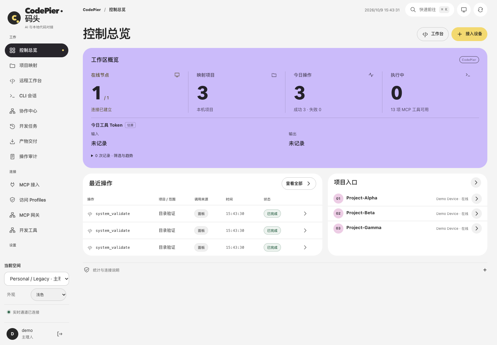

# CodePier · 码头

让 ChatGPT 在你授权的电脑和服务器上读代码、改文件、跑测试，并拿到可核对的执行结果。

[](RELEASE.json)
[](LICENSE)

CodePier 是自托管的 MCP 服务和开发面板。**Hub** 负责接入与管理，**Agent** 在 macOS、Windows 或 Linux 上运行本机工具。你也可以在网页里继续 Pi、Codex、Claude Code 会话，管理多台电脑和服务器。

项目留在原来的电脑上，开发电脑无需开放公网入站端口。读取的源码、命令结果和会话记录会按使用流程传给 Hub 或客户端。

[5 分钟快速开始](#5-分钟快速开始) · [核心能力](#核心能力) · [使用示例](#使用示例) · [使用文档](docs/README.md) · [版本下载](https://github.com/cyeinfpro/codepier/releases/latest)



界面示例使用独立合成数据。

## 5 分钟快速开始

下面是最短接入流程。首次镜像构建、下载和 HTTPS 配置可能需要更久；已有 Hub 可从第 2 步开始。

### 1. 安装 Hub

服务器需准备 Git、Bash、Python 3.9+、Docker 和支持 `up --wait` 的 Docker Compose v2。以下安装本版本 **v1.30.6**，最新正式版本见 [Releases](https://github.com/cyeinfpro/codepier/releases/latest)：

```bash
git clone --branch v1.30.6 --depth 1 https://github.com/cyeinfpro/codepier.git
cd codepier
bash install.sh
```

按提示设置地址和管理员账号，完成后打开面板登录。没有默认管理员密码。

以上默认生成 HTTP 配置，仅适合可信网络。**公网使用前先配置 HTTPS，不要通过裸公网 HTTP 输入密码或配对设备。** 详细步骤见[安装教程](docs/START-HERE.md)。

### 2. 接入开发电脑

在面板打开 **设备节点 → 接入电脑**，选择系统，填写设备名称和已有的授权目录，将生成的命令复制到这台电脑的终端执行。

完成后确认设备在线。命令含一次性配对票据，不要公开分享。只需文件访问时，取消勾选“Shell 与目录任务”。[各系统安装说明](docs/AGENT_INSTALL.md)

### 3. 添加项目

在 **项目映射** 中选择设备，填写项目名称（如 `demo`）和授权目录内的实际路径。先开启读取，确认能打开一个文件；需要改代码、跑测试时，再开启写入和执行权限。

### 4. 连接 ChatGPT

在 **系统设置 → 公开地址** 保存实际 HTTPS 基地址，再在 ChatGPT 中添加 MCP 连接：

```text
https://你的域名/mcp
```

通过 OAuth 登录 CodePier，确认项目和工具权限。在新对话里启用 CodePier，试试：

> 打开 demo 项目，读取 README，告诉我项目结构和测试入口。先不要修改文件或运行命令。

具体客户端入口、私有 Hub 和其他 MCP 客户端的配置见[连接指南](docs/CHATGPT.md)。只使用网页里的 CLI 会话，可跳过这一步。

## 核心能力

| 场景 | 能做什么 |
| --- | --- |
| **真实项目开发** | 按授权目录搜索、读取、SHA 校验修改文件，审阅差异、运行命令与测试；需要时使用 worktree。 |
| **原生 AI 编程会话** | 在网页继续 Pi、Codex、Claude Code 会话，查看历史、附件和审批；CLI 安装与登录留在 Agent 电脑。 |
| **多电脑与 VPS** | 一台 Hub 接入多台 macOS、Windows、Linux Agent；通过项目访问已分配的 SSH 服务器。 |
| **项目执行环境** | 在项目卡片切换默认**清洁模式**、兼容模式或符合条件的 Linux 容器模式，并分别核对保存和生效。 |
| **协作中心** | 在获准开启后建立项目讨论室，接入 dot，通过 `@` 交办、查看进度与原话题回传；实际任务领取需要宿主订阅和独立授权。 |
| **浏览器与桌面** | 按需接入浏览器和桌面操作；需另行配置与授权，不能由项目文件权限自动开启。 |
| **权限与审计** | 按 Space、项目及工具划分 OAuth/PAT 权限，保留操作编号、输出、退出码和原操作恢复入口。 |

CodePier **不提供模型服务**。只使用 MCP 文件与命令工具，不需要安装模型 CLI；使用原生会话时，需在 Agent 电脑上自行安装、登录相应 CLI，模型费用沿用其配置。

清洁模式使用独立 HOME、缓存和非登录 Shell，并默认复用 Agent 执行账号已有的 GitHub CLI 登录、Git 全局配置和 SSH Agent。可在项目的 **执行环境 → 复用已有登录** 中逐项关闭。它**不是操作系统沙箱**：Shell 仍以本机 Agent 账号权限执行。依赖个人终端启动脚本、特殊签名或硬编码 HOME 的工具仍需配置。[项目运行时与边界](docs/PROJECT_RUNTIMES.md)

### 最近版本变化

- **v1.30.6 — 更新存储分离与宿主引擎**：新版宿主更新器单次确认默认分离数据库快照与附件，成功后安全切换已验证宿主引擎；旧固定更新器仍可升级 Hub，但不能自行获得宿主引导权限。[兼容范围与更新说明](docs/PANEL_UPDATE.md)
- **v1.30.5 — 配对权限选项**：新配对默认提供读取、写入、执行和电脑控制选项；仅预选读取，额外权限由用户明确勾选。显式只读请求与已有连接权限保持不变。[权限范围说明](docs/ACCESS_PROFILES.md)

- **v1.30.4 — VPS SSH 可靠性**：仅在可以安全判定的连接/认证失败阶段，在同一操作中最多进行 3 次有界尝试；保留逐次诊断。主机密钥错误、远端命令已开始、取消或结果不明时不会盲目重试。[VPS 与 SSH 说明](docs/VPS.md)
- **v1.30.3 — 安全与稳定性**：加强登录限流、HTTP 请求预算与响应安全头，修复聊天、连接状态与项目发现问题。
- **v1.30.2 — 清洁模式授权复用**：默认复用既有 GitHub CLI、Git 配置及 SSH Agent，按项目可关闭，不会复制私钥或自动新增授权。

版本功能是否已经运行，取决于实际部署的 **Hub、Agent 和客户端工具目录**，不能仅凭仓库代码或版本说明判断。[完整更新记录](CHANGELOG.md)

## 使用示例

在已连接 CodePier 且具有相应权限的 ChatGPT 对话里，可以这样说：

> 打开 demo 项目，先阅读 README 和项目规则，再告诉我结构与测试入口。不要修改文件。

> 检查 demo 项目的 Git 状态，修复指定问题，运行相关测试；只提交你修改的文件，并报告 commit 与推送结果。

> 查询 demo 项目已分配的 VPS，检查磁盘和服务状态；如果返回 pending，继续查询原操作编号，不要重新执行命令。

协作中心启用并完成 dot 订阅后，也可在面板中选择 `@dot` 交办任务。消息发送、订阅连接、实际领取和最终回传是不同状态。[dot 协作指南](docs/DOT_COLLABORATION.md)


## 使用前了解

- **Shell 和原生 CLI 使用 Agent 运行账号的系统权限，不是项目目录沙箱。** 只授权必要目录；互不信任的用户应使用独立系统账号、容器或虚拟机。[安全说明](SECURITY.md)
- 浏览器与桌面控制需另行配置和授权。桌面控制当前已验证 macOS，Windows / Linux 桌面后端尚未验证。[配置说明](docs/COMPUTER_USE.md)
- 文件入站未配置时默认开启，显式关闭会保留；来源授权不会自动扩大。支持范围、大小限制和客户端验收状态见[文件入站指南](docs/FILE_IMPORT_INGRESS.md)。协作室默认关闭，启用前阅读[协作室指南](docs/COLLABORATION_CHATROOM.md)。

## 遇到问题时

| 现象 | 先检查 |
| --- | --- |
| Agent 离线或项目打不开 | 电脑是否在线、Hub 地址、本机授权目录与项目映射；不要先删除配对配置。 |
| 能读文件却无法运行命令 | 项目与客户端 `execute` 权限、Agent 本机 Shell 开关，以及清洁模式下的工具 PATH。 |
| GitHub/SSH 凭据在清洁模式不可用 | 确认实际 Agent 运行账号已有登录，并查看项目「复用已有登录」是否被显式关闭。 |
| VPS 登录失败 | 主机密钥、账号/密码、Agent 网络与 `ssh_diagnostics`；不把远端命令失败当作 SSH 认证失败。 |
| 操作显示 `pending`、`queued` 或 `unknown` | 使用原 `operation_id` 查询；不能以新幂等键盲目重跑写入、部署或远程命令。 |
| dot 收不到任务 | 核对协作功能开关、加入范围、实际宿主事件订阅及消费状态；消息已发送不等于任务已执行。 |

[常见问题](docs/FAQ.md) · [连接诊断](docs/CHATGPT.md) · [操作恢复](docs/LONG_OPERATIONS.md)

## 更新与备份

发布新版本不会自动更新你的部署。面板顶部的快捷更新只更新面板、Hub 与 Agent 分发文件，**不会自动更新或重启已安装的 Agent**。如需同步更新当前空间已授权的受管 Agent，请在更新详情或系统设置中选择范围并确认，也可在设备节点页单独升级。

更新前备份 Hub 数据库及其**匹配的密钥文件**（视加密格式包含 `master.key`、`master.keys.json`），重要的 Agent 状态、journal、原生 CLI 历史和部署配置还需单独备份。回退必须使用与程序和数据库格式匹配的备份；不要通过删除数据卷或重新配对解决升级故障。

[更新 Hub](docs/PANEL_UPDATE.md) · [升级 Agent](docs/AGENT_INSTALL.md) · [备份 Hub 数据](docs/PANEL_UPDATE.md#备份-hub-数据)

## 更多文档

- [文档导航](docs/README.md) · [完整入门](docs/START-HERE.md) · [ChatGPT / MCP 连接](docs/CHATGPT.md)
- [项目执行环境](docs/PROJECT_RUNTIMES.md) · [MCP 工具](docs/CORE_TOOLS.md) · [协作中心](docs/COLLABORATION_CHATROOM.md)
- [VPS 管理](docs/VPS.md) · [安全说明](SECURITY.md) · [开发与验证](docs/DEVELOPMENT.md)
- [贡献指南](CONTRIBUTING.md) · [更新记录](CHANGELOG.md) · [问题反馈](https://github.com/cyeinfpro/codepier/issues)

## 版本与许可

当前仓库的 `RELEASE.json` 标记为 **1.30.6 / prepared / source-and-image**；可下载版本以 [Releases](https://github.com/cyeinfpro/codepier/releases/latest) 为准，`main` 可能包含尚未发布的改动。

- **Version:** 1.30.6
- **License:** [MIT](LICENSE)

第三方依赖保留各自许可证，见 `web/vendor/` 与 [MCP Apps 声明](web/mcp-apps/THIRD_PARTY_NOTICES.txt)。
