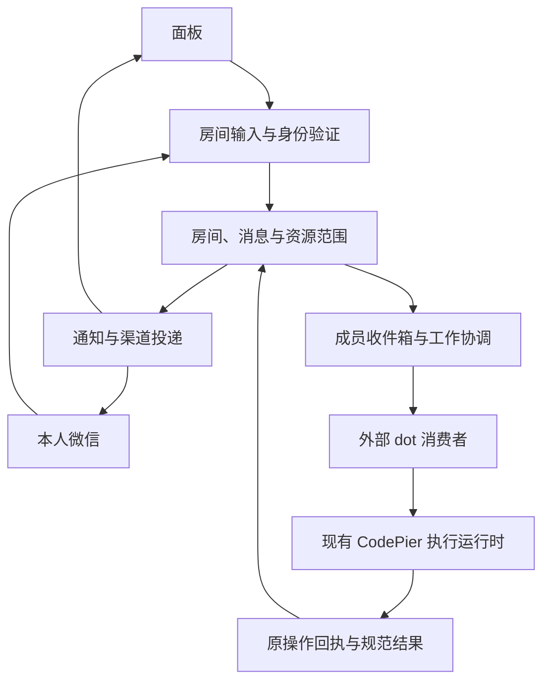
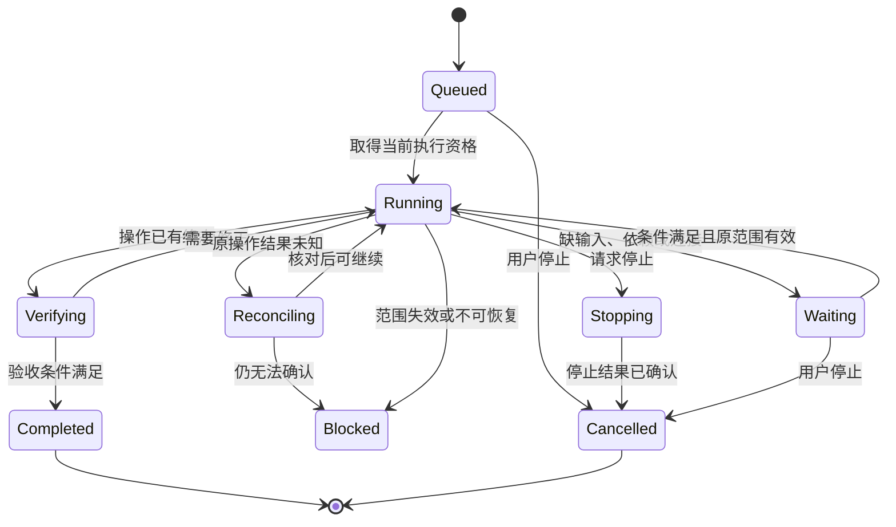

# MCP 协作中心全面重构设计

> 公开脱敏版；历史观察不代表当前环境。

> 版本：1.0 · 实施设计
> 日期：2026-11-02（UTC+08:00）
> 目标：建房间、增删项目、添加 dot、连接微信，在同一条对话中自主推进工作。
> 本轮交付：现状审计与完整重构方案；文中“应当”“目标”“验收”均为待实施要求。
> 审计基线：历史开发工作区；不等同于当前 main、正式 Release 或线上版本。

## 1. 结论与产品定义

协作中心应成为一个长期存在的工作房间：用户把项目和 dot 放进来，用面板或本人微信说清楚要做什么，系统在既有权限内安排执行、协调成员、验证结果、回复进展；需要用户做决定时，才回到同一条对话提问。

**重构的中心是“房间”，不是项目分区、接入位置、订阅或任务规则。** 用户只需要理解五个对象：房间、项目、dot、消息、工作。微信是一种收发入口，不是另一套任务系统。

现有代码已经具备可靠执行所需的许多底座，包括持久消息、原操作回执、幂等、租约与 fencing、事务 outbox、统一收件箱、消费者会话和团队交接。本次全面替换用户流程和上层业务组织，复用这些底座，不另造第二套执行平台。[E1–E8]

### 1.1 最终要得到的体验

1. 点“新建房间”，输入名称即可进入。项目可以现在选，也可以稍后加。
2. 点“项目”，勾选已有项目；移出项目不会删除仓库、服务器文件或 CodePier 的全局项目。
3. 点“添加 dot”，填写名称、确认显示的参与范围，把一段加入说明发给目标 dot。系统自动跟踪连接和往返验证，失败时给一个准确的继续动作。
4. 点“连接微信”，在同一向导里完成扫码、本人确认和房间绑定。
5. 在面板或微信直接说“检查并修复这个问题”。主责 dot 理解请求、安排工作、必要时委派其他 dot，进展和结果回到原处。
6. 后续说“继续”“先处理另一个项目”“先停一下”，作用于明确关联的原工作；用户无需重新建任务、重新加 dot 或重新配微信。
7. 关闭网页后，Hub 中已持久化的工作和通知继续运行。外部 dot 暂时不可用时，工作保持可恢复状态，界面说明正在等谁。

### 1.2 本次必须做出的决策

| 主题 | 决策 |
| --- | --- |
| 入口 | 房间列表是第一层，不再先选项目才能理解房间 |
| 空房间 | 允许零项目；可以整理目标、聊天和接入成员，执行项目工作时才要求明确项目 |
| 项目管理 | “关联项目”与“允许某个 dot 使用哪些能力”分开建模，同一面板集中完成 |
| dot | 稳定成员身份与临时邀请、MCP grant、宿主订阅、消费者租约分离 |
| 添加 dot | 一个可恢复的接入流程；无 CPJ/CPD/v1/v2 选择题 |
| 微信 | 复用现有腾讯 iLink 私聊接入；扫码、配对、任务范围确认在同一向导完成 |
| 聊天与任务 | 一个输入框；明确的本人请求在授权内自动转成工作，普通讨论自然回复 |
| 多 dot | 每项工作一个主责；其他 dot 通过结构化子工作或交接参与 |
| 自主推进 | 由新输入、依赖完成、执行回执、恢复和明确日程驱动；无事时不循环聊天 |
| 持续授权 | 成员关系长期存在；新授权可明确选择直到撤销，短期邀请和运行租约仍有限 |
| 恢复 | 恢复同一成员、同一工作、同一操作；不通过重建对象消除错误 |
| 并发 | 复用现有资源调度与项目公平；控制请求、通知、消费者和执行分别限流 |
| 迁移 | 新流程唯一写入；旧接口只保留边界适配，按验收条件退出 |

## 2. 当前问题：为什么“添加 dot”仍然很难

本节区分源码事实、历史报告和设计判断。没有把旧验收记录当作今天的线上实测，也没有在真实 dot 或微信里发送测试消息。

### 2.1 房间看似独立，实际仍被项目分区牵制

源码中已经存在用户房间 `conversation_rooms` 和关联表 `conversation_projects`；`collaboration_rooms` 则仍承担项目与环境分区。两种“room”同时存在。`ConversationService.view` 在看不到任何项目时返回“房间不存在”，`resolve` 也先要求当前项目属于房间。[E1]

**影响：** 房间生命周期、项目可见性和连接路由相互影响。项目移除、权限改变或旧连接锚点失效，可能让用户面对“房间不见了”“连接失效”，而不是一个仍然存在、准确说明缺少资源的工作房间。

**重构：** 保留用户房间身份；资源不可用只改变资源状态。房间本身的元数据、通用对话、成员管理和项目执行分别授权。

### 2.2 项目管理被特定 dot 和执行基线绑定

现有 `WorkingScopes.candidate` 需要房间已有 dot，固定原消息连接；已有范围不能直接切换到另一 dot。旧增补路径 `ProjectScopes.candidate` 又要求同一环境、原目标是项目 Agent、原 dot 已有执行许可、新项目可写且允许执行，有效期还受原策略创建后七天限制。[E2]

这里不能把旧增补路径的每一条限制都说成当前所有入口必然触发；两套路径共存本身就是需要消除的复杂度。

**影响：** 添加只读项目、先整理房间再加 dot、不同 dot 使用不同项目、长期房间变更成员，都被底层连接模型拖累。

**重构：** 项目关联独立保存。成员能力按“成员 × 项目 × 执行位置”计算，某个 dot 不可用不能阻止房主增删项目。

### 2.3 “添加成员”同时冻结了执行目标和授权快照

`DotService.create` 在创建 dot 时就保存项目、执行目标和能力快照；`approved_owner` 在项目快照改变时要求重新添加 dot。`collaboration_dots.id` 还直接引用加入位置的 ID。[E3]

**影响：** 一次项目路径调整或目标变化，容易演变为成员重建；用户难以判断该重新授权、恢复订阅，还是重新加一遍。

**重构：** 成员身份稳定；项目执行批准独立版本化。项目变化只修复受影响的资源授权，成员、历史消息和未受影响的项目保持原身份。

### 2.4 对连接成功的证明不足以代表可以工作

现有 `experience_projection.connection` 已提供统一状态投影，这是应保留的能力；但其 ready 分支主要依据已登记和订阅相关状态，不能独立证明目标 dot 的实际消费和回复。[E4]

前端 `collaboration-dots.js` 又同时保留 `ready`、`transport`、`statusText` 和卡片 `connected` 判断：部分使用服务端投影，部分退回 slot、duplex 和 task_status。需要把主状态与按钮可用性的推导收敛到同一契约，避免卡片文字和操作资格漂移。[E13]

已有文档也反复区分 webhook 接受、dot 领取、任务执行与最终回复。新界面不应让用户逐个拼这些证据；应该由服务端计算一个主状态和一个下一步。

### 2.5 已经实现的新能力，没有自然成为主流程

工作区已包含 `dot_consumers.py`、`dot_mailbox.py`、`team_collaboration.py`、`relay_hints.py`。旧使用文档仍先后介绍通知位置、任务接入、双向聊天、通用发言、独立授权和多 dot 协商。[E5–E8]

**影响：** 技术能力越来越多，首次成功的路径却没有缩短；用户仍然需要理解“做完哪一层才算接通”。

**重构：** 新接入默认走同一个受支持的房间消费者协议；旧模式在兼容适配器里处理，不出现在新用户主流程。

### 2.6 微信的功能已经较完整，操作被拆散

仓库已有扫码、加密保存账号、联系人配对、本人任务授权、直到撤销、原处澄清和回传。当前文档入口需要经过连接、通道与范围等多层页面；扫码成功也还未完成联系人和房间绑定。[E9–E11]

**重构：** 账号登录、联系人核对、房间路由和允许工作的范围保留独立证据，呈现为一个连续向导。减少页面跳转，不省略必要的真实账号确认。

### 2.7 本轮观察与历史状态

- 历史只读查询不证明目标 dot 已接入，也不等于完整房间状态。
- 历史验收记录不代表当前部署或授权状态，实施前必须重新核对。[E12]
- 本轮发现公共工具的通用字段可以被特定 action 拒绝，例如 rooms 不接受 limit。应由单一契约注册表生成 action 参数说明和精确 next_request，避免宿主猜参数。

## 3. 产品对象与边界

| 用户看到的对象 | 含义 | 稳定标识 | 生命周期 |
| --- | --- | --- | --- |
| 房间 | 持续对话、项目、成员与工作的共同容器 | room_id，对应既有 conversation_id | 新建、活跃、暂停、归档、恢复 |
| 项目 | 可被房间使用的 CodePier 项目及环境 | project_id + environment_id | 关联、不可用、移出 |
| dot | 参与此房间的助手成员 | member_id | 邀请、接通、暂停、移除 |
| 微信 | 本人和房间之间的收发入口 | channel_binding_id | 扫码、配对、连接、需重连、解除 |
| 消息 | 唯一原始输入、回复或系统事实 | message_id | 保存后按版本修订 |
| 工作 | 从明确请求派生、可追踪的目标和执行过程 | goal_id / work_item_id | 排队、执行、等待、完成、停止 |

技术层继续区分：

- **成员身份**：谁在房间里；显示名不作为可信身份。
- **连接绑定**：该成员的宿主、MCP 身份和当前绑定世代。
- **授权**：允许此成员对哪些项目、目标进行什么操作。
- **通知路线**：如何提醒宿主有新待办。
- **消费者会话**：谁在处理这一轮待办，何时失效。
- **执行操作**：具体读写、命令或部署的持久 operation。
- **渠道投递**：某条规范消息送往面板、微信的独立结果。

用户默认看成员和工作；以上技术细节只在诊断抽屉展开。

## 4. 核心用户旅程

### 4.1 新建房间

入口固定在协作中心左上角。表单只有房间名称必填，可选项目支持多选；环境和执行位置使用已配置值，不让用户在这里填写数据库或订阅参数。

点击“创建”即持久化房间。未选择项目时显示简洁空态：“添加项目，或先邀请 dot。”两项都可独立完成。第一条消息可以描述目标，不需要先建立任务。

房间名称、图标和排序属于展示版本；修改名称不使订阅、授权、进行中的工作失效。

重复点击或响应丢失，用同一请求键恢复原房间。用户取消表单时不产生半建房间。房间创建成功后，后续添加项目失败不回滚已经存在的房间。

### 4.2 增删项目

房间顶部只有“项目 N”入口，打开同一个侧面板：

| 项目 | 当前用途 | 参与 dot | 执行位置 | 动作 |
| --- | --- | --- | --- | --- |
| MCP | 读取、修改、执行 | 主责、审核 | 已批准 Agent | 调整 / 移出 |
| 另一项目 | 只读 | 主责 | 不涉及执行 | 调整 / 移出 |

关联已有项目不要求房间先有 dot，不要求项目必须允许 Shell。不可用能力显示具体原因，其他可用能力仍可选择。

一次保存可包含项目关联和明确选择的成员能力，但后端分开表达两种意图：`attach_project` 与 `approve_member_scope`。仅关联项目绝不声称已经可以执行。

移出项的文案为“移出房间”。执行前给出实际影响：将阻止哪些待执行步骤、哪些运行操作正在请求停止。其他项目的工作继续；底层项目和文件保留。批量保存发生版本冲突时保留用户选择，只重审冲突项。

添加项目不自动导入别的房间历史，也不把项目访问权广播给所有 dot。新范围只供后续明确任务使用；既有任务若需要扩大范围，要记录一次范围变更。

### 4.3 添加 dot：压缩成一次接入流程

入口首先展示“已连接的 dot”和“连接新 dot”。已连接列表只来自 CodePier 已验证且当前账号有权使用的连接记录，不声称可以枚举用户在 ChatGPT 中的全部 dots。选已有 dot 后，建立当前房间独立成员及范围；可以复用的宿主认证沿用，新增房间仍需要的原生订阅或确认由同一流程完成。不要为复用身份而复制旧房间 callback、消费者票据或批准范围。

主入口固定为“添加 dot”。用户只做三件事：

1. 填名称，确认参与范围。默认展示房间当前可用项目和能力；可以进一步收窄。无项目时加入为可聊天成员。
2. 将生成的一段完整说明发送给目标 dot。若当前宿主确有经过验证的打开入口，可提供“打开目标 dot”；没有则提供复制，不编造深链接或自动创建能力。
3. 回房间查看结果。服务端自动跟踪登记、订阅和往返验证；必要时沿同一个成员继续。

新接入不展示 CPJ/CPD、task-only/duplex、policy、checkpoint、consumer fence。底层协议和授权记录由服务生成。

“添加成功”的提示必须限定为“已创建成员，等待 dot 接入”。真正完成的标准是目标宿主通过当前绑定完成一次带随机关联值的读取和规范回复，且需要的当前项目能力核对通过。无项目或仅聊天成员可以独立显示“可聊天”。

首次接入允许顺带发送一个明确标记为连接检查的无副作用探测。它只验证通路，不创建业务任务、不执行命令，不计入 CodePier 的业务任务次数；宿主实际发生的模型用量仍按宿主规则计算，诊断另设小额频率限制。用户已经通过“添加并连接”同意这项检查，不再额外弹窗。

#### 接入主状态

| 服务端阶段 | 用户文案 | 唯一主动作 | 成功依据 |
| --- | --- | --- | --- |
| invited | 等待 dot 接入 | 复制加入说明 | 成员和邀请已持久化 |
| joining | 正在连接 | 查看当前步骤 | 真实登记流程推进 |
| waiting_host | 等待在 dot 中确认 | 继续连接 | 宿主确认或订阅尚缺 |
| verifying | 正在验证回复 | 查看详情 | 当前世代通知已验证，等待消费回执 |
| ready_chat | 可以聊天 | 发消息 | 当前绑定完成消息往返 |
| ready_work | 可以协作 | 开始工作 | 消息往返及本次所需资源能力可用 |
| degraded | 需要恢复连接 | 恢复连接 | 有明确失效层和恢复动作 |
| paused | 已暂停 | 继续 | 成员仍存在，暂停不重建 |
| removed | 已移除 | 无自动恢复 | 新输入和新步骤已停止准入 |

`ready_work` 是当前可用范围的投影，不承诺模型永远在线或任何任务都能成功。已验证时间、正在等待的宿主和最后处理记录可在详情里查看。

#### 接入流程必须有的恢复能力

- 刷新、关页、切房间后，恢复同一 onboarding_id；不丢失已有成功步骤。
- 邀请过期但已经登记：继续订阅或验证，不要求重新兑换。
- 尚未兑换的邀请过期：刷新邀请，保留 member_id；旧邀请失效。
- 订阅续期失败：修复该路线，保留成员、工作、消费水位。
- 目标 dot 中工具目录过旧：给出“刷新插件目录”的精确提示，并保留接入状态。
- 同名成员：显示短标识和宿主来源，不能按名称自动合并。
- 同一成员重复接入：返回已有流程；真正更换宿主必须显式更换绑定并增加世代。
- 共享 grant 的两个 dot：必须各自完成通知通路和消费身份绑定；不能靠名称、加入码或手工“我收到了”按钮证明独立身份。
- 宿主不能提供所需能力：显示“当前宿主无法完成此连接”及已确定的缺项，不无限等待，也不伪造可工作状态。

### 4.4 连接微信

入口直接放在房间顶部“连接微信”，不藏进执行边界或高级设置。

向导依次呈现“扫码 → 确认本人 → 完成连接”。后台仍保留以下真实步骤：账号登录、确认加密保存、联系人挑战、本人核对、房间绑定、入站/回复范围与本人任务范围。

用户在一次最终确认中看清：

- 接的是哪个微信身份和联系人；
- 消息进入哪个房间；
- 默认由哪个主责 dot 处理；
- 允许只是聊天，还是在所列项目范围内工作；
- 是否将进展、结果发回这个已验证私聊。

只有相同账号、联系人、房间和能力范围没有改变时，恢复可以复用此前同意。换人、换账号或扩大资源范围不能静默继承。

微信登录完成不等于房间已连接。缺配对时留在同一向导，给出必要的短配对动作；不跳到另一套管理页。取消或二维码过期保留房间选择，晚到结果不能覆盖另一个房间的流程。

**首版路由决策：一个 bot 与一个 peer 的组合，只允许一个活跃房间绑定。** 若已有绑定，明确展示现有房间，并提供显式迁移；不按“最近活跃房间”猜测。迁移只影响之后的新消息，旧消息和运行工作的回复继续按已冻结且仍有效的原绑定处理；旧绑定关闭后未发出的消息留在面板并显示原因，不暗中改发新房间。多房间复用同一私聊的交互留作后续独立设计。

### 4.5 聊天和自主工作

不增加“聊天 / 任务”模式切换。输入框支持自然语言、选择成员、引用回复和附件：

- “这个方案哪里有问题？”：阅读和讨论。
- “检查并修复这个问题”：在本人身份、项目和现有范围足够时建立工作并执行。
- “让 A 研究，B 复核”：同一目标下分配两个子工作，由一个主责汇总。
- “继续”：只继续当前明确关联的未完成工作。
- “先停一下”：立即停止新步骤准入，追踪已启动操作的停止回执。
- “谢谢”：无需开启新一轮工作或触发 dot 互相回复。

一般消息由房间主责处理；显式选择其他 dot 时，路由到该成员。单个 dot 房间自动选主责；多 dot 房间在成员面板选择一次主责。无人主责或主责不可用时，保存消息并给出明确等待状态；不擅自交给权限更大的成员。

真正缺少关键信息时在原处问一个具体问题。用户在微信回答，仍关联同一个问题和原工作；只有存在多个可能指代时才要求选择。普通开发、读取、修改和必要验证不因跨了一层接口再问一次“要不要继续”。[E11]

## 5. 信息架构与交互设计

### 5.1 桌面布局

左侧是房间列表，中央是消息与工作进展，右侧为按需打开的单一详情面板。正常聊天时不给每个技术状态分配一张卡片。

房间顶部依次为名称、项目数量、成员头像、微信状态和更多操作。自主推进状态只有一个轻量入口，显示“待命”“进行中”“需要你”或“已暂停”。内部队列和订阅数量放到详情。

消息流保留人类对话的节奏。主责 dot 负责主要回复，其他 dot 的过程默认收在关联工作卡里；用户可展开查看，也可直接点成员继续讨论。

### 5.2 手机布局

房间列表与对话页分级展示；项目、成员、微信向导以同一套底部面板打开。返回时保留草稿、引用对象、选中成员和滚动位置。键盘弹出时输入框保持稳定，不能因轮询或连接状态更新跳动。

顶部主要入口不可依赖鼠标 hover。按钮可触达区域至少 44 CSS px，图标配可访问名称。支持中文输入法组合输入、屏幕阅读器和浅深色主题。

### 5.3 视觉与动效

沿用精简、统一的 Apple 风格：中性背景、蓝色主要动作、统一线宽与圆角。状态不单靠红绿区分，文字只表达当前事实和下一步。

局部过渡建议 160–220 ms，面板进入 220–280 ms；这些是设计值，不是当前性能实测。支持减少动态效果。消息、头像与工作状态更新使用稳定 DOM 身份，不整页重绘；读取旧消息时，新消息只显示底部提示，不强制滚动。

### 5.4 状态和错误文案

一个对象同时只显示一个主要状态、一个阻塞原因、一个主要操作。技术详情按需展开。

| 实际情况 | 应显示 | 不应混淆的含义 |
| --- | --- | --- |
| 消息保存，尚未送达 dot | 已发送，等待 dot | 不是 dot 已开始工作 |
| 外部宿主接受通知 | 正在等待 dot 处理 | 不是模型已读 |
| 原执行仍有有效回执 | 正在执行 | 不能因网页关掉变成失败 |
| 工作完成但微信暂不可送 | 已完成，微信回复待恢复 | 业务结果和投递分开 |
| 项目权限收窄 | 此项目需要调整权限 | 不要求重新添加所有成员 |
| 一个任务结果未知 | 正在核对原操作 | 不提示重新运行来“修复” |
| 空闲 | 待命 | 不持续显示忙碌动画 |

## 6. 房间主导的目标架构



职责分工：

1. **房间服务**管理成员、项目、规范消息和房间生命周期。
2. **接入协调器**管理邀请与微信向导的持久状态，生成精确下一步；不自行创造宿主能力。
3. **授权服务**计算成员与资源的有效交集，保留既有宿主审批边界。
4. **工作协调服务**解释结构化意图、保存依赖和状态、分配主责；推理由已接入 dot 承担。
5. **消费者服务**复用 mailbox、consumer session、fence、yield 和恢复机制。
6. **执行服务**继续使用现有 Hub/Agent/VPS 受管 operation，不新增另一路 Shell。
7. **渠道服务**保留微信原始入站、规范消息、独立 outbox 和投递回执。
8. **状态投影**统一生成页面与工具看到的状态，复用并收敛现有 experience_projection。

首版沿用现有 Hub 与 SQLite 事务边界。没有测量出单实例无法满足目标前，不引入 Redis、Kafka 或第二套任务数据库。外部网络、模型等待和执行进程不能放进数据库事务。


## 7. 数据模型与旧数据映射

以下是目标逻辑模型及迁移约束，不是已经执行的数据库变更。实施先做表、触发器和所有调用方清单，再确定迁移 SQL。

### 7.1 用户房间与旧分区必须显式区分

- 用户房间继续使用 `conversation_rooms.id`，不为已有房间重发 ID。
- 现有 `collaboration_rooms.id` 保留“项目环境分区”的历史含义。
- 已有 MCP 参数 `room_id` 不能被悄悄改成用户房间 ID。新房间动作使用 `conversation_id`；新面板响应使用 `room.id` 表达产品房间。
- 新接口内部使用不同类型 `ConversationId` 与 `ProjectPartitionId`，禁止两个裸字符串随意互换。
- 不创建虚假的 CodePier 项目来支撑空房间；空房间必须是数据和授权模型真实支持的状态。

### 7.2 主要实体

| 目标实体 | 现有基础 | 必要变更与约束 |
| --- | --- | --- |
| Room | conversation_rooms | 保留 ID；独立状态、设置版本、活动序号；零项目也可查询 |
| RoomProject | conversation_projects + 项目环境分区 | 关联状态与历史分区分离；显式移出；唯一房间/项目/环境关系 |
| RoomMember | collaboration_dots + join slots | 稳定成员记录；邀请只引用成员；旧 dot_id 建立不可变映射 |
| DotConnection | 当前已验证连接及来源记录 | 可复用的宿主身份与房间成员分离；跨房间不复制上下文或权限 |
| MemberBinding | 现有消费者绑定 | 固定当前宿主与绑定世代；更换宿主产生新世代，不覆盖旧回执 |
| MemberProjectScope | working scopes / project scopes / delegation policies | 收敛为一个授权计算服务；按成员与项目分配，保留原批准证据 |
| ConnectionFlow | 原 join / 微信 QR / pairing 状态 | 增加统一持久流程记录，保存阶段、失效层、原请求键和下一步 |
| Message | collaboration_messages | conversation_id 为主归属；允许无项目消息，保留原来源和序号 |
| MessageProjectRef | 旧单项目归属 | 必要时支持多项目可见范围；原单项目消息不丢来源 |
| Goal / Work | coordination / delegation / team 记录 | 保留原身份；用当前意图版本、主责和依赖驱动推进 |
| ChannelBinding | 既有微信 binding 与 owner authority | 房间路由、联系人与账号世代独立；登录不等于本人任务许可 |
| Delivery | 事件和渠道 outbox | 分通路持久状态；不以成功投递覆写工作状态 |

不机械地为表中每个逻辑实体再建一张新表。已有消费者、mailbox、team、幂等和回执数据优先复用；只有稳定成员与接入流程等实际缺失的持久关系才新增。

### 7.3 关键字段和唯一性

稳定成员至少包含 `id、conversation_id、label、role、state、binding_generation、created_at`。邀请包含自己的 `invite_id、member_id、expires_at、redeemed_at、revoked_at`；邀请过期不改变成员身份。

一个已验证 DotConnection 可以关联多个 RoomMember，但每个房间保留独立上下文、水位、订阅范围和任务。底层宿主并发能力按该连接统一限制，不能靠加入多个房间绕过限额。共享 MCP grant 不能单独证明两个记录是同一原生 dot；复用必须有已验证的宿主绑定依据。这里的上下文分区属于 CodePier 数据路由，不承诺清除或隔离外部宿主自己的私人会话记忆。

接入流程至少包含 `id、kind、subject_id、stage、version、last_error_code、resume_action、started_at、updated_at`。同一成员或同一微信账号的互斥接入过程只能有一个 active 流程。网络重试复用原 action 请求键。

每条工作保持 `source_message_id、source_version、intent_revision、scope_revision、owner_member_id` 及原 operation 关联。已发出的操作不能因任务改名、重试或界面刷新生成新身份。

推荐关键唯一约束：

- 房间、客户端输入身份与请求键；
- 房间、项目与环境的有效关联；
- 外部平台、账号世代、peer、外部消息 ID；
- 当前成员绑定与宿主通知身份；
- 同一目标及意图版本的规范最终发布；
- 每个步骤的逻辑执行键与原 operation；
- 同一规范消息、目标渠道和内容版本的发送分项。

### 7.4 消息可见性

房间元数据和无项目的通用消息，按当前房主或有效成员绑定授权；项目资料继续按项目授权。接入邀请只批准明确房间内的参与范围，不创建项目凭据或扩大连接的项目上限。空房间的读取不能借用一个无关项目来通过权限检查。第 11 节的能力交集用于具体资源操作，不把零项目房间的正常聊天判定为无权限。

通用房间消息可以没有项目归属；涉及项目资料的消息仍须携带来源范围。由工作产出的回复继承其依赖资料的项目范围，不能由模型通过设置空 project_refs 去除限制。

多项目汇总默认要求读者拥有全部关联来源的读取权；向权限较窄的成员或微信通道展示时，生成明确受限的投影，不发送完整汇总再在前端隐藏。标题、引用预览、搜索、增量、附件和缓存都执行相同过滤。

移出项目不删除历史。是否仍可查看历史由当前读取权限决定；有历史但无权读取时显示不泄露标题和正文的占位信息。房间仍可用，不再整体伪装为不存在。

## 8. 成员接入与订阅协议

### 8.1 一个流程，多个可证明阶段

接入协调器不在一个 HTTP 请求里等待外部宿主。创建成员与接入流程完成后立即返回 receipt；宿主登记、订阅 challenge、消费验证分别以幂等事件推进。

服务端返回：

```json
{
  "member_id": "member_example",
  "flow_id": "flow_example",
  "stage": "waiting_host",
  "revision": 4,
  "display": {
    "title": "等待在 dot 中确认",
    "primary_action": "continue_connection"
  },
  "evidence": {
    "member_created": true,
    "host_bound": false,
    "subscription_verified": false,
    "round_trip_verified": false
  },
  "next_request": {
    "tool": "collaboration",
    "arguments": {
      "action": "room_connect_resume",
      "conversation_id": "conversation_example",
      "flow_id": "flow_example",
      "expected_version": 4,
      "idempotency_key": "flow_example:resume:4"
    }
  }
}
```

这是拟议接口示例，标识均为占位。secret、callback 凭据、消费者 proof 和邀请原文不能进入公开状态投影或普通日志。

### 8.2 稳定通知路线

新房间的通知语义应是“该成员的房间收件箱有变更”，不为每个 Goal、每次发言或每个项目建立新订阅。

当前 v2 mailbox 的订阅仍包含项目、环境、会话、slot 与 binding_generation。**不能删除旧订阅中的项目过滤条件，随后仍声称只是原范围续期。** 空房间和项目无关的成员绑定需要明确的新协议契约：

- 新增 `codepier.collaboration.room_inbox_dirty.v1`，仅供新的房间成员流程；
- 过滤器由服务端生成，绑定所有者、conversation_id、member_id、binding_generation；
- 事件只含不敏感标识与变化序号；读取内容时重新计算当前资源权限；
- 通知注册仍核验当前账户和房间成员范围；
- 旧 `inbox_dirty.v2` 按原过滤语义保留到成员完成显式迁移；
- 复用现有投递、消费者与 mailbox 引擎，不复制一套事件调度器。

新事件明确改变“房间是否依赖一个主项目”的资源语义。底层仍复用 v2 的恢复机制；事件名、过滤器和迁移步骤在 M0 一并冻结，不通过重用旧名称扩大原订阅范围。

### 8.3 宿主能力与真实边界

当前 OpenAI 官方文档支持 Work Cloud 与 dots 的 MCP webhook 订阅；回调和签名材料由宿主提供。普通 webhook 接受与模型处理分开。官方也允许客户端请求无到期订阅，但是否授予由服务端决定；不能把仓库当前的有限 TTL 误写成协议永远不支持长期订阅。[X1]

因此：

- 接入适配器通过实际目录与返回值发现能力，不猜 connector_id。
- CodePier 负责生成准确订阅请求、保存状态和提供恢复；宿主负责其原生订阅动作。
- 对有限订阅按原身份续期；只有双方实际协商并支持时才使用无到期。
- 加入失败不能通过创建定时任务、借其他 dot 的订阅或手写 callback 来伪装成功。
- 当前事件集成没有可直接替代 webhook 的宿主轮询模式；本地补偿扫描只负责发现待处理状态和修复通知，不保证能唤醒一个不可用的宿主。[X1]

### 8.4 消费与排空

沿用当前 consumer session、fencing、短期唤醒票据、mailbox dirty revision 和 yield 机制。[E5–E7]

一次唤醒可以读取一批待办。每项处理前检查当前消息版本、范围和已有工作；开始执行前登记原操作。处理结束后，原子比较已消费水位与最新 dirty revision，再释放消费者所有权。期间新增输入必须被后续读取或新唤醒覆盖。

每个成员同一时刻只有一个有效协调消费者。长执行可以交给受管 operation，消费者保持轻量续租和状态推进；不能为了等待一个命令，占住全房间唯一的输入处理通路。

## 9. 自主推进：有目标、有状态、有停止条件

### 9.1 允许驱动推进的事件

| 事件 | 系统可以推进什么 |
| --- | --- |
| 本人新输入 | 讨论、澄清，或在已有范围内创建工作 |
| 本人补充或纠正 | 更新原工作意图版本，重新规划未开始步骤 |
| 子工作完成 | 唤醒依赖它的主责或下一步骤 |
| 原 operation 到终态 | 核对实际结果，继续验证或发布 |
| 已批准的项目/监控事件 | 在原规则内分析或通知 |
| 连接恢复 | 核对原待办和原操作，继续可恢复步骤 |
| 明确创建的日程到期 | 执行该日程原先批准的动作 |

普通心跳、查询页面、重复 webhook、消息镜像、dot 自己的状态回帖，不创建新的业务工作。

没有待办时释放消费者并待命；不进行“还要做什么”的模型轮询，不让 dot 之间靠互相 @ 持续运行。

### 9.2 从自然语言到工作

模型可以提出结构化意图，但任务准入由服务端检查认证来源和原范围。建议契约：

```json
{
  "source_message_id": "message_example",
  "source_version": 1,
  "intent": "execute",
  "project_refs": ["project_example"],
  "acceptance": ["指定问题已修复", "相关验证通过"],
  "plan": [
    {"key": "inspect", "kind": "read"},
    {"key": "fix", "kind": "change", "depends_on": ["inspect"]},
    {"key": "verify", "kind": "verify", "depends_on": ["fix"]}
  ]
}
```

计划只是候选。服务端校验当前成员、本人输入、项目、执行位置和能力，建立唯一 Goal。模型自己的计划、第三方引用、附件或其他 dot 的建议不能凭此成为新批准。

已确认的正常开发范围内，读取、修改、必要测试和修复测试失败自动推进。发布、删除或外发是否能进行，由用户原请求、房间的具体授权及执行宿主规则共同决定，不把“自主推进”当作无限权限。

### 9.3 工作状态



图中的状态是产品投影。底层 operation、消费者租约、目标验收和渠道发送仍保留各自事实，不能以一个枚举覆盖所有状态。

Waiting 必须附带明确原因：`waiting_user`、`waiting_dependency`、`waiting_host`、`waiting_target` 或 `waiting_capacity`。这些状态可以共用简洁外观，但自动恢复条件分别判断；权限失效与预算耗尽另外保留可操作的原因码。

### 9.4 多 dot 协作

复用已有 team / handoff / artifact / publish 机制，每个 Goal 只有一个当前主责和一个最终发表者。[E8]

交接包含原始用户请求、当前意图版本、允许的项目与能力、具体子任务、依赖、验收条件和产物引用。接收者不能继承主责没有明确授予的项目权限。

并发只用于无冲突子工作；同一路径写入、部署目标或数据库迁移仍经过既有资源锁。不同 dot 修改同一仓库时优先使用已授权的独立工作区，并由主责整合；不能让全房间永久占用项目根写锁。

主责掉线时，持久状态不会丢失。若房主事先指定有同等有效范围的备用主责，可在原消费者失效、fence 增长后接任；否则等待原主责或让用户一次选择替代成员。切换不能自动扩权，旧主责迟到结果只能作为历史证据。

讨论型协作也必须有上限：每轮围绕一个明确问题，有轮次数与截止时间；连续没有新证据或新决定时汇总结束。不会把“每个 dot 都说一句”当作完成指标。

### 9.5 用户插话、纠正和停止

每条被采纳的方向变更增加 intent_revision。未开始步骤按新版计划调整；已开始操作保留原意图、原范围和回执。

旧意图的结果可以留档，但不能覆盖新版目标的最终结果。用户明确停止后，阻止后续执行；正在运行的操作按原取消协议处理。界面区分“已请求停止”与“已停止”。

没有确切证据证明某个操作未开始时，不自动重跑。用户说“继续”时优先恢复当前可恢复工作，而不是新建一份内容相同的任务。

## 10. 微信收发与连续工作

### 10.1 接入方案

复用仓库当前的腾讯 openclaw-weixin / iLink 机器人私聊协议实现。它不是公众号登录，也不自动提供微信群能力。真实账号资格和服务状态以手机授权与实际往返为准。[E9、X2]

首选复用项目内已有通道，不把另行部署机器人服务加入正常使用流程。现有 Telegram 能力保留独立开关，本次不扩展其产品范围。

协议可兼容不等于供应商保证接受任意独立运行环境。实施早期必须用当前正式服务完成真实扫码和收发验证；若供应商明确拒绝当前部署方式，保留原错误并调整为供应商支持的适配方式，不能通过伪造客户端身份或放宽检查实现“已连接”。在该项验证通过前，不承诺微信真实接入已经可用。[X2]

### 10.2 一个规范消息，两端独立呈现

微信入站先进入持久 inbox，再映射为唯一规范消息。外部消息 ID、账号世代和 peer 组成去重边界；长轮询重复返回或断线恢复不会生成第二项工作。

主责的回复先保存到房间，再由渠道 outbox 投递。面板显示和微信发送共用 message_id、reply_to 和工作关系，状态各自独立。镜像和平台回声不再次进入工作触发器。

发送长回复时沿用确定性的分段和分项身份。发送响应未知时核对原分项；没有供应商可验证的幂等或查询能力时，不保证端到端 exactly-once，也不盲目重发制造重复。

### 10.3 本人任务与原处补充

微信消息只有在当前联系人已核实为本人、原 task consent 有效、消息新鲜且内容为新的原始请求时，才能成为执行来源。

“可以”“继续”通过明确问题和原工作关联解释。遇到多个待确认问题时提示选择，不把一个简短回复广播批准所有工作。文件、转发、引用和陌生联系人不获得执行资格。

账号登录、普通聊天授权、本人任务授权是三种状态。只撤销任务授权时可保留已批准聊天；解除整个渠道时停止新入站、外发和新的渠道来源工作。

### 10.4 持续连接和失效恢复

复用现有 until_revoked 记录，不用不断加长日期模拟长期授权。微信登录失效、context 过期或需要重新扫码时，工作可以继续保存在面板；投递状态说明缺少的条件，不把所有工作标成失败。

同账号重新扫码必须核对真实身份与原 peer；新账号不得继承旧本人许可。新世代隔离旧入站和待发送状态，避免历史消息被当作新命令。保留此前同意不等于跳过当前身份核验。

### 10.5 通知频率与附件

默认发送首次接手、关键阻塞、必要澄清和最终结果。短时间内多条普通进展合并，房间内仍可看完整细节。安静时段只影响非紧急外发，不停止已授权工作；用户提出日程时才新增日程。

附件沿用现有分享与逐文件外发范围，不能把“微信可以聊天”解释成任意文件自动外传。失败重发针对原已批准产物，不重新执行生成任务。

## 11. 权限更简单，执行事实更严格

用户界面集中显示“谁、对哪些项目、可以做什么、在哪执行”。技术层按下式计算每一步能力：

`effective_scope = 当前账户权限 ∩ 连接上限 ∩ 房间资源 ∩ 成员批准 ∩ 任务范围 ∩ 当前目标约束`

常规工作不重复弹出确认。需要新的用户决定限于真实变化：首次批准参与范围、扩大项目或能力、换执行身份、当前任务有具体的未覆盖动作、实际宿主审批要求。

### 11.1 四种期限分离

| 记录 | 推荐语义 |
| --- | --- |
| 房间和成员关系 | 持续存在，直到暂停、移除或归档 |
| 邀请码 | 短期、可撤销；过期只影响未完成邀请 |
| 授权策略 | 新建可选择直到撤销或明确期限；旧 timed 记录不自动升级 |
| 消费者租约、工作期限、命令超时 | 有限；持续授权不代表无限运行 |

订阅 TTL 和微信登录有效期属于外部连接层，独立展示和恢复。更新成员名称、页面布局、订阅签名轮换，不应使原任务范围无故失效；项目目录、执行身份或真实权限变化则必须重新核对受影响范围。

until_revoked 必须贯穿接入候选、范围计算、项目增量、领取、续租、恢复和投递验证，不能只在 policy schema 增加一个枚举。当前旧路径中的固定七天上限应由统一 lifetime 计算替代；旧 timed 记录保留原边界。

### 11.2 配额不冒充授权过期

区分权限不足、预算耗尽、并发排队、宿主未响应和结果未知。达到预算时显示真实额度和下一可用时间，不要求重新添加 dot。读取状态、恢复原回执和取消不消耗新的任务次数。

不得宣称拿到全部 ChatGPT 内部 token 或精确费用。只能展示 CodePier 实际可测的调用、执行时长与供应商实际返回的用量；未知字段明确缺失。

### 11.3 全局连接上限保持独立

房间内调整项目能力，不改变整条 MCP grant 的全局上限，不影响同一连接用于其他聊天的权限。发现旧连接绑定到已归档房间时，不能静默挪到新房间；引导在原宿主建立合法的新绑定。

执行账号的文件与进程权限如实展示。普通项目目录约束不等于操作系统沙箱，重构不会通过修改标签制造隔离承诺。


## 12. 持续上下文与工作记忆

每个房间维护一份有来源的简要上下文：当前目标、已经决定的事项、约束、活跃项目、未解决问题和已完成工作的产物引用。它是原记录的投影，不替代历史消息或权限证据。

由主责在有实质变化时更新摘要；每条决定指向原 message_id 和版本。用户纠正后标记旧决定被替代，不并排保留两个相互冲突的“当前事实”。

给 dot 的上下文包包含当前输入、原话题、相关目标、必要的最近消息、授权范围摘要及按需读取入口。按权限裁剪，再按预算摘要；不会因为摘要跨了项目边界就扩大可见范围。

新加入 dot 默认只获得这间房间获准的上下文，不读取它在 ChatGPT 中的私人历史，也不导入其他房间全部聊天。大量历史采用分页和明确的不完整标记，不能截断后宣称已读完整历史。

上下文更新不能自主产生新任务。已有工作结束后收到新要求，按新输入建立新工作；相关成果可复用，旧批准不被无限延展。

## 13. API、工具与前端模块重构

### 13.1 一个契约注册表

HTTP 路由、MCP 三个公共工具、前端类型、错误码和恢复动作从同一份 action 注册表生成。各 action 的字段精确限定，所有 next_request 都必须通过同一验证器。

继续保留 `collaboration_query、collaboration、collaboration_work` 三个公共工具组。新房间动作以 conversation_id 定位；项目读写动作仍要求确切 project/target。不能只是把前端的 project 选择器隐藏，后台仍要求一个偷偷推断的主项目。

若宿主不能接受复杂联合 JSON Schema，使用经过验证的简单包络和精确 action 示例；不能假设 oneOf 在所有客户端上可靠。旧 action 的字段与意义保持兼容，旧名字只映射到新服务，不再维护第二份业务逻辑。

### 13.2 面板 API 目标

以下为待实施的目标资源接口，M0 冻结后用于三条实施线；它们目前不代表已有接口：

| 方法 / 资源 | 作用 | 一致性要求 |
| --- | --- | --- |
| POST /api/collaboration/rooms | 创建用户房间 | 允许空项目，幂等 |
| GET /api/collaboration/rooms | 房间列表 | 当前授权、分页、轻量摘要 |
| GET /api/collaboration/rooms/{id} | 当前房间视图 | 统一 revision 和状态投影 |
| PATCH /api/collaboration/rooms/{id} | 名称、主责、暂停等设置 | expected_version，动作语义分明 |
| PUT /api/collaboration/rooms/{id}/projects | 更新项目关联及明确能力变更 | 原子保存，返回变更影响 |
| POST /api/collaboration/rooms/{id}/members | 创建成员和接入流程 | 返回稳定 member_id / flow_id |
| GET /api/collaboration/connect-flows/{id} | 恢复向导 | 无副作用，不刷新权限 |
| POST /api/collaboration/connect-flows/{id}/actions | 执行当前允许的接入步骤 | 版本与请求键，拒绝越步 |
| POST /api/collaboration/rooms/{id}/messages | 同一输入框发送 | 唯一消息与原工作关系 |
| POST /api/collaboration/work/{id}/control | 补充、暂停、继续、取消 | 当前意图版本与执行证据 |
| GET /api/collaboration/rooms/{id}/changes | 增量投影 | 游标与授权修订绑定 |
| GET /api/collaboration/rooms/{id}/diagnostics | 最小必要诊断 | 脱敏，无正文和凭据 |

创建、关联、接入、执行、发布、投递分别返回真实记录，禁止全链只返回一个 `success: true`。

### 13.3 前端组织

在现有 `web/core` 与构建体系上建立模块边界，不以更换框架作为本次重构的前提。

建议按业务拆分：

- room-shell：房间导航、顶部、生命周期；
- room-store：规范状态、版本、局部订阅和失效处理；
- project-panel：关联与成员能力；
- member-panel / connect-flow：成员与接入；
- conversation-view / composer：消息、引用、草稿和发送回执；
- work-view：进展、待补充、验证与取消；
- channel-panel：微信账号、绑定与恢复；
- diagnostics-view：按需展开的运行证据。

页面不自己拼连接成功条件，也不从六个接口分别猜房间当前状态。服务端返回统一投影；前端只维护交互草稿、当前路由和正在进行的请求。

### 13.4 防止迟到请求破坏体验

每个房间视图有 route epoch；只应用当前房间、当前授权修订的响应。切房间取消无用读取，不取消已经提交的持久操作。

同一数据域单飞刷新；写请求返回版本后，旧读取不能覆盖新结果。发送消息先保存稳定 client_message_id；网络未知时查询原回执，只有权威“未保存”才沿同一键补交。

表单等待和局部加载不冻结整个聊天输入框。错误就在所属面板呈现，保留已输入内容。

## 14. 一致性与恢复规则

### 14.1 事务边界

一次有效用户输入应在一个短事务内完成：规范消息、已确认的路由、必要工作关联、待办变化和 outbox 意图。事务后唤醒投递器。

项目移出、成员撤销与新步骤准入使用同一个当前 scope_revision 做原子校验和写入，消除“校验通过后撤权、步骤仍启动”的窗口。已经进入原 operation 的动作保留其身份；仍有相应权限的房主可以核对原回执和请求取消，不能因任务范围撤销而失去必要的停止与核对入口。此处不为已失去身份或读取权限的旧消费者保留访问特权。

房间归档、成员移除和 binding generation 切换同样进入这个准入边界。Hub 准入与 Agent 真正开始之间的撤销，继续沿现有投递前和节点执行前复核处理；不能用数据库 CAS 冒充跨网络的瞬时停止。

网络投递、扫码轮询、模型回合、远程执行、文件上传不在事务内等待。单条外部请求失败不能回滚已经成功保存的用户消息。

### 14.2 幂等与未知状态

| 场景 | 正确动作 |
| --- | --- |
| 页面发送响应丢失 | 查询原 client_message_id |
| 创建成员响应丢失 | 恢复原 flow_id / 请求键 |
| 通知重复或乱序 | 重读当前 inbox 和版本，忽略已处理项 |
| 操作已准入但回执未知 | 查询原 operation_id，不新建操作 |
| 结果已保存，微信发送失败 | 恢复投递，不重新执行工作 |
| 租约过期、旧消费者迟到 | 保存必要历史证据，不接受旧 fence 的新写入 |
| 策略被撤销后旧回执重放 | 返回历史事实，不能返回新的执行资格 |
| 主责最终发布重复 | 返回同一规范结果，内容不一致则冲突 |

内部幂等与 fencing 的目标是防止本系统重复准入副作用；跨外部平台的发送不能笼统宣称严格 exactly-once。

### 14.3 分层恢复

恢复入口只有“恢复连接”或“继续工作”，后台判断真正失效的层：

1. 成员身份仍有效、通知缺失：修通知。
2. 通知有效、消费者未响应：显示等待宿主，有限重提醒并保留待办。
3. 消费者重启：按原绑定恢复消费和原操作。
4. 执行目标离线：等待目标恢复，独立工作继续。
5. 项目范围变更：只核对受影响授权。
6. 微信不可发：面板结果继续可用，等待原渠道恢复。
7. 旧房间已归档或授权已撤销：不自动复活，给出实际原因。

重试间隔、最大次数、截止时间与错误分类在统一配置中定义；不在各前端模块和消费者提示词里各写一套。

## 15. 并发、延迟与资源控制

用户等待需要拆成四部分：CodePier 排队、通知送达、dot 响应、具体执行。没有证据时不能把总等待都归因于模型慢。

### 15.1 四类容量独立

| 通路 | 控制方式 |
| --- | --- |
| 房间查询、发送、取消、恢复 | 保留轻量控制容量；不被长任务占满 |
| 原生事件和微信 outbox | 有界并发、按成员/账号公平、慢端隔离 |
| dot 消费者 | 每成员一个有效协调会话，按房间控制活跃工作 |
| Agent / VPS 操作 | 现有节点压力、项目配额、目标限额和资源锁 |

新增房间、成员或工作区不能绕过项目和节点配额。主责调度保留处理新输入和停止请求的能力，长命令等待不占住控制通路。

### 15.2 消除无意义排队

- 资源和执行名额联合检查；等待同一路径写锁时不消耗可用执行名额。
- 对精确读写路径、目标和服务声明资源；纯消息、回执查询不锁整个项目根。
- 外部 CI、宿主和 webhook 等待不持有项目文件锁。
- 回调并发采用持续补位，慢成员不阻塞整批其他成员。
- dirty 通知合并的是提醒，不是用户消息；每条输入仍独立持久化。
- 收件箱和 outbox 使用有界分页与索引，避免每次刷新扫描全部历史。
- SSE 只提示哪些域变了；断线后按水位补读，低频兜底不替代可靠队列。
- 空闲房间不调用模型；后台恢复任务只扫描未完成且到期需处理的记录。

这些改动与 MCP 项目正在进行的调度优化共用底座，不能在协作模块再设一把全局大锁或另一组互相竞争的执行队列。[E14]

### 15.3 目标与测量方法

下列数字是建议验收目标，**不是当前已达到的性能，也不是对外部模型和微信平台的 SLA**。参考测试环境先固定为 4 vCPU、8 GiB 内存、SSD 的单 Hub，记录实际 CPU 架构、数据库规模及 Agent 配置。

| 指标 | 初始验收目标 |
| --- | --- |
| 本地发送反馈 | 100 ms 内显示本机发送态 |
| 消息持久化 API | 基准负载下 p95 ≤ 300 ms |
| 数据已提交到本地 outbox 被领取 | p95 ≤ 1 s |
| 接入状态持久化到面板更新 | 正常连接下 p95 ≤ 1 s |
| 控制请求在后台繁忙时 | p95 ≤ 500 ms；取消不等待全部工作排空 |
| 重复输入/事件导致的重复业务操作 | 故障注入样本中为 0 |
| 当前权限之外的数据投影 | 验收样本中为 0 |
| dot 端响应时间 | 单独统计，不纳入可控服务延迟承诺 |

基准分三组：单房间低延迟；100 个房间、200 个已连接的合成成员；持续 20 条入站消息/秒、5 倍短突发、10% 慢回调。至少持续 30 分钟，并记录 p50/p95/p99、队列年龄、数据库事务时长、内存和错误分类。

这些负载使用合成接收端，不等于同时驱动 200 个真实 dot。真实宿主验收独立记录；若指标未达标，定位瓶颈后调整实现或明确容量，不通过省略消息、放宽权限或增加无限队列伪造吞吐。

## 16. 可观察性：系统要能告诉用户卡在哪里

每个接入和工作拥有可关联的 trace，至少连接：room、member、binding generation、message、goal、work、operation 与 delivery。普通页面只显示必要解释；技术标识和细节在诊断中。

关键指标：

- 新建房间成功率；
- 添加 dot 从点击到真实首次回复的成功率和分阶段耗时；
- 每次接入需要用户复制、切页、重复确认的次数；
- 等待订阅、等待消费、等待资源、等待输入的数量及年龄；
- 工作失败、未知原操作、自动恢复与需要人处理的比例；
- 微信首次绑定、掉线重连、重复入站、发送未知和积压数量；
- 多 dot 交接成功率、旧意图结果被拦截次数；
- 常规工作中的多余确认次数；
- 无待办时的模型调用数，应为零。

诊断应能回答“服务端是否收到订阅”“dot 是否读取”“哪个目标在排队”“任务是否已经完成，只是微信未送达”。不能只给一个连接失败。

日志记录错误码、阶段与关联标识，不记录加入码、签名材料、微信令牌、验证码、完整回调 URL 或无必要的聊天正文。诊断导出采用现有白名单思路。[E4]

## 17. 迁移方案与回滚边界

### 17.1 先冻结真实基线

实施开始时重新核对 main、工作区改动、待发布分支和实际运行镜像。本轮看到的未提交修改需要逐项归属；不能重置、覆盖或把别的会话改动混入本次“已验收”结论。

先建隔离开发分支或工作区，冻结需要合入的源码与构建身份。当前文档独立落盘不等于这些既有代码已发布。

### 17.2 分阶段迁移

| 阶段 | 动作 | 放行条件 |
| --- | --- | --- |
| M0 契约冻结 | 明确两类 room ID、成员、范围、接入状态和事件契约 | 三条实施线使用同一契约样例 |
| M1 数据扩展 | 添加必要字段/映射，保留历史 ID、原批准、回执、游标 | 旧数据迁移后可读；迁移幂等 |
| M2 新服务与适配 | 新业务服务成为唯一实现，旧 API 映射到它 | 旧行为无扩权，撤销与恢复测试通过 |
| M3 新入口灰度 | 新房间默认走新界面；旧房间先只读投影，再明确迁移连接 | 旧任务继续可核对，无重复消费 |
| M4 成员与事件切换 | 新订阅准备/验证，冻结水位，原子切换 binding 世代 | 全过程只有一个可写消费者 |
| M5 主流程替换 | 新界面覆盖房间、项目、dot、微信与工作 | 真实纵向旅程通过 |
| M6 退出旧实现 | 删除重复状态和旧 UI；旧 wire 适配按版本窗口保留 | 有调用统计、替代验证与退役公告记录 |

M3 灰度按房间进行，不能给同一房间同时开放两个互不知情的写入界面。

### 17.3 旧对象如何处理

- 旧 conversation_id、message_id、goal_id、work_item_id、operation_id 保留。
- 旧 dot 与新 member 建立一对一来源映射；同名不同连接不合并。
- 旧 CPJ 通知成员继续只是通知用途，不自动升级为工作成员。
- 已撤销、到期或归档的授权不能因迁移被激活。
- 旧 timed 授权保持原时限；迁移到直到撤销需要房主明确选择。
- 已有新增项目范围保留证据和原任务引用，新授权服务读取其原语义。
- 原微信账号密文、联系人、批准记录、发送分项与游标完整保留。
- 不把数据库附件混入源码，也不生成无限历史快照。
- 更新与迁移副本沿用现有保留策略，已完成快照最多两份；活动迁移及唯一可用恢复证据先完成替代验证，再进入正常清理，不在迁移中途删除。

### 17.4 事件切换的关键顺序

准备新路线时，只做验证，不让两个消费者同时执行。保存迁移水位与旧未处理项；新路线验证完成后，在一个数据库事务内提升世代、设置新唯一写入绑定并关闭旧新工作准入。

准备阶段使用仅验证的 challenge 与独立 pending binding，不提前修改当前 binding_generation、fence 或原订阅状态。新验证失败时，旧有效路线仍然可用；只有切换事务才能让旧消费者失去后续写入资格。

已有 operation 继续沿原身份核对结果。旧消费者迟到消息不会成为新任务；需要保留的结果作为原操作证据入账，再由当前协调者发布。新通知覆盖切换期间积累的 dirty revision。

若新路线验证失败，继续保留原路线，不丢已有待办。不能删除旧订阅后才发现新宿主不可用。

### 17.5 空项目消息的数据库变更

当前代码普遍按项目分区读消息，因此“允许空房间”不只是放宽表单。必须审计：

- schema、NOT NULL/外键、插入触发器和序号生成；
- 房间查询、消息分页、搜索、引用、SSE 与权限过滤；
- dot scope、邀请、订阅、上下文与工作来源；
- 微信绑定、回传与附件可见性；
- 旧消费者、旧二进制恢复和迁移工具。

需要重建 SQLite 表时，采用有版本的迁移与完整行数/引用验证；迁移前停止相关写入，不能在线随意删表或只让一条新 API 绕过约束。

### 17.6 回滚

新版本尚未接受写入时，可以按既有更新器事务恢复。已接受新数据后，不直接恢复旧数据库快照；优先前向修复，或用已验证的兼容准备程序保留最新 ledger 再切换二进制。

回滚或恢复不会恢复已撤销权限、重放未知操作或重发所有微信消息。正式发布与部署沿项目既有更新器、版本、资产摘要和兼容规则完成，不手工覆盖运行快照。

## 18. 应删除、应保留、应退出的旧内容

| 范围 | 处理 |
| --- | --- |
| 新用户面对的 CPJ/CPD、task-only/duplex、v1/v2 选择 | 从主流程删除 |
| 项目、连接上限、委托范围分散的重复编辑入口 | 收敛到房间项目与成员面板；整条 grant 仅留明确高级入口 |
| 前端独立推导 ready、重复拼接订阅文案 | 删除，使用统一服务端投影和接入协调器 |
| 多份轮询、状态缓存、相同消息的重复列表 | 收敛，保留一个规范 store 和有界刷新调度 |
| 一个规则版本要求一套新的用户操作说明 | 用稳定成员连接及范围版本管理替代 |
| 各模块手写“恢复”并重新创建对象 | 删除，统一原流程/原操作恢复 |
| 原 operation journal、幂等键、lease/fence、outbox | 保留并接入新业务模型 |
| v2 mailbox、consumer session、team handoff/publish | 复用和收敛，不因改名重写 |
| 当前授权复核、密钥加密、取消与未知结果处理 | 保留，集中到边界服务 |
| 旧公共 action 和旧通知订阅 | 作为兼容适配保留，不能突然删除或扩大语义 |
| 旧设计文档 | 标记适用版本；重叠主流程由一个新指南接管 |

每次删除必须说明替代位置、调用方迁移情况和回归证据。不能仅因为文件很长就拆碎，也不能为了“全面重构”删掉恢复证据或权限检查。

最终目标是减少独立状态源、独立审批流程和用户入口数量，代码行数不是验收目标。

## 19. 并行实施拆分

实施分三条主线，先冻结共享契约，再并行。每条线提交可独立评审的改动；集成负责人负责迁移、真实验收与发布。下面是实施任务，不是本轮已经运行的任务。

### A：房间、资源与数据迁移

负责：

- Conversation / ProjectPartition 类型分离；
- 空房间、项目独立关联、移出与历史可见性；
- 稳定成员、成员项目范围与统一授权计算；
- schema、索引、触发器与旧数据映射；
- 新房间 API、版本冲突和兼容适配。

交付：数据库与 API 契约、迁移程序、旧数据/撤销/并发保存回归。不能依赖前端猜主项目修补后端关系。

### B：dot 接入与自主推进

负责：

- 接入协调器、恢复与单一下一步；
- 宿主能力协商、稳定房间事件、实际往返验证；
- 复用 mailbox / consumer / fence / yield；
- 目标与意图版本、主责、结构化交接、唯一发布；
- 原操作恢复、有限重提醒、无工作不调用模型。

交付：从成员邀请到连续两项工作的闭环，故障恢复和多成员隔离证据。不能用合成 webhook 的 2xx 冒充真实 dot 已会工作。

### C：界面与微信完整旅程

负责：

- 房间导航、统一输入框、项目/成员面板；
- dot 接入向导与状态投影；
- 微信扫码、本人确认、绑定、原处补充和回传；
- 手机与桌面草稿、滚动、键盘、动效和减少动态效果；
- 删除旧主流程和重复状态逻辑。

交付：从零建房到微信交办的完整可操作界面，Chromium/WebKit 与真实宿主验收录入。

### 集成顺序

1. A 先交付 ID 和权限契约，B/C 基于同一契约并行。
2. 做通第一条纵向链：新房间 → 一个项目 → 一个真实 dot → 第一条回复 → 一项实际工作 → 原处结果。
3. 加入第二个项目、第二个 dot，再验证无重复和权限交集。
4. 接微信完整往返，并验证刷新、重启、断线、继续。
5. 完成迁移、故障、并发、移动端与发布门禁。
6. 清理旧主流程，更新唯一使用指南，冻结正式发布候选。

不要先分别“完成所有后端”“完成所有页面”再首次连接真实 dot。最早一条纵向链应暴露宿主和上游实际限制。

## 20. 验收矩阵

验收同时记录输入、原记录 ID、关键状态、实际操作回执与用户可见结果。以下全部是待实施的验收要求，不能从已有测试数量推断已完成。

### 20.1 产品闭环

| 编号 | 场景 | 通过标准 |
| --- | --- | --- |
| R01 | 零项目建房 | 房间可见、可改名、可保存通用目标，不自动创建虚假项目 |
| R02 | 多项目建房 | 一次选择多个已有项目，不要求逐个先加 dot |
| R03 | 无 dot 时加只读项目 | 成功关联，不要求 execute |
| R04 | 移出最后一个项目 | 房间和通用对话保留；相关新执行停止 |
| R05 | 首次添加 dot | 一个向导；完成真实往返前不显示可协作 |
| R06 | 邀请过期 | 原成员可继续接入，不产生第二成员 |
| R07 | 两个同名 dot | 独立通路、独立消费者，不串消息或任务 |
| R08 | 已接入成员增加项目 | 只确认新增范围，不重新添加成员或重建无关订阅 |
| R09 | 微信首次连接 | 同一向导完成扫码、本人确认和房间绑定 |
| R10 | 微信原处补充 | “可以/继续”精确关联原问题与工作，无重复确认 |
| R11 | 普通讨论到明确任务 | 同一输入框自然完成，只有明确本人请求进入执行 |
| R12 | 连续两项任务 | 第二项无需再次加入、再次订阅、再次配置整套权限 |
| R13 | 多 dot 协作 | 一个原目标、明确子工作、唯一最终汇总 |
| R14 | 用户中途改方向 | 旧结果不覆盖新意图，已启动操作留真实回执 |
| R15 | 用户停止 | 新步骤立即禁止准入，运行操作的实际停止单独确认 |
| R16 | 选择已有 dot 加入另一房间 | 复用已验证身份；房间范围和消费水位独立，必要宿主确认仍真实完成 |

### 20.2 故障与边界

| 编号 | 故障 | 通过标准 |
| --- | --- | --- |
| F01 | 创建/发送响应丢失 | 同键恢复原结果，零重复对象 |
| F02 | webhook 重复、乱序、迟到 | 无漏待办和重复执行 |
| F03 | 一条回调超慢 | 其他成员继续收发 |
| F04 | Hub 重启 | 成员、接入阶段、水位、工作和 outbox 可恢复 |
| F05 | Agent 在命令后断线 | 先查询原 operation，不重复副作用 |
| F06 | 消费者过期后迟到写入 | 旧 fence 无效，原操作证据仍可核对 |
| F07 | 撤销一个项目 | 所有读取投影与新步骤及时收窄，其他项目继续 |
| F08 | 撤销 dot | 停止新领取和新步骤，历史不丢失 |
| F09 | 微信重新扫码或换人 | 新世代不继承错误身份，不重放旧任务 |
| F10 | 微信结果发送未知 | 不重跑任务，不无证据重发 |
| F11 | 接入期间切房间 | 迟到响应不能改写新房间状态 |
| F12 | 旧房间归档后使用旧邀请 | 明确拒绝；不能静默接管另一 active 房间 |
| F13 | 新旧订阅迁移失败 | 原有效路线可保留；同一成员没有双写消费者 |
| F14 | 预算耗尽 | 额度原因清楚，取消与原回执查询仍可用 |
| F15 | 无事可做 | 没有模型轮询、互相唤醒或无意义回复 |
| F16 | 项目移出与步骤准入竞态 | 撤销提交后的旧范围不能准入；原操作可按权限查询和取消 |
| F17 | 持续授权跨过旧七天边界 | 新长期策略保持有效，旧 timed 仍按原期限到期；可用确定性时钟验收 |

### 20.3 界面与性能

| 编号 | 场景 | 通过标准 |
| --- | --- | --- |
| U01 | Chrome/Chromium 与 Safari/WebKit | 主流程一致，错误不会只在一个浏览器可恢复 |
| U02 | 手机键盘和中文输入 | 输入框不跳，组合输入不误发送 |
| U03 | 阅读旧消息时收到进展 | 不强制滚动，不丢阅读位置 |
| U04 | 切换面板/房间 | 草稿、引用和选中成员按房间保留 |
| U05 | 减少动态效果、键盘导航 | 所有主要操作可完成 |
| P01 | 基准负载与慢回调 | 达到第 15 节目标或给出实际瓶颈与容量 |
| P02 | 长执行期间新聊天和停止 | 控制通路仍可响应 |
| P03 | 长期运行与历史增长 | 内存、队列和查询耗时有界，保留策略可观察 |

### 20.4 必须独立记录的真实验收

合成消费者用于回归和压力测试；真实 dot 与真实微信分别验收：

1. 指定构建和工具目录，建立真实 dot 连接；
2. 确认原生订阅、真实消费和第一条规范回复；
3. 完成一个仅用测试项目的真实读写/执行任务并核对 operation；
4. 同一连接完成第二个任务；
5. Hub 重启后继续已有工作，不重新添加 dot；
6. 第二个 dot 加入，验证隔离、交接和唯一结果；
7. 真实微信扫码、本人绑定、交办、原处补充和结果回传；
8. 微信失效后按原范围恢复，既不丢工作也不重放旧任务。

实际外部宿主、账号或供应商不支持时，记录具体失败阶段和错误。该项保持未通过；不能通过手工数据库改状态、合成宿主代替或绕过供应商验证来放行。

## 21. 完成定义与交付物

完成此次全面重构，需要同时交付：

- 一条完整的新用户旅程和统一的房间主界面；
- 一个稳定的 Room/Member/Scope 模型及已验证迁移；
- dot 单次接入、持续工作、恢复和多 dot 协作；
- 微信同一房间收发、本人任务和原处继续；
- 消息、工作、执行、发布、投递分别有真实回执；
- 针对性回归、必要完整发布 CI、Chromium/WebKit 和真实宿主证据；
- 一份主使用指南、一份维护/恢复指南，旧设计注明适用范围；
- 源码、生成资源、发布包和目标部署身份一致。

**只改界面、只新增 API、只跑过模拟消费者、只生成加入码，都不算完成。** 通过标准是用户从空房间开始，可以在面板和微信连续交办，dot 在权限内自行推进，遇到问题能在原处恢复。

本轮仅交付本设计文档，不把上述实施、发布或实机验收列为已经完成。

## 22. 证据与参考

### 22.1 仓库证据

路径按 MCP 仓库中的 docs 目录相对引用；表中函数名用于定位，后续代码变化时以源码重新核对。

| 编号 | 来源 | 本文采用的事实 |
| --- | --- | --- |
| E1 | [conversations.py](../hub/collaboration/conversations.py)，migrate / view / resolve / create / add_project | 两层房间、项目关联、零可见项目处理 |
| E2 | [working_scopes.py](../hub/collaboration/working_scopes.py)，candidate；[project_scopes.py](../hub/collaboration/project_scopes.py)，candidate / approve | 当前连接绑定、增补项目与执行基线限制 |
| E3 | [dots.py](../hub/collaboration/dots.py)，migrate / create / approved_owner；[joining.py](../hub/collaboration/joining.py) | dot 与邀请位置、不可变项目与目标快照 |
| E4 | [experience_projection.py](../hub/collaboration/experience_projection.py)，connection / message / diagnostic | 已有状态投影、证据和脱敏机制 |
| E5 | [dot_consumers.py](../hub/collaboration/dot_consumers.py) | 消费者会话、绑定世代与所有权 |
| E6 | [dot_mailbox.py](../hub/collaboration/dot_mailbox.py)；[多 Dot 指南](MCP_EVENTS_MULTI_DOT.md) | v2 收件箱、dirty 通知、恢复契约 |
| E7 | [events.py](../hub/collaboration/events.py)；[relay_hints.py](../hub/collaboration/relay_hints.py) | 事件投递与界面提示底座 |
| E8 | [team_collaboration.py](../hub/collaboration/team_collaboration.py)；[coordination.py](../hub/collaboration/coordination.py) | 团队交接、工作和结果发布 |
| E9 | [微信扫码](WEIXIN_QR_LOGIN.md)；[weixin_qr.py](../hub/collaboration/weixin_qr.py)；[weixin_protocol.py](../hub/collaboration/weixin_protocol.py) | 当前扫码与 iLink 实现路线 |
| E10 | [微信本人任务](WEIXIN_OWNER_TASKS.md)；[channel_owner_authority.py](../hub/collaboration/channel_owner_authority.py) | 本人任务、长期授权、账号恢复 |
| E11 | [本人任务上下文](OWNER_TASK_CONTEXT.md)；[owner_task_context.py](../hub/collaboration/owner_task_context.py) | 原处澄清、原工作复用和来源区分 |
| E12 | 2026-10-28 就绪审查（历史源码文档：`MCP_EVENTS_MULTI_DOT_LIVE_READINESS_2026-10-28.md`，不随发布包分发）；2026-10-29 发布准备（历史源码文档：`MCP_EVENTS_MULTI_DOT_RELEASE_READINESS_2026-10-29.md`，不随发布包分发） | 历史候选与线上差异、真实宿主未验收边界 |
| E13 | 历史路径 `web/collaboration.js`、`web/collaboration-dots.js`、`web/collaboration-channels.js`（旧界面已退出当前目录） | 当时的界面入口与模块组织 |
| E14 | [架构](ARCHITECTURE.md)；[调度](ADAPTIVE_SCHEDULER.md)；[贡献规范](../CONTRIBUTING.md) | Store 事务、持久回执、资源并发与发布要求 |

### 22.2 外部第一方资料

- **X1 — OpenAI MCP Events**：[官方文档](https://developers.openai.com/plugins/build/mcp-events)。2026-11-02 查阅，用于核对宿主订阅、webhook、续期与能力边界；本文拟议的 Room 业务模型不是官方协议的一部分。
- **X2 — Tencent openclaw-weixin**：[当前协议说明](https://github.com/Tencent/openclaw-weixin/blob/main/docs/protocol.md)与[项目说明](https://github.com/Tencent/openclaw-weixin)。2026-11-02 查阅。当前说明明确区分客户端行为与完整服务器契约；类型中有字段不等于服务器或插件已提供对应能力。
- 仓库微信实现另记录固定版本 `c6643f6f0ac03574eb126f2d69569ea4267cc3c6`、包版本 2.4.10。本轮固定版本页面未成功取回，未宣称已重新核对该提交的全部上游代码；实施前须对固定基线和当前服务要求做差异确认。

### 22.3 关键源码指纹

以下 SHA-256 对应本轮实际读取的工作区字节，不是提交或运行镜像的替代证明。

| 文件 | SHA-256 |
| --- | --- |
| hub/collaboration/conversations.py | [已脱敏摘要] |
| hub/collaboration/working_scopes.py | [已脱敏摘要] |
| hub/collaboration/project_scopes.py | [已脱敏摘要] |
| hub/collaboration/dots.py | [已脱敏摘要] |
| hub/collaboration/experience_projection.py | [已脱敏摘要] |
| hub/collaboration/dot_consumers.py | [已脱敏摘要] |
| hub/collaboration/dot_mailbox.py | [已脱敏摘要] |
| hub/collaboration/team_collaboration.py | [已脱敏摘要] |
| web/collaboration.js | [已脱敏摘要] |
| web/collaboration-dots.js | [已脱敏摘要] |
| web/collaboration-channels.js | [已脱敏摘要] |
