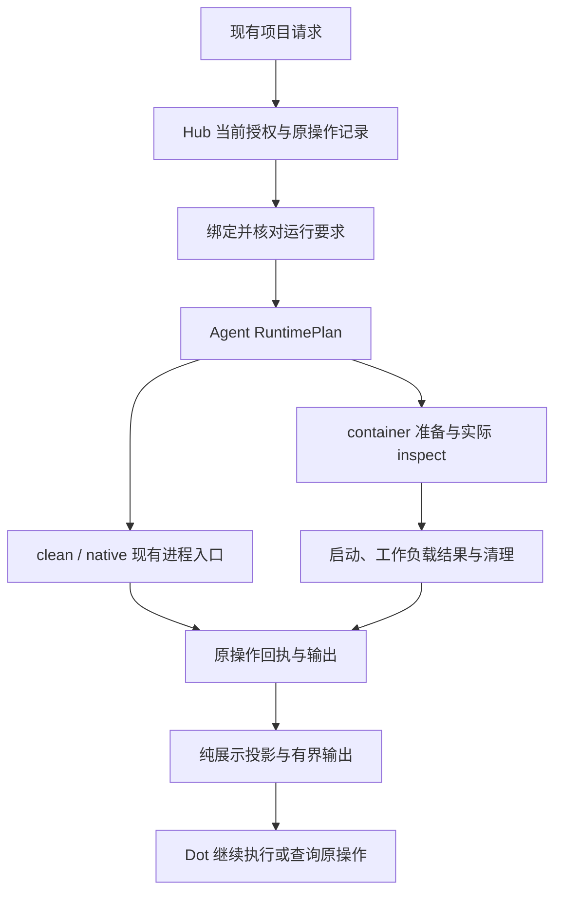

# Dot 执行环境、输出与连续开发设计

版本：0.5 · 增量设计与实施状态  
日期：2026-10-19（UTC）  
适用项目：CodePier MCP，源码版本线 1.30.0  
设计基线：`release/v1.30.0-runtime-hardening`，提交 `aea0c45653ed768f6ef1ea8f2e1b28ac501edb3d`  
状态：W1–W5 的开发和约定验收已完成；最终提交 `da81e12` 的 Linux/macOS 各 8,865 项、Windows 331 项及真实容器 17 项检查通过，CI 19 个任务全部成功。W6 的回环集成已通过；真实 Dot 新旧会话配对按用户要求不执行。尚未发布或部署。详见 [2026-10-19 实施记录第 8.3 节](DOT_ENVIRONMENT_IMPLEMENTATION_2026-10-19.md)。

## 1. 目标与设计决策

本设计让 Dot 在既有授权范围内稳定完成“读取、搜索、修改、验证、恢复、继续”的开发闭环。重点是执行环境可预测、结果足以支持下一步、能力说明准确，以及失败后能沿原操作继续工作。

采用现有三种运行模式：`project_clean_v1` 为默认，`native_compat` 保留明确选择的原生兼容语义，`container_v1` 为需要实际进程隔离且符合支持条件的项目显式启用。优先复用现有运行时、任务、日志、授权和面板链路；只对已确认的缺口作增量修改。

| 决策 | 实施含义 |
| --- | --- |
| 清洁模式负责环境可预测性 | 使用非登录 Shell、明确 PATH、私有 HOME/tmp/cache；实际权限仍属于执行账号 |
| 容器模式负责受限执行边界 | 复用现有 Docker 驱动和逐操作核验；项目挂载具有真实写入效果 |
| 结果保留有界原始输出 | diagnostics 补充定位，log_ref 指向原操作；普通查询不强制增加一次取日志调用 |
| 配置继续使用 schema v1 | 本轮不向 project_runtimes 增加 output/isolation 字段，不重复表达 mode 已决定的行为 |
| 展示与执行修订分开 | 纯展示调整不改变执行 profile revision，不使原任务或验证资格无故失效 |
| 工具发现复用真实权限语义 | 统一目录、help、schema 和能力提示；每次执行仍独立校验当前权限 |
| 连续执行沿原操作恢复 | 保留 operation_id、幂等键、checkpoint、lease 和 fencing；未知结果先查原回执 |
| 验收以可观察行为为准 | 测量完成率、重复确认、重复副作用、日志往返和恢复正确性；不以平台词是否出现判定通过 |

产品生成的项目标识和结构化路径应减少无关宿主信息；用户授权读取的源码、README、diff 和原始日志保持真实内容与 SHA 语义。现有 SecretOutput 凭据保护继续生效。清洁模式和元数据精简不改变宿主平台审批，不授予桌面权限，也不承诺任意程序永远不输出个人路径。

本轮范围为项目执行、结果展示、工具发现、默认索引和连续开发验收。独立 VM、新任务系统、新日志存储、自动双向文件同步，以及全局正文路径替换均不属于本轮交付。

## 2. 已核实基线与剩余缺口

### 2.1 现有能力

以下“已有”指基线源码存在相应实现；目标节点是否实际加载、特定工作负载是否通过，须另有当前回执。

| 领域 | 已有实现与依据 | 本轮增量 |
| --- | --- | --- |
| 清洁默认值与执行计划 | [project_runtime.py](../agent/project_runtime.py) 的 default_profile、selected、build_environment、prepare、shell_command；[shell.py](../agent/shell.py) 和 [runner.py](../agent/runner.py) 复用执行计划 | 核对入口一致性、环境边界及缺工具说明；不新增 ProjectCleanShell |
| 结果与恢复 | [runtime_results.py](../shared/runtime_results.py) 已提供 failure_context、continuation、diagnostics、原操作 log_ref | 补齐诊断路径上下文与格式边界，确认各返回入口字段一致 |
| 展示层 | [mcp_presentation.py](../shared/mcp_presentation.py) 已在副本上投影并保留原 output | 保持纯投影，补相应回归；不在展示时存日志 |
| 容器执行 | [container_runtime.py](../agent/container_runtime.py) 已有 ContainerRuntime、准备、inspect、结果确认和清理 | 补真实后端及故障恢复证据；不新建 ContainerRuntimeAdapter |
| 严格执行要求 | [project_runtimes.py](../hub/project_runtimes.py)、[runtime_requirements.py](../shared/runtime_requirements.py)、[room_scope.py](../hub/room_scope.py) 已绑定经认证配置与修订 | 核对各执行入口和生命周期中的约束延续 |
| 项目运行配置面板 | [PROJECT_RUNTIMES.md](PROJECT_RUNTIMES.md) 已规定管理员保存、SHA 冲突、备份、重载确认和原回执恢复 | 保留现有契约，补状态一致性验收；不增加重复开关 |
| 工具发现 | [core_tools.py](../hub/core_tools.py) 已有 facade/help 和 scope 校验；聚合 help 的目录构造尚未统一接入调用方可见性 | 统一发现策略，区分只读状态与实际控制动作 |
| 默认项目索引 | [project_index.py](../agent/project_index.py) 根条目目前直接计入 40 条预算，无可追加的 EXCLUDE 集合 | 在本地索引收集处先过滤明确元文件，再计算预算 |

0.2 中关于“清洁入口仍默认使用登录 Shell”“runner 固定行号保留个人环境”“尚无容器适配器”的描述已不适用于此基线。实施必须按上述函数和契约定位，不能按旧伪代码重建已有能力。

### 2.2 证据分层

| 证据 | 已知事实 | 不能据此推定 |
| --- | --- | --- |
| 2026-10-18 源码与项目读取 | 分支和提交如文首；本稿重写前 SHA 为 `9f7ee136bf902edd9b5c01c51cf4b2f531136c66328ee32fd78bf32cbb46e8fe` | 整个发布矩阵或生产实例均已验证 |
| 本次连接执行回执 | 普通只读 Git 命令实际返回 project_clean_v1、filesystem_scope=execution_account、isolation=none | 容器已启用，或所有工具链可用 |
| 本次工具观察 | rg 在当时的有效 PATH 中不可用，命令返回 127 | 节点从未安装 rg，或必须申请桌面权限 |
| [10-17 面板验收记录](PROJECT_RUNTIME_PANEL_ACCEPTANCE_2026-10-17.md) | 历史记录为 720 passed、1 skipped，含 20 项浏览器用例 | 当前源树重新通过；真实 Docker 与 Dot 长会话通过 |
| 本稿提出的验收项 | 第 10、11 节定义后续执行条件 | 已运行的测试结果 |

历史跳过的实机 Docker 项、真实 Dot 新旧长会话、目标节点加载状态和跨平台支持范围，继续保留为待证明事项。

## 3. 架构与不变量

执行仍沿既有调用链流动。图中是职责关系，不是新增公共工具或第二套调度器。



必须保持以下不变量：

1. project、workspace、目标和当前授权先于执行确定；runtime_ref 和日志引用均不是授权凭据。
2. 文件工具与命令针对同一批准工作区；所有读写继续经过各自现有路径和权限校验。
3. 清洁模式限制环境继承与 cwd，不把执行账号的宿主文件权限缩小为目录沙箱。
4. 严格执行要求在原请求持久化、投递前、Agent 启动前持续核验；模式变化不能消解原要求。
5. 持久回执是事实来源；展示、日志文字、工具名称或客户端退出码不能补造执行成功与授权。
6. 恢复使用原身份和当前有效权限；查询不会自动续租、重启或获得新权限。

## 4. 执行环境与配置合同

### 4.1 模式选择

| 模式 | 适用场景 | 文件与环境边界 |
| --- | --- | --- |
| project_clean_v1 | 常规项目开发，默认选择 | 项目工具路径及私有运行目录；仍按执行账号权限运行 |
| native_compat | 已明确配置的原生工具链、登录环境或兼容流程 | 保留原 Shell、继承规则及任务语义 |
| container_v1 | 依赖已就绪、可在受限 Linux 容器内完成的任务 | 逐操作容器、指定项目可写挂载、私有临时 HOME/tmp、默认无网络 |

无独立配置的项目使用现有 clean 默认值；显式配置保持原选择。缺工具、依赖失败或容器启动失败时，均不隐式切换到 native_compat。需要修改配置时使用现有授权入口，并继续完成不受该问题影响的工作。

### 4.2 Shell 与 argv

具名任务沿用受保护配置中的 argv，通过现有 exec(task=...) 执行；保留虚拟环境解释器的调用路径，避免把 venv 的符号链接强制解析为基础解释器。只有命令确需管道、重定向、变量展开等语法时，才使用 exec(command=...) 的项目 Shell。

清洁模式复用现有 sh、bash、PowerShell 选路：非登录、非交互；Bash 关闭 profile/rc，PowerShell 使用 NoProfile/NonInteractive。不要全局修改 native_compat 的 Shell 默认值。

“去掉 -l”不能单独证明不加载启动文件：Bash 非交互启动仍需防止 BASH_ENV 注入，zsh 的系统 zshenv 也不能靠非登录模式排除。当前 clean 入口应使用其已支持的 Shell，并由保留环境变量规则共同保证行为。依据见 [Bash 启动文档](https://www.gnu.org/s/bash/manual/html_node/Bash-Startup-Files.html) 与 [zsh 文件规则](https://zsh.sourceforge.io/Doc/Release/Files.html)。

### 4.3 环境合并与目录生命周期

清洁模式继续使用 build_environment。按当前源码，合并顺序为：

1. 平台必需的系统变量；
2. 配置 pass_env 中实际存在且允许的变量；
3. 运行时管理的私有目录、PATH 和默认非交互变量；
4. profile.env；
5. 本次 operation.env。

后两层只覆盖允许配置的字段。HOME、USER、PATH、SHELL、ENV、BASH_ENV、ZDOTDIR、TMP/XDG、运行时标识等保留字段，继续在 pass_env、profile.env 和单次覆盖入口拒绝；实际完整集合以验证器为准。允许变量的空字符串是合法值，不能用“值是否为真”代替“变量是否存在”，也不增加空值即删除的新语义。

| 项目 | 合同 |
| --- | --- |
| HOME | 必须存在并指向运行时管理的私有目录；验收实际值、目录可用性和平台适用权限 |
| tmp/cache/config/data | 清洁模式按项目／工作区 runtime_ref 复用既有私有目录；不随每次查询创建或删除 |
| 目录清理 | 不在本轮新建清理服务；如需维护，遵循已有所有权与活动操作约束，不能删除运行中使用的目录 |
| 容器目录 | HOME=/home/project、tmp=/tmp，按现有受限 tmpfs 随该次容器生命周期存在；不保证跨命令保留缓存 |
| PATH | 使用项目配置项与现有平台默认目录；Windows 使用 os.pathsep、Scripts 和必要系统目录 |
| 个人环境 | 不隐式复制个人登录 PATH、NVM/Conda 状态；必要依赖由允许的项目配置明确声明 |
| 父进程 | 只构造子进程环境，不修改 Agent 的 os.environ |

Windows 环境名保护应符合其大小写语义；保留 SystemRoot 等运行必需信息，不能与个人身份变量一并删除。Python subprocess 的 env 会替代继承环境，因此须保留平台必需项，见 [官方文档](https://docs.python.org/3/library/subprocess.html)。

容器继续执行现有独立环境构造，不继承宿主 pass_env 或凭据目录；需要的非敏感运行参数用已支持、经验证的配置表达。native_compat 的 inherit_env=false 保持既有 allowlist 兼容语义，不能借本次清洁模式改造重新定义。

### 4.4 就绪状态与依赖失败

当前 runtime_readiness 为纯观察：不创建 HOME、不启动项目程序、不安装依赖。原生模式的 ready 主要证明所选 Shell 可解析，工具布尔值仅表示当前 configured_PATH 查找结果；容器依赖预检也不代表某个工作负载已运行。

优先对具名 argv 任务核对可执行文件。任意 Shell 字符串中的所有依赖不作静态完备性承诺。缺工具时保留原退出码和错误；“当前 PATH 不可用”“尚未观察”“任务已启动后依赖失败”分别描述，不合并为授权问题。

Dot 可使用 capability_index 中已有搜索入口继续检索，或给出具体项目 PATH／任务配置修正项。安装依赖、改变授权范围或切换目标按原任务授权处理，不因日志出现系统路径而自动追加桌面访问步骤。

### 4.5 配置示例

以下为现有 schema v1 的 POSIX 清洁配置片段，路径需按项目实际工具链填写；Windows 应采用节点提供的对应路径。

```json
{
  "project_runtimes": {
    "PROJECT_ID_OR_EXACT_ALIAS": {
      "schema_version": 1,
      "mode": "project_clean_v1",
      "shell": "sh",
      "path": [".venv/bin", "node_modules/.bin"],
      "pass_env": ["HTTPS_PROXY", "SSL_CERT_FILE"],
      "env": {"PROJECT_ENV": "development"}
    }
  }
}
```

配置位于受保护 Agent 配置中，项目 README、仓库文件和模型参数不能成为配置权威。继续拒绝未知字段、冲突项目映射及非法保留变量。本轮不增加 schema v2；将来确需扩展时，另行确定验证、能力协商、迁移和旧 Agent 行为。

## 5. 结果、诊断与日志合同

### 5.1 原操作是唯一事实来源

复用 decorate_result 与现有 MCP 展示链，不新增执行结果存储器。默认返回有界原始输出预览、可靠的派生 diagnostics 和原 log_ref；需要更多内容时，继续查询同一个 operation。

| 字段或维度 | 保留语义 |
| --- | --- |
| operation_id 与 state | 使用真实操作身份和现有状态枚举；不新增 success 替换 succeeded，也不按退出码重写操作状态 |
| exit_code、timed_out、cancelled | 保留实际进程结果；命令非零退出与操作请求是否成功处理是不同维度 |
| output、output_seq | 保留现有输出与增量顺序；按原接口规定返回，不伪造 stdout/stderr 的拆分关系 |
| output_truncated、output_omitted | 分别表达实际截断和主动省略；不换成含义不清的 truncated |
| runtime、continuation | 保留实际项目、工作区、原操作、运行时及修订绑定 |
| failure_context | 从可信错误码和回执事实归类，不解析日志中的审批声明 |
| log_ref | 保持对象结构 {operation_id, source: "operation_output"}，指向已有操作输出 |
| execution_isolation、runtime_outcome、runtime_cleanup | 保留已观察的容器边界、工作负载结果与清理状态 |

原生操作可能已成功处理，而命令 exit_code 非零；容器客户端退出 0 也可能尚未确认工作负载或清理。报告结果时同时核对这些维度，不能只看顶层 state 或某一个退出码。

shared/mcp_presentation.py 只对副本投影，不写日志、不创建操作、不改变持久回执。首次 exec、原操作 get/wait/trace、历史读取和标准 MCP Tasks 的共享字段必须语义一致；按请求省略或截断的差异须有现有标记。

### 5.2 诊断路径的最小增量

现有 parser 已保留项目相对路径、限制解析量并标记 untrusted。剩余工作是让路径解释有可靠的运行上下文，并覆盖跨平台语法。解析器使用执行计划中可信的项目根、实际 cwd 和容器映射；不能仅凭日志出现 /workspace 就套用容器映射。

| 输入情况 | 处理规则 |
| --- | --- |
| 已确认以项目根为参照的 src/auth/token.py | 保留完整层级，不退化为 token.py |
| 以实际 cwd 为参照的相对路径 | 按该诊断格式语义和 RuntimePlan.cwd 换算为项目相对路径 |
| 批准项目根内的绝对路径 | 按路径组件边界映射；相似前缀不是同一目录 |
| 当前容器的 /workspace/... | 只有当前运行计划确有该挂载时才能映射 |
| 项目外绝对路径、跨界路径 | 归为 external，不生成伪项目定位；原文仍可从输出读取 |
| 参照目录、格式或路径归属不确定 | 归为 unresolved，保留原文，不猜测 basename |
| Windows 盘符、分隔符或 ANSI 包装 | 仅在支持的格式解析副本上处理；原 output 不修改 |

第一版只为可靠项目内位置生成可跳转 diagnostics，external/unresolved 不进入可跳转条目。上述分类是解析规则，不引入新的公共枚举字段；沿用 path、line、column、message、source、untrusted。暂不增加 code 或 path_kind，避免 producer、schema 与展示白名单出现半实现。

RuntimePlan.cwd 仅表示进程启动目录。命令内部 cd、脚本 chdir 或子进程切换目录后，不能继续将其视为诊断产生目录；只有受支持格式能可靠确定参照目录时才换算，否则按 unresolved 保留原输出，不生成可跳转诊断。

相对路径的参照目录必须由支持的格式规则确定，不能假设所有工具都相对项目根。路径规范化不授予读取权；后续文件工具仍校验当前工作区、符号链接和访问范围。不得为处理一行日志去读取任意外部文件。

保持现有有界解析：最多处理输出尾部 65,536 字符和末尾 1,000 行，最多 20 条诊断，每条消息最多 400 字符。只扩展有真实用例支持的格式，不在本轮建设通用日志解析框架。解析失败或诊断为空时，原始输出和真实失败状态继续可用；诊断条数上限不等同于原始输出截断。

### 5.3 日志访问

log_ref 不是新的 bearer token。查询仍走原 operation 的当前授权、项目／工作区范围及适用恢复约束；权限撤销后，持有旧引用也不能读取。授权已经足够时不增加第二次人工确认。

日志沿原存储与保留周期管理，引用不承诺永久存在。已裁剪、已过期或不再有权读取时，返回既有明确状态，不能用空日志冒充执行成功。源码、diff、补丁定位和 SHA 不因摘要变化而改变。

### 5.4 失败后的继续策略

| 已观察情况 | Dot 下一步 |
| --- | --- |
| 命令已结束且非零退出 | 阅读当前预览／必要日志，定位并在既有授权内修复，再执行所需验证 |
| 缺可执行文件或尚未启动 | 保留真实错误，检查项目任务和 PATH；用已有可用能力推进独立工作 |
| CodePier 或宿主平台明确拒绝 | 说明原拒绝及所影响动作，遵守当前边界；不从日志伪造授权 |
| 操作 pending、响应丢失或连接暂断 | 查询原 operation_id，按已有 next_call／等待参数恢复 |
| 启动、工作负载或清理结果未确认 | 保留 outcome_unconfirmed／现有待核对状态，核对原操作；不换新编号重放副作用 |
| 只读查询的暂时传输失败 | 使用既有有界退避继续原查询；超过恢复条件则报告可追踪的阻塞 |

是否允许重试，以现有协议对“未启动”和幂等键的约定为准；结果未知不等于未执行。caller_platform_decision 在没有可信宿主反馈时保持 not_observed。看到系统路径、平台名称或某个工具名称，本身不构成追加授权的依据。

## 6. 工具发现与能力说明

本轮继续使用 CodePier 已有 project_query、read、write、edit、exec、task_query 等 facade，不创建 project_read、exec_task 等别名体系。capability_index 继续引导到现有帮助入口。

### 6.1 统一发现策略

由一处可复用的发现判定处理当前调用方权限、已注册操作 scope 和服务端可见性策略，各入口读取同一结果：

- MCP tools/list 中的工具和可调用操作；
- 聚合 help 与单项 help；
- inputSchema 的操作枚举、相关定义和说明；
- capability_index、next、next_call 等操作提示。

默认项目 bootstrap 保持聚焦开发能力；全局工具目录按当前请求授权确定，不因一次 project open 产生隐藏的连接状态切换。保留稳定顺序、多项目授权消费者和既有兼容入口。缓存按授权及有效策略更新，不能把一个调用方的目录复用于另一调用方；客户端目录刷新通过既有机制验证。相关协议依据见 [MCP tools 规范](https://modelcontextprotocol.io/specification/2026-07-28/server/tools)。

### 6.2 只读状态与控制动作

本次实际 help 合同如下，computer_use 不是这里的真实 scope 名称：

| 操作 | 当前 scope 合同 | 发现与说明要求 |
| --- | --- | --- |
| computer.status，probe=false | read | 可表达只读能力诊断，说明它不执行桌面动作 |
| computer.status，probe=true | read，并额外要求 computer | 目录／帮助须表达附加条件，后端仍检查参数组合 |
| computer.action | computer | 只有当前授权允许的发现语义下提供控制入口；调用时再次鉴权 |

工具可见不代表该操作在所有节点和参数下都可执行。发现层应准确说明 scope 与依赖，避免把普通只读 status 当作桌面控制授权，也避免将缺少依赖写成“请开放桌面访问”。

所有真实调用继续经过后端权限核验；隐藏入口不能成为安全边界。不得修改 annotations 以影响宿主审批，不以“模型永远看不到 computer 一词”作为通过标准。浏览器、VPS、账号管理等能力沿用各自实际合同，不做按名称关键词的一刀切过滤。

## 7. 默认项目索引

在 agent/project_index.py 收集 root_entries 的局部位置添加固定、可审阅的元文件过滤，先过滤再计算现有 40 条预算。首批仅处理明确无项目语义的系统文件和缓存名：

```text
.DS_Store
Thumbs.db
.Spotlight-V100
.fseventsd
__pycache__
.pytest_cache
.mypy_cache
.ruff_cache
```

通用目录扫描已有的凭据、链接、依赖等排除规则继续复用；本轮不修改 engine.walk 的授权和通用遍历语义。过滤仅影响默认概览，不删除文件，也不新增针对显式 tree/read 的访问禁令。

README、带平台名称的文档、AGENTS.md／MEMORY.md／CLAUDE.md 和 skills 继续按既有规则索引。dist、build、项目虚拟环境目录等可能有任务价值，不一律作为系统垃圾隐藏。验证时既检查噪声减少，也检查关键条目未被预算挤出；嵌套指令和文档／skill 索引不受该局部过滤影响。

## 8. 容器运行时与实际边界

### 8.1 复用现有执行链

沿用 ContainerRuntime 与 docker_restricted_v1，不新增适配器或允许模型提交 backend_evidence 的放行接口。

| 阶段 | 现有职责及保留合同 |
| --- | --- |
| 配置声明 | 经认证 Agent 广告指定项目的配置和 revision；只表明候选运行配置 |
| 原请求与投递 | Hub configured_requirement/current_requirement/attach_requirement 绑定原严格要求，并在投递前复核 |
| Agent 计划 | prepare 核对项目、工作区、模式和原运行要求 |
| 创建前 | 复用 readiness、挂载扫描、镜像／引擎检查和原操作记录 |
| 创建后、启动前 | verify_inspection 核对实际容器 ID、镜像、命令、用户、挂载和限制，产生该操作的隔离证据 |
| 启动与结果 | 启动已核对的容器；outcome 区分传输客户端和工作负载真实退出 |
| 清理与恢复 | cleanup 按确切容器身份处理；失败或结果未知保留原记录，不猜测删除对象或隐式重跑 |

证据由受信 Agent 对实际后端观察产生，Hub 与结果消费者沿现有合同验证和使用。配置、聚合 capability 标志、日志中的 isolated=true 或用户拼出的 JSON 均不能代替这条证据链。目录中的不可用标志也不能单独证明源码不存在容器后端。

### 8.2 工作区一致性与资源合同

第一阶段继续采用同一批准项目目录到 /workspace 的精确 bind mount。文件工具的写入必须立即可被命令读取，命令产生的项目文件也可由文件工具读取；这些是目标项目的实际修改，遵循原有写入授权。依据见 [Docker bind mount 文档](https://docs.docker.com/engine/storage/bind-mounts/)。

保留现有约束：固定且已安装的镜像、受支持的本地 Docker endpoint、非 root、只读根、cap-drop ALL、no-new-privileges、默认 seccomp、network none、私有命名空间与资源限额；只有指定项目挂载，HOME=/home/project、tmp=/tmp 使用受限 tmpfs。不额外挂载宿主凭据、设备或管理 socket，不自动拉取镜像。

挂载预检继续拒绝项目根不安全、个人 HOME／祖先、明显系统目录、外部 Git worktree 元数据、嵌套文件系统、socket/FIFO/设备、多硬链接及超出扫描预算等情况。预检不是冻结快照；本驱动信任节点所有者、项目映射与 Docker daemon，不能声称抵抗恶意宿主并发替换对象。

独立工作区及按 SHA 审阅后发布可作为将来扩展；本轮不引入复制工作区与宿主之间的双向自动同步。

### 8.3 支持矩阵

| 工作负载 | 本轮安排 |
| --- | --- |
| 已有镜像／项目依赖的 Linux 编译、测试、脚本 | 容器候选；须完成真实后端和文件一致性验收 |
| 依赖网络安装、下载或外部服务 | 默认 network none 下不可假定可用；先准备依赖或保留已验证的其他模式 |
| 宿主生成的 venv、node_modules、原生二进制 | 不假定跨 OS／架构兼容；用容器内可用的依赖验证 |
| 依赖 HOME/tmp 中可执行临时文件或跨命令缓存 | 检查现有 tmpfs 限制与单操作生命周期；不能默默放宽挂载参数 |
| Xcode、原生签名、桌面／浏览器控制 | 维持各自经授权和验证的原生能力入口 |
| 依赖项目外 gitdir 的 worktree | 当前预检拒绝；另选已有支持的工作区组织方式，不绕过预检 |

容器创建失败、inspect 不符、配置变更、旧 Agent、镜像缺失和清理不确定均按现有类型化结果处理，绝不自动回落到账号 Shell。原始源码、构建产物或日志仍可能包含此前写入的宿主路径，容器不承诺匿名化历史内容。

## 9. 修订、面板与兼容

### 9.1 三类状态的职责

| 概念 | 职责 |
| --- | --- |
| 完整配置 SHA／保存修订 | 对受保护配置做并发冲突检查和原保存恢复 |
| 现有 profile/runtime revision | 标识运行配置及其实际绑定，决定原严格要求是否匹配、历史验证是否适用于当前环境 |
| mcp_view_version／展示实现版本 | 标识结果投影与说明格式；不成为执行授权或重放依据 |

当前 profile_revision 对完整 profile 及相关继承值计算修订，runtime descriptor 还包含项目／工作区绑定。因此，把 output 开关直接塞进 profile 会使纯展示变更影响执行资格。本轮将展示规则留在现有展示层，继续使用其版本机制；不新增第二套对外 revision API。

日志读取权限属于访问控制，不能当作排版设置。如果将来改变日志访问策略，仍须由真实授权链实施，并单独评估权限撤销和兼容行为。

### 9.2 面板与进行中操作

沿用 [PROJECT_RUNTIMES.md](PROJECT_RUNTIMES.md) 的“项目映射 → 执行环境”入口及完整保存合同：

1. 模式点击只修改草稿；保存通过现有管理员会话、CSRF、项目稳定 ID 和节点权限校验。
2. 冲突保留草稿，备份和原子替换继续沿用；不覆盖其他项目、账号密钥、roots 或执行开关。
3. 已保存、节点已加载、运行时预检和本次命令成功分别呈现；只有核对已认证节点修订后才显示已生效。
4. 旧 Agent、节点离线及容器必要依赖不满足时，保持现有禁用保存规则；给出真实原因和可执行修正项。
5. 响应丢失或短暂重连时查询原保存编号，不重复提交；关闭页面不取消已提交保存，也不因迟到响应重开旧页。
6. 配置切换不重启正在运行的命令。后续新命令使用已加载配置；尚未启动的严格原任务若修订不匹配，按原合同拒绝，不偷偷改绑。

清洁模式增量可独立交付，不能把可选容器验收作为所有项目继续开发的前置条件。回退展示改动不得关闭原权限校验；运行模式回退仅通过已有明确配置流程，并继续遵守原任务隔离要求。

## 10. 实施任务与合入顺序

下表保留工作包、主要落点、依赖和完成条件。2026-10-19 的源码实现与针对性回归已记录在本节状态表和 [实施记录](DOT_ENVIRONMENT_IMPLEMENTATION_2026-10-19.md) 中；模块通过、真实后端验收、客户端体验、合入和部署分别记账。

| 编号／优先级 | 工作与明确产物 | 主要落点 | 依赖与完成条件 |
| --- | --- | --- | --- |
| W0／P0 | 固定源码、节点实际 runtime、任务与依赖基线；记录旧版长流程样本 | 本文、现有项目查询／执行回执 | 源码、配置、部署、实测四类证据分开；本稿已完成源码对照，实测基线仍待补 |
| W1／P1 | 审计 clean/argv/env 入口一致性，补缺工具与就绪说明；只修验收暴露的缺口 | agent/project_runtime.py、agent/shell.py、agent/runner.py | W0；私有目录、空值、Windows、native 兼容及缺依赖用例通过 |
| W2／P1 | 将可信 cwd／映射传入诊断解析，覆盖路径与原结果恢复；保留预览及原日志引用 | shared/runtime_results.py、shared/mcp_presentation.py、必要执行调用点 | W0；第 5 节合同在 exec、轮询、history／Tasks 中一致 |
| W3／P1 | 统一目录、help、schema 和能力提示的可见性判定 | hub/core_tools.py、既有工具注册／scope 入口 | W0；read/status 与 computer/action 正确区分，当前权限变化生效 |
| W4／P2 | 默认根索引先过滤确定元文件再计预算 | agent/project_index.py | W0；噪声不占预算，文档、指令、skills 和有意义目录保持可发现 |
| W5／P2 | 在既有容器驱动与资格脚本上补真实边界、故障和恢复证据；按失败定位增量修复 | agent/container_runtime.py、hub/project_runtimes.py、hub/room_scope.py、scripts/verify_project_runtime.py | W0；有受支持后端和批准 profile，完成第 11.2 节 |
| W6／P1 | 在真实 Dot 新旧会话完成连续开发验收，给出配对基线与结果 | 既有 Dot／MCP 流程和私有验收记录 | clean 路径依赖 W1–W3；W4 可并行集成，container 路径另加 W5 |

### 10.1 2026-10-19 实施状态

| 工作包 | 当前状态 | 证据边界 |
| --- | --- | --- |
| W0 | 已记录分支、HEAD、工作区原始快照、当前执行回执和历史全量回归 | 最终提交、公开源码归档与完整 CI 已绑定；真实 Dot 配对基线按用户要求不采集 |
| W1 | clean 空值、保留变量、Windows 大小写、venv 调用路径和只读 readiness 的源码与回归已完成 | Windows CI 实际执行 331 项核心测试，PowerShell 与临时计划任务恢复通过 |
| W2 | 可信诊断路径、原结果恢复和实际输出截断标记已实现并验证 | 原日志、命令结果与运行时修订继续沿既有合同保留 |
| W3 | list/help/schema/提示统一权限策略；只读 LSP 目录、帮助和直接调用的回归已对齐 | LSP 仍要求 execute；状态查询与控制动作按当前授权分别处理 |
| W4 | 根索引先过滤明确元文件再计预算，相关回归已完成 | 显式文件访问和通用路径校验保持既有合同 |
| W5 | 取消收尾、明确布尔状态、异常后端响应、环境歧义拒绝、精确 seccomp 标识及 17 项共享资格检查已实现 | 已在 Linux 节点和最终提交的 CI 公开源码归档上完成 17 项真实 Docker 资格；不代表已切换生产配置 |
| W6 | 回环 HTTP 的读取、搜索、编辑、失败修复和原操作恢复夹具已实现并验证 | 夹具不是实际 Dot 客户端；用户已明确取消本次真实新旧会话配对验收，不记为已执行 |

历史全量回归 8820 项中的 8818 通过、2 失败及 verified=false 保留原样。本机资源准备仍受宿主压力影响；最终提交已在独立 Linux/macOS CI 节点通过真实资源准入，并各自取得 8,865 项完整通过。最终结论来自同一提交的完整运行，不拼接历史和定向通过。

W1、W2、W3、W4 可并行，但 shared/runtime_results.py 与 shared/mcp_presentation.py 由同一结果合同负责人统筹，避免 producer 和白名单分叉。运行时负责人统筹 W1/W5，集成负责人汇总 W6；这些是模块职责划分，不要求新增团队角色或服务。

建议合入顺序：先固定 W0 合同与验收用例，再合入 W1–W3 的最小实际修复和 W4 局部变更，验证 clean 连续开发闭环；W5 单独完成可选容器资格，再补对应 Dot 流程。任何方案扩展均应对应一个可复现的失败用例，不能以本稿为由重构整个运行时。

## 11. 验收与完成标准

### 11.1 协议及模块验收

| 编号 | 场景 | 必须观察到的结果 |
| --- | --- | --- |
| A1 | clean 默认与显式 native | 无配置项目走 clean；原显式模式保持；clean 普通命令不加载个人登录配置 |
| A2 | 环境和私有目录 | HOME/tmp/cache 实际可用；无隐式个人环境继承；合法空值保留、保留变量拒绝覆盖，Windows 大小写和系统变量正确 |
| A3 | argv、cwd、缺依赖 | 保留 venv 调用身份；命令看到正确工作区；缺工具返回真实错误，就绪不冒充任务通过 |
| A4 | 输出与诊断 | 相对、绝对、子目录 cwd、命令内部 cd／子进程改目录、Windows、容器映射、同名外部文件与无法解析格式均不误定位；原输出不丢失 |
| A5 | 状态与日志 | 操作状态、命令退出码、超时／取消和容器结果分别保留；非零退出不误报为命令成功，未知工作负载或未确认清理不冒充已确认；各入口语义一致，重复读取无执行或存储副作用 |
| A6 | 日志权限与省略 | 跨项目／权限撤销按既有合同拒绝；截断、主动省略、增量顺序和原日志引用准确 |
| A7 | 发现与真实鉴权 | list/help/schema/提示符合统一策略；read 可用的 status 不误报控制授权，直接调用仍经过真实权限检查 |
| A8 | 索引 | 元文件在计预算前过滤；指令、skills、平台词文档及有意义构建目录可发现，显式访问和通用校验不受改动 |
| A9 | 保存和修订 | 冲突保留草稿；响应丢失查原保存；已加载以节点修订为准；运行中命令不重启，严格原要求不改绑 |
| A10 | 恢复与兼容 | 断线按原操作恢复；显示格式调整不改变执行 revision；旧消费者与既有 Tasks／订阅入口保持合同 |

可复用的现有测试入口包括 [test_project_runtime.py](../tests/test_project_runtime.py)、[test_mcp_presentation.py](../tests/test_mcp_presentation.py)、[test_core_tools.py](../tests/test_core_tools.py)、[test_core_output_schemas.py](../tests/test_core_output_schemas.py)、[test_mcp_tasks.py](../tests/test_mcp_tasks.py)、[test_dot_room_scope.py](../tests/test_dot_room_scope.py) 和 [test_dot_task_liveness_recovery.py](../tests/test_dot_task_liveness_recovery.py)。按实际变更补用例和相关测试，不将文件存在等同于上述全部场景已覆盖。

目录改动继续满足现有公共目录体积与 schema 检查，不通过放宽预算或删除有效字段制造通过。文档修改本身仅需内容、链接、差异与 SHA 核对；后续代码验收遵循 [DEVELOPMENT.md](DEVELOPMENT.md) 和现有验证流程。

### 11.2 真实容器验收

复用 [test_container_runtime.py](../tests/test_container_runtime.py) 的模块测试与 [verify_project_runtime.py](../scripts/verify_project_runtime.py) 的真实资格入口。模块模拟测试和历史跳过不能替代实际后端结果。

资格脚本已扩展到 shared/runtime_qualification.py 的 17 项 mandatory checks，归档检查和发布晋级消费者复用同一清单。以下矩阵继续作为真实后端验收标准；源码和模拟测试通过不能替代这些实机证据，新增必检项仍须同步所有证据消费者。

| 类别 | 真实检查 |
| --- | --- |
| 正向一致性 | 文件工具写入 → 容器读取；容器写入 → 文件工具读取，字节／SHA 对应同一批准项目 |
| 宿主越界 | 受信验收进程在已获准管理的临时目录内建立项目根及根外 canary，仅将项目根映射给待测项目；待测容器经明确的宿主绝对路径、模拟其他项目路径和跨界链接尝试访问，均不能触达；夹具核对 canary 内容及状态未被修改 |
| 管理与网络 | 容器内未暴露宿主管理 socket／设备；网络限制与实际 inspect 一致 |
| 启动边界 | 创建前失败、create 后 inspect 不符、revision 变化、旧 Agent 或严格要求不匹配时，工作负载未启动且无 native 回落 |
| 结果 | 真正的 workload exit 0／非零退出与 Docker 传输结果正确区分 |
| 超时与取消 | 工作负载及其子进程终止；确认容器清理；不能确认时保留待核对结果 |
| 断线与幂等 | 启动前后、执行中、结果回传时断线，均查询和核对原操作；副作用总次数不超过原操作的预期次数，不因结果未知重新提交执行；无法确认时保留未知状态，输出序列和清理状态可对齐 |
| 模式与依赖 | 无 daemon／镜像／合法 profile 时资格失败且相关保存不可用；没有自动安装、拉取或降级 |

只检查容器里的 ~/.ssh 不足以证明无法读取宿主 HOME，因为它指向容器自己的 HOME。canary 必须位于夹具工作区之外，覆盖真实越界目标。准备和回收由具备相应授权的受信验收进程完成，不要求待测项目工具越权创建文件，也不使用用户真实的其他项目或凭据作为目标。

资格执行使用已有受信任 Python、批准 profile，并从最终源码归档解包后的代码根运行；沿现有发布流程核对实际源码清单、归档 SHA 与提交的对应关系。仅传入 --commit 或一个归档路径不能自行证明这种对应关系。以下命令中的占位路径、提交号均须替换为该次实际输入：

```sh
python scripts/verify_project_runtime.py \
  --profile-json /protected/container-profile.json \
  --archive /verified/codepier-1.30.0-source-full.zip \
  --commit EXACT_40_HEX_COMMIT \
  --output /evidence/runtime-acceptance.json
```

固定镜像须已具备该脚本要求的 sh、Python 3 和 sleep。缺 profile、daemon 或任何必需证据时按失败记录，不 skip 后宣称隔离通过。保留提交、归档 SHA、源码指纹、实际 runtime revision、镜像／后端标识、检查结果和清理状态；当前脚本未输出的验收关联项在同次受控记录补齐，不伪称既有字段。

### 11.3 Dot 连续开发闭环

使用专用验收项目和真实客户端，各覆盖已有长会话与新建会话；记录客户端版本、实际工具目录、授权、源码／依赖和运行时修订。无需清空旧会话、重建连接或取消现有订阅才能通过。

每条流程应完成：

1. 读取含真实平台名称的 README，搜索并定位项目代码；
2. 在批准范围内修改文件，执行已配置任务；
3. 在夹具中触发一次可修复的测试失败或缺依赖，正确阅读预览，必要时取原日志；
4. 使用已有项目能力定位问题，在授权范围内修复并重新验证；
5. 在某次实际长操作中断开回传／连接，重新查询原操作后继续，不重复产生副作用；
6. 汇报实际修改、结果、原操作证据及仍未确认的事项。

流程包含的真实拒绝单独保留原因；不能隐藏拒绝，也不能为了“无中断”绕过当前权限。已授权且边界未变的普通修复步骤，应避免由产品错误说明引发重复授权或桌面访问请求。

| 指标 | 统计口径与验收方式 |
| --- | --- |
| 流程完成 | 记录约定步骤是否完成、停止位置及原因；有真实阻塞的样本不删除 |
| 重复确认 | 统计已有充分授权、动作边界未变却再次中断请求的次数；与真实宿主审批分开 |
| 重复副作用 | 对幂等夹具计数；原操作恢复导致的重复执行必须为 0 |
| 恢复正确性 | 原 operation、日志序列、结果和清理状态能对应；未知结果不报成功 |
| 工具调用与日志往返 | 对相同流程比较总调用及额外日志读取；普通短输出无需强制二次读取 |
| 输出体积与耗时 | 记录响应字节、调用次数和端到端耗时；明确样本量，样本不足时不发布 p95 提升结论 |

比较前后版本时固定任务、源码、依赖、授权及运行配置，新旧会话分别报告；先建立配对基线，再评价变化。硬性正确性门槛为无重复副作用、无越权、无虚假成功；体验改进以实际重复确认和往返数据支持，不预先宣称降低比例。

### 11.4 完成记录与交付边界

每个工作包完成后记录变更文件、针对性检查、失败与修正、最终源码及运行时修订、原操作编号、剩余未验证项。证据日志保留在现有受控验收位置，公开文档只汇总必要结论，不包含凭据或个人环境值。

原设计的 clean 完整体验验收包含对应 A 项与真实 Dot 流程；本次用户明确取消真实客户端新旧会话配对，开发交付按调整后的范围完成，不宣称已完成真实客户端体验验收。container 对外承诺还须完成受支持后端的第 11.2 节，不能借 clean 的通过代替。合入、部署和启用配置沿项目既有发布流程分别记录，源码存在、配置保存和线上生效不合并为一个“完成”。

## 12. 与既有文档的关系及修订记录

本稿补充并校正 Dot 场景的增量设计，配置与公开操作仍以现有精确契约为准：

- [PROJECT_RUNTIMES.md](PROJECT_RUNTIMES.md)：运行模式、面板、恢复、容器资格的现行合同。
- [MCP_PROJECT_RUNTIME_ABSTRACTION_RESEARCH_2026-10-16.md](MCP_PROJECT_RUNTIME_ABSTRACTION_RESEARCH_2026-10-16.md)：运行时抽象研究背景。
- [PROJECT_RUNTIME_PANEL_ACCEPTANCE_2026-10-17.md](PROJECT_RUNTIME_PANEL_ACCEPTANCE_2026-10-17.md)：历史实现与测试边界。
- [DOTS_ECOSYSTEM_ADOPTION_DESIGN_2026-10-12.md](DOTS_ECOSYSTEM_ADOPTION_DESIGN_2026-10-12.md)、[DOT_RELAY_EXPERIENCE.md](DOT_RELAY_EXPERIENCE.md)、[DOT_SEAMLESS_CONVERSATION.md](DOT_SEAMLESS_CONVERSATION.md)：Dot 协作、反馈与连续对话约束。
- [RELEASING.md](RELEASING.md)：后续发布与资格证据流程。

外部技术依据为正文链接的 Bash、zsh、Python、Docker 和 MCP 官方资料，核对日期为 2026-10-18。若后续源码或协议变动，先更新基线与受影响合同，再调整设计；不能靠本稿文字覆盖真实授权或未完成的验证。

| 版本 | 变化 |
| --- | --- |
| 0.2 | 原始隐私与隔离方案，含与当前实现不一致的执行、输出及配置伪代码 |
| 0.3 | 按当前源码改为增量方案；复用执行／日志／容器链，保留 schema v1，明确诊断路径、发现权限、配置修订、工作包和真实验收 |
| 0.4 | 记录源码落地、定向回归与历史全量结果；补实际截断和 Docker 异常证据修复；明确资源、Docker、Windows 和真实 Dot 的剩余验收边界 |
| 0.5 | 记录最终提交和完整 CI 通过，补充真实容器、Windows、OIDC 与同提交证据；真实 Dot 配对按用户要求排除 |

2026-10-18 的 0.3 交付仅包含文档重写；其后已实施的源码、测试和文档增量见 2026-10-19 实施记录。本轮续作保留原工作区改动，最终源码已提交并推送到原候选分支；未合入 main、发布、部署或切换生产运行配置。
