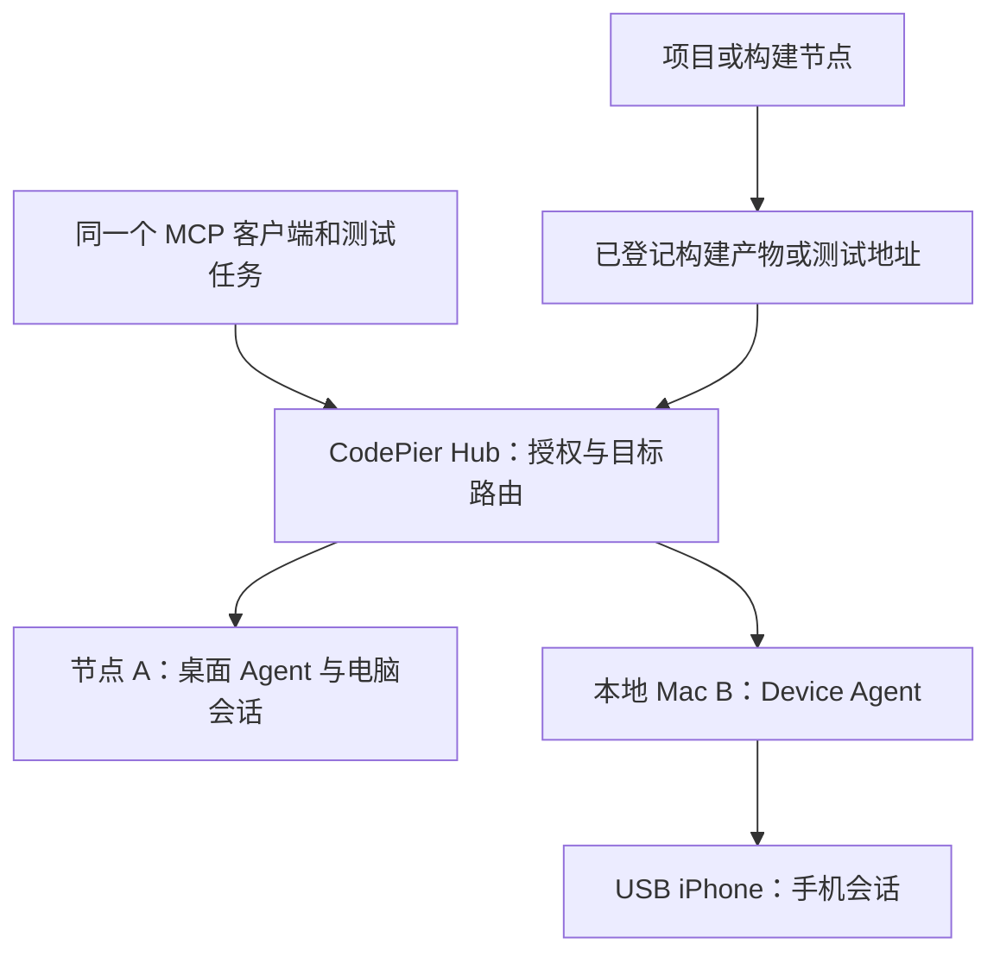

# CodePier Device Lab：指定电脑节点、本地 iPhone 与完整能力对标设计

> 版本：v0.6，2026-10-24；替代 v0.5 的产品范围与实施顺序，保留其授权、派发和恢复协议。
> 状态：待实施设计。现有 project-bound computer 桥接可作为基础；独立 Device Lab、本次扩展与真机验收未完成。本次仅调研和修改设计文档。
> 首个交付：同一真实 MCP 客户端选择节点 A 的已有桌面，以及本地 Mac 节点 B 通过 USB 连接的指定 iPhone，在同一任务中分别观察、操作和验证。
> 对标对象：`leeguooooo/iphone-use`。调研资料为 2026-10-24 读取的官方 main 文档；候选固定发布基准为 v0.23.0 / `ab32b3fe516974cc96d009ad1714b2ffb05a141b`。固定构建的全量接口与实机能力仍待 P0 核验，详见 §3。

## 0 结论、完成定义与本次调整

### 0.1 两个目标分别交付

**目标一：双端测试可用。** 用户可以独立指定电脑载体和手机载体；代码项目可以在另一节点，两条设备会话不随项目切换、最近调用或另一台设备故障而改变目标。现有物理桌面 `desktop_lease` 与物理 iPhone `ios_device_lease` 同属 P1，不再把已有桌面推迟到虚拟机阶段。

**目标二：iphone-use 功能对齐。** v0.5 的四类 iPhone P1 动作只覆盖基础子集。上游公开能力还覆盖复合手势、长列表、流程与测试、开发诊断、媒体、人工遥控及外部集成。WDA/Appium 可以作为底座，不能仅凭采用相同底层技术宣称全部等效。逐项范围、阶段与验收见 §3、§12–13。[S3][S4][S6][S10]

这两个目标有不同出口：P1 可完成用户最先需要的双端流程；完成 P1 不等于 iphone-use 全能力完成。产品界面必须明确当前可用能力与缺口，不能显示笼统的“全功能已支持”。

### 0.2 “完整”的可核对定义

| 完成层次 | 可以声明的内容 | 不足以作为完成证据 |
|---|---|---|
| 双端基础可用 | 指定电脑节点 + 本地单 iPhone + 同一 MCP 客户端联合验收通过 | 单独演示手机，或仅跑 fake provider |
| 控制能力对齐 | §3 控制账本的全部基线子项，在指定设备/OS/构建上行为等效 | 只对齐 tap/type/scroll，或工具名称相同 |
| 测试工具能力对齐 | 安装、诊断、Flow、套件、定时任务等对应子项全部通过 | 只有日志读取，或 Flow 只能手动替代 |
| 产品能力对齐 | 连接、观看、人工控制、客户端和高级集成等基线子项全部通过 | 只暴露 MCP、将外部模型称为手机端推理 |
| 完整 iphone-use 基线对齐 | 固定基线清单的所有必需子项均通过，环境范围、差异与性能单列 | 任一子项仍 planned/partial/blocked/unverified，却以缩小清单宣称全量 |

功能等效允许 CodePier 使用不同工具名、受控引用和管理界面；必须保持获授权任务的行为和结果，不能用“安全包装”掩盖缺失功能。上游明确 unsupported 的组合保留为限制，不把不存在的能力补进对标目标。新版本出现能力变化时另建基线差异，不自动扩大部署权限。

“控制对齐”“测试对齐”可单独发布；未经用户明确调整目标，不从全能力账本删除难项。手动输入可以让基础任务继续，但不能计为 vault 自动登录已对齐。只读重试也不能计为未知动作可安全重放。

### 0.3 相对 v0.5 的变更

- 将“已有桌面 + 本地 iPhone”的接入、两个会话和联合验收前移到 P1。
- 增加节点选择、设备登记、真实物理身份、旧/new computer 入口互斥与同宿主资源隔离。
- 将“默认 WDA 即可扩展”改成按许可、功能和执行控制证据选择一条 iPhone provider 路线。
- 增加上游三层能力账本、固定构建核验、文档差异和明确未验证项。
- 将 Flow/Jev/人工 viewer/定时任务全部纳入统一执行闸门，新增功能不旁路旧安全协议。
- 将 Dot 专属集成、额外手机、VM/池调度设为独立门槛，不阻塞首条双端流程。

“必须”表示实现与发布要求；“建议参数”仍待测量。本文件不把研究结论、上游宣传或本次文档修改当成 CodePier 实现、许可决定或真机验收。

## 1 用户流程、资源与首期范围

### 1.1 用户实际操作

1. 在“设备”页选择一个已接入的节点，查看桌面 backend、GUI 登录会话和权限状态，登记 unverified 电脑 target 并显式完成准备；只有具备已验证桌面能力的目标才可进入控制选择器。
2. 本地 Mac 以 Device Agent 节点接入同一 Hub；发现连接的测试 iPhone，先登记为 unverified target，再对该目标显式授权 prepare，完成配对、签名、runner 和 USB 检查。身份与控制路径验证通过后才标为 available、允许打开控制会话。
3. 分别授权两个 target 的应用、任务用途和能力。授权可以覆盖一段低风险测试任务，不必为每次普通点击重复配置节点。
4. 客户端从设备目录选中电脑与 iPhone，分别打开 session；后续调用显式绑定 session，没有连接级“最后使用设备”路由。
5. 同一任务可观察电脑、操作手机、回到电脑验证；每条结果包含可识别的设备标签和 opaque target/session，不混用截图或元素引用。
6. 分别结束或撤销会话；目标失联时报告原设备状态，不自动迁移到别的节点或手机。

管理端选择节点；MCP 选择已登记的 target。这不要求 MCP 接受任意 IP、端口或 host 路径。节点标签仅供展示，不能作为身份或路由凭据。

### 1.2 部署与数据关系



A 与 B 可不同，也可在能力验证后为同一宿主。电脑 GUI 控制域与 USB 手机是不同资源；不能用“整台 Mac 一把锁”阻止正常双端使用。同宿主方案仍需证明手机 runner 不意外改变桌面焦点、剪贴板或输入。

项目、构建产物、测试 URL 与设备绑定分开。节点 A、B 和手机中的 `localhost` 各自指向本机；控制通道不会自动让手机访问项目开发服务。测试地址需由已授权部署/网络配置提供，设备工具不自动开公网隧道。构建包以 artifact 引用传递到手机节点，不假定各节点共享磁盘路径。

### 1.3 资源语义

| kind | 资源 | 数据与关闭语义 | 首次交付 |
|---|---|---|---|
| `desktop_lease` | 已登记节点的现有物理桌面/GUI 控制域 | preserve；结束会话不关闭用户应用或擦除数据 | P1 |
| `ios_device_lease` | 本地 Mac 连接的指定物理 iPhone | preserve；不抹除 App、Keychain 或个人数据 | P1 |
| `ios_simulator_ephemeral` | 独立 CoreSimulator device set | 明确与真机不同，按 adapter 验证清理 | P4 |
| `desktop_ephemeral` | 指定 runtime 的 VM 或容器桌面 | 分别验证镜像、卷、快照和外部存储 | E1 |

“独立”首先指设备选择和授权独立于 project/workspace，不自动表示独立内核、独立 VM 或新硬件。客户端显示 `kind / physical / isolation_class`。多显示器、项目别名、USB 端口变化不能制造同一物理资源的多个写 owner。

### 1.4 首期前提与边界

P1 选用一条已验证桌面 backend 和一条固定的 iPhone provider 路线。首个参考环境为具备 GUI 的 Mac 桌面节点、专用 Mac iPhone 节点、测试 iPhone、USB、无真实隐私数据的测试账号和允许列表 App。现有桌面文档只报告 macOS 原生 backend 验证，Windows/Linux 在线不等于具备可用桌面。[L1][L2]

上游 README 声明其 Mac/iPhone 环境与首次 USB 准备要求；这些是上游支持范围，不能自动继承为 CodePier 的兼容矩阵。实际 Mac、macOS、Xcode、iOS、签名团队和服务账号组合必须在 P0/P1 记录。[S1]

不绕过锁屏、Face ID、Trust、Developer Mode、签名、TCC 或系统审批；不开放任意 shell/PID/provider 参数透传。App 被允许不代表其中所有业务行为已授权。物理人手不能被协议锁住，observe 与输入也不能原子锁住 UI。

P1 只承诺基础双端测试；安装、全部手势、Flow、诊断、录屏和高级集成按后续账本实现。它们仍保留在完整对标范围中，不以“首期非目标”永久排除。

## 2 目标登记、架构与兼容责任

### 2.1 target 绑定模型

控制面至少持有下列逻辑字段；P0 将其落实为 schema，不表示现有数据库已有这些字段：

| 字段 | 作用 |
|---|---|
| `target_id / kind / display_name` | 稳定 opaque 选择入口、资源种类和显示标签 |
| `execution_node_id` | 实际运行 adapter/gate 的已登记节点 |
| `physical_resource_key` | 受保护的物理手机身份或桌面控制域，用于跨别名排他 |
| `binding_revision` | 节点、连接、桌面登录域或硬件绑定变更时递增 |
| `provider_id / version / capabilities_revision` | 选定 backend 和已验证能力 |
| `readiness / health_revision / observed_at` | 有时效的设备就绪证据，独立于节点在线 |
| `reuse_policy / allowed_apps` | 复用和应用范围，不由客户端扩大 |

设备身份、连接端口、配对记录和映射仅留控制面。同一手机换 USB 口仍是同一资源；跨 Mac 迁移须显式重绑定、fence/drain、递增 epoch 和 binding revision，旧 session 失效。桌面不同项目别名也使用同一物理控制锁。

### 2.2 统一控制路径

授权客户端 → Device MCP façade / Hub admission → target/session/lease/持久 operation → 已有认证加密 Hub–Agent 通道 → 对应节点 Device Agent → 每物理控制资源的 gate/持久 dispatch ledger → typed provider adapter → 目标桌面或 iPhone runner。

Hub 负责授权交集、目标路由、撤销和审计；节点负责身份、GUI/签名/隧道/进程生命周期；末端 gate 负责执行前校验、持久 intent、期限与旧队列处置。provider 不直接暴露给远程 MCP。媒体经受控存储/鉴权网关返回 opaque ref，不信任 provider 自报 URL。

服务账号不等于 GUI 已可用。P0 明确 desktop 登录会话、launchd daemon/GUI Agent、TCC、配对记录归属、Keychain 签名访问及本地 human control 模式。node online、runner alive、tools/list 成功分别只能证明对应层。

### 2.3 复用现有 computer 的正确边界

现有 `ComputerProject` 要求 project，ComputerOpen/Observe 继承它；公开合同没有独立 node/target 参数。现有界面先选项目，session 绑定应用、项目根和授权归属。[L1][L2]

新入口复用底层 desktop provider、类型合同和媒体处理，不创建“设备占位项目”作为长期路由，也不直接把旧 project grant 转成 device grant。旧接口保持兼容，原有授权范围不扩大。

同一桌面的旧 computer 会话、新 desktop_lease、受管人工 viewer 必须共享物理控制排他状态。任何入口已占用时，另一入口按明确的接管流程 fence/drain；不能各自认为自己是唯一 owner。旧 backend 若无法接入统一锁，则该桌面的两入口不得同时启用。此项是 P1 发布门槛。

### 2.4 威胁与执行控制

| 风险 | 必须控制 | 仍然不能声称 |
|---|---|---|
| 跨用户/Space/设备与错误节点 | 认证主体派生、授权交集、绑定版本、单 target 票据 | 名称或模型自述构成授权 |
| 重放、旧 owner、迟到回调 | 持久去重、epoch/incarnation、末端 fence 和执行期限 | Hub 锁能停止所有离线旧进程 |
| provider/UI/Flow/Jev 旁路 | 全部受管入口经过统一 gate；隐藏的自动步骤也纳入审计 | 仅在外层 HTTP 检查已覆盖内部队列 |
| 人手、锁屏、通知、焦点改变 | 能力声明、输入前重查、显式 handoff | 检查后 UI 不会再变 |
| 媒体、秘密与宿主失陷 | 受控采集、最小输出、隔离与撤销 | 自动识别全部秘密、召回已下载内容 |
| 错误清理与误回池 | 控制停止、队列与资源逐项 receipt | 杀进程或 TTL 到期等于干净设备 |

TCB 包括 Hub/存储/密钥、宿主配置、Agent、gate、provider、runner 和平台控制路径。版本/签名/绑定记录是运行证据，不是宿主未失陷的远程硬件证明。

## 3 iphone-use 调研、能力账本与 provider 决策

### 3.1 来源、版本与证据边界

本次调研对象是原设计引用的 `https://github.com/leeguooooo/iphone-use`，不是所有名称近似的 iPhone MCP 项目。

- 2026-10-24 查询 latest 得到 v0.23.0；发布 commit 为 `ab32b3fe516974cc96d009ad1714b2ffb05a141b`。[S2]
- 功能盘点取自当日可读取的官方 main README、MCP/HTTP/agent 文档、runner、testing、guide 和部分 Jev 源码。固定 tag/commit 的完整文档抓取未成功，不能宣称这些 main 页面已逐文件证明属于同一构建。
- v0.23.0 发布说明单独确认 multi_longpress 与 Jev 观察恢复变更，并披露模拟器验收和未完成的特定真机复测。协议或模拟器证据不能替代目标 iPhone 验收。[S2]
- 上游文档的工具清单及 observe 默认值存在差异；P0 必须从选定构建导出 tools/list、HTTP capability manifest、动作 schema、默认值、传输与依赖版本，冻结 manifest hash。不得按 README 工具数量推导完整性。[S3][S4]
- 本次没有安装上游软件、配对设备或运行实机测试。所有 CodePier 对齐项当前均为 `planned / unverified`；依赖许可或外部系统的项另有进入门槛。

能力账本的持久记录包含：`capability_id、子项、source_ref、source_revision、upstream_evidence、CodePier映射、phase、implementation_state、acceptance_state、evidence_refs、known_limits`。来源状态取 documented/release_confirmed/source_checked；实现状态取 planned/partial/implemented/blocked；验收取 unverified/pass/fail/not_applicable。三者不可互相替代。缺条件可以 blocked，不能伪造 pass。

### 3.2 控制与观察能力

下表列功能类别而非工具总数。每行的子项在 P0 拆成逐项验收记录；括号阶段是补齐目标，不代表当前已实现。

| ID | 上游公开能力与来源 | CodePier 目标与关键验收 |
|---|---|---|
| C01 | readiness/capabilities、owner/hold/reconnect [S3] | P1：状态不暗中启动；恢复原 target；两个 session 独立，重复查询不重新输入 |
| C02 | AX、snapshot、过滤/隐藏元素 [S4] | P1 基础、P2 全量：稳定引用、稀疏/截断明确；隐藏元素不能直接变可点击 |
| C03 | 截图、OCR、元素覆盖层 [S3] | P1 截图、P2 全量：图像来源/尺寸/方向正确；OCR 与 AX 分开标证据 |
| C04 | delta、settle、wait_for [S5] | P2：稳定不等于业务成功；空树/读取失败不能证明“元素不存在” |
| C05 | 坐标、元素、标签/locator 点击 [S4] | P1 元素、P2 全量：唯一定位；坐标与新观察绑定；歧义/遮挡拒绝 |
| C06 | Unicode、长文本、set_value/clear [S3][S4] | P1 普通输入、P2 全量：分入口确认清空语义，长输入/中断不整段重放；不杜撰独立 clear 工具 |
| C07 | key、Home/Spotlight/back、键盘关闭 [S4] | P2：明确导航与提交差别；只隐藏键盘不能退化成 Return/Done |
| C08 | scroll/swipe/longpress/连续 drag [S4] | P2：坐标、时长与路径边界；拖动中保持接触；不以连续点击冒充手势 |
| C09 | multi_longpress [S2] | P2：同一请求同步多点，固定基线的点数/时长合同；独立输入回执及真机 App 识别 |
| C10 | alert/picker/控件动作、pinch/rotate [S4] | P2：枚举动作与控件类型；逐项能力开关，系统敏感确认仍 handoff |
| C11 | App 清单/名称解析、启动、deep link [S3][S4] | P1 启动、P2 全量：候选歧义不猜；明确 App/URL 范围和副作用 |
| C12 | scroll_find、collect_list [S4] | P2：属于会滚动的控制操作；分页、去重和停止原因可核对，未到尾不报完整 |
| C13 | 有界批处理、等待、首错停止 [S5] | P2：每子步骤仍有授权、intent 与结果；partial/unknown 后不重放整批 |

### 3.3 测试工具能力

| ID | 上游公开能力与来源 | CodePier 目标与关键验收 |
|---|---|---|
| T01 | Flow 列表/参数/录制/回放/兼容 [S3] | P3：版本/hash、参数不留秘密、逐步结果；脆弱坐标和不完整录制明确标识 |
| T02 | 测试套件、断言、JSON/JUnit 与 CI [S6] | P3：确定的测试用例、报告/退出码和失败证据；恢复或重试先核验未完成副作用 |
| T03 | cron/窗口/运行历史与通知 [S6] | P3：显式创建计划；每次运行重新检查 grant/target/期限，撤销后不再派发 |
| T04 | 安装 .ipa/.app、HTTPS 来源、fresh、HTTP 独立卸载 [S3][S4] | P3：先登记 artifact 再安装；fresh 与独立卸载分别验收，签名/数据影响和授权明确 |
| T05 | logs/crashes [S3] | P3：指定 App/时段/预算、采集启停与日志脱敏；不推导任意 debugger 能力 |
| T06 | GPS 模拟与清除 [S3] | P3：明确持续副作用、owner、恢复值/清除 receipt |
| T07 | MP4 录屏 [S3] | P3：时长/大小、来源、敏感暂停与停止产物；live viewer 不自动取得录制权 |
| T08 | App notes [S3] | P3：按 App/授权域持久化、版本与删除；笔记是数据，不是后续任务授权 |
| T09 | run/调用/失败与延迟度量 [S3] | P3：统计口径区分工具调用与模型轮次；缺追踪不填造模型次数 |
| T10 | Home layout 元数据 [S3] | P3：原机、配对和字段完整性；不把图标顺序当像素坐标或布局恢复功能 |
| T11 | Flow registry 更新、publish/report [S3] | P3：本地验证和网络更新分开；向 GitHub 发 PR/issue 需要外部账号和显式发布授权 |

完整调试器、WebInspector、DVT/debugserver 可作为 CodePier 的额外扩展另立需求；本次未取得上游完整支持这些功能的证据，不计作已证实的 iphone-use 能力。

### 3.4 产品体验与高级集成

| ID | 上游公开能力与来源 | CodePier 目标与关键验收 |
|---|---|---|
| X01 | USB/Wi-Fi、实例与生命周期 [S1][S7] | P1 USB、P4 无线：相同物理绑定；接拔线后新观察/输入实测；不照搬不安全的网络默认 |
| X02 | MCP stdio/HTTP、Agent HTTP、工具 profiles 与 JSON/image 返回 [S3] | P1 实际 MCP 客户端、P4 全接入面：传输/readonly/定制目录、隐藏面板工具及图像/structuredContent 兼容均验收 |
| X03 | MCP 屏幕面板、网页/iOS 人工控制 [S1] | P4：认证 viewer、配对/撤销、输入与 AI 共享物理控制域；人机交接不双 owner |
| X04 | H.264/MJPEG 与质量模式 [S7] | P4：实测帧率/带宽/延迟、断流和采集暂停；wireframe 明确标为 AX 重建图 |
| X05 | 多手机实例与切换 [S1] | P1.1 身份安全、P4 产品体验：每台独立目录/端口/媒体；无公平池调度也可明确选机 |
| X06 | Simulator preview [S1] | P4：单独 runtime/能力与证据，不能代替真机/传感器/系统服务验收 |
| X07 | 有额外签名条件的手机自托管 [S7] | P4 条件项：单独 adapter、信任边界与控制权移交；与 Mac runner 互斥 |
| X08 | vault 自动登录与验证码相关集成 [S3] | P4 条件项：用户自己的秘密存储、App 匹配、提交授权和私密采集状态；手动 handoff 不算等效 |
| X09 | Jev 目标执行 [S9] | P4 条件项：外部模型/数据出口/费用配置明确，每步走 gate；不能宣传为已证明手机本地推理 |
| X10 | Shortcuts semantic intents/Focus 桥 [S4] | P4 条件项：声明会切 App 或改 Focus 的副作用，动作逐项授权且可恢复 |
| X11 | 安装/升级/doctor 与客户端集成 [S1][S7] | P4 产品化：版本匹配、诊断、恢复和回滚；不自动改用户客户端、签名或系统配置 |

条件项仍在完整产品对标账本内；条件不满足就报告 blocked/部分对齐。不能因本次主要采用 USB，就宣称 Wi-Fi、原生客户端或手机自托管已完成。

上游限制也进入基线：App Switcher shortcut 明确 unsupported；特定压力触控、Home layout/Simulator、runner locator 等存在设备或接口限制。受保护截图场景的 AX wireframe 是替代表示，不是绕过系统恢复真实截图。具体限制由 P0 固定构建导出后逐项确认。[S3][S4][S7][S8]

### 3.5 Provider 选择

上游 runner 已发展为自有 XCTest 服务，兼容部分 WDA HTTP 路由，并有自己的 AX/事件/媒体实现；共享 XCTest 或路由形式不证明与普通 WDA 完整等效。[S8] Appium XCUITest 自身也有丰富的手势、应用管理和诊断接口，适合作为候选底座；是否等效由能力账本与实测决定。[S10]

| 路线 | 选择条件与用途 | 不能省略的工作 |
|---|---|---|
| iphone-use 原生 adapter | 实际用途许可适用，且固定版本能接入统一控制闸门时，优先评估高保真复用 | 目标绑定、授权、隐含动作、owner/队列、恢复、媒体、外部服务与真实客户端验收 |
| Appium/WDA adapter | 适合作为基础与独立实现路线；上游复用许可未决时可继续基础验证 | 明确逐项实现控制/测试/产品层，单列 AX/OCR/settle/Flow/viewer 的差距与性能 |
| Callstack agent-device 对照 | 必要时作离线对照和维护成本评估 | 固定版本与许可证，不能据对照 README 继承行为或切换生产目标 |

P0 最终为首台 iPhone 选定一条 provider 路线和固定构建；桌面另选已验证 backend。运行时不自动 fallback 到另一个 provider、设备或 session。若原生 adapter 的隐含动作不能受控，保留该能力 blocked；不能删掉 gate 要求，也不能把基础 WDA 路线改名为完整对齐。

### 3.6 许可与部署决定

当日官方 LICENSING 声明原有代码/文档使用 PolyForm Shield 1.0.0，属于 source-available，含竞争用途限制；它没有一概禁止商业使用。第三方材料保留自身许可，过去已获得的 MIT 副本授权也不能推导新增版本全部仍是 MIT。[S11][S12]

本文件不替实际 CodePier 用途作许可适用结论。实施前记录内部测试/分发/托管方式、选定组件与版本、notices 和所需授权；未决时不复制受限实现、默认安装或分发。此次功能调研不以许可未决为由停止设计工作，也不构成对部署的许可批准。

### 3.7 Adapter 必需接口与能力报告

| 接口 | 语义 |
|---|---|
| discover / inspect_identity / health | 只读发现和已有状态；不自动配对、解锁或启动 |
| prepare | 显式准备 GUI/runner/隧道；报告设备侧与宿主侧副作用 |
| install_fence / acquire_owner / renew_owner | 持久 epoch，确认旧路径 drain 后取得有限控制权 |
| observe | foreground-preserving；能力不足返回明确原因 |
| perform | 有界 typed 动作，无自动目标选择或写重试 |
| query_receipt / reconcile | 查询原 operation，不再次执行 |
| fence / release / cleanup_status | 阻断新输入并逐项核验旧路径与资源 |

每次报告 provider/runner 版本、build hash、target binding revision、incarnation、health revision、时间及 supported/unsupported/unverified 原因。UI tree、screen、OCR、稳定引用、前台/焦点验证、observe-only、锁屏/人手事件、队列取消、持久回执分别报告，不能只有一个 ready=true。

Flow、collect、Jev、viewer、安装与定时任务启用前扩展明确 adapter 合同；provider 内部的 App 激活、Focus 设置、隐藏键盘、重连、读重试与写重试逐项审计。任何复合任务的子动作都不能绕过 §4–11。

## 4 授权对象与审批

### 4.1 权限交集

有效权限 = 当前认证 credential 的 device scopes ∩ Space/target grant ∩ owner 批准的 delegation ∩ 当前任务意图/动作审批 ∩ Agent opt-in/系统权限 ∩ 已验证 provider 能力。

`read / prepare / observe / control / install / debug / capture / admin` 分开。后续 secret-use、外部模型、计划执行和外发发布按独立能力/目标授权；device grant 不产生 GitHub、vault 或模型服务凭据。通知订阅、旧连接、@dot、managed=false、自报身份及 project/execute/computer 权限均不产生 device 权限。关闭工具注册不替代执行端检查。

### 4.2 四种对象不能混用

| 对象 | 绑定与受众 | 消费/撤销语义 |
|---|---|---|
| `delegation_grant` | owner、actor、Space、target 集、action/risk/capture 上限、purpose、policy revision、expiry；`aud=DeviceHub` | 可用于多步任务；不是每次 action 消费一次的 nonce；可撤销 |
| `session_exchange` | grant、actor、单 target、open request hash；`aud=DeviceHub` | 一次 nonce 原子兑换一个 session；同请求返回原 session，异参冲突 |
| `session_lease` | session、单 target、epoch、Agent incarnation、scope 子集、期限；`aud=指定 DeviceAgent` | renew 用 CAS；不是可转用到别的 Agent 的 bearer |
| `dispatch_ticket` | operation、request hash、session、target、epoch、provider incarnation、sequence、deadline、approval ref；`aud=指定 gate` | 每 operation 独立 nonce；同 hash 查原结果，异参拒绝，不能授权第二次派发 |

每一跳使用精确受众、签名算法 allowlist、key ID、issuer、iat/exp 和协议版本。Agent→gate 如分进程则兑换为 gate 专用短期凭据，不透传用户 bearer。下游只可收窄范围，不得增加 App、target、时长或风险。

nonce 命名空间至少包含 issuer、audience、用途和对象 ID；消费记录与请求 hash/结果原子提交。精确重复调用返回原结果，不将正常恢复误判成新执行。结果读取独立鉴权，不再次消费执行 nonce。

去重 tombstone 至少覆盖全部票据有效期、最大重试窗口与审计要求；过期 operation 不得因清理记录而可再次创建。客户端重用历史 key 返回 `IDEMPOTENCY_EXPIRED`，不能悄悄成为新动作。P0 必须选择可实现的拒旧策略：保留 key tombstone，或使用服务端签发、带不可延长有效窗口的 key namespace；未建立拒旧机制前不得删除相关去重记录。

### 4.3 业务审批不是动作类型

tap 可能是聚焦，也可能付款。风险由任务、App、目标、内容、最大影响与可验证性共同决定，不能因动作叫 tap 而降为低风险。

审批对象绑定：`actor + purpose + target + session + foreground_app + action_hash + observation_digest + policy_revision + impact_limit + expires_at`，由真实 owner 的认证批准通道产生，不接受模型自签。

派发前仍重验 UI、焦点和风险。审批等待导致 observation 过期时必须重新观察；新 digest 或动作语义不一致则原审批失效，重新确认，不延长旧 observation 绕过检查。支付、外发、不可逆删除或无法可靠核验的敏感行为在 P1 一律 handoff。

## 5 资源 会话与时间状态机

### 5.1 Target 状态独立于 session

| 状态 | 进入条件 | 可分配 |
|---|---|---|
| `unverified` | 新登记或身份/能力证据不足 | 否 |
| `available` | 身份就绪、无有效 owner、控制停止与策略清理证据完整 | 是 |
| `reserved` | Hub 唯一 active lease 已提交 | 否 |
| `active` | fence 安装/drain 确认且 session ready | 否 |
| `draining` | close、撤权、到期、handoff 或异常，正阻断与核验 | 否 |
| `offline` | 原设备失联；不推断 owner 已停止 | 否 |
| `quarantined` | 身份冲突、未知在途、停止/清理证据不满足策略 | 否 |
| `retired` | 经管理员退役 | 否 |

唯一约束覆盖 reserved/active/draining 和未确认释放的离线 owner；不能仅因 TTL 到期删除 lease 行后立即分配。`offline/quarantined → available` 需管理员或已批准恢复流程核验原 target、fence、队列和清理，不按名称换机。

### 5.2 Session 状态

```text
requested → preparing → ready → closing → closed
requested/preparing → rejected | setup_blocked
preparing/ready → suspended → closing → closed
```

`suspended` 原因包括 lease_expired、revoked、device_lost、human_handoff、fenced、outcome_unknown；不得继续写。恢复需要新会话/新 epoch 与重新授权检查，不把旧 observation 或旧 token 恢复为有效。

`closed` 表示该会话已终止且有关闭结果，关闭结果可以是 `cleanup_unverified`；它绝不等于 target available。`rejected/setup_blocked/closed` 为终态，迟到回执只补证据，不重新打开会话。

### 5.3 Lease 与本地时间

Hub 事务分配严格增加的 target epoch，CAS `(target, epoch, lease_revision)` 续租。gate 保存当前 epoch、incarnation、owner 与本机 lease deadline；没有新 owner 时旧 owner 也必须到期停止。

单调时钟只比较同机同 boot 的持续时间；签名 wall-clock expiry 用于验证外部凭据。接收 lease 时保守换算本地剩余预算，扣除传输/时钟不确定性，不跨主机比较 monotonic 值。时间偏差超策略阈值、休眠后连续性不明或 boot 变化时 fail-closed，禁止沿用旧 deadline。

建议 P1 起始参数：session 600 秒、总时长上限 1800 秒；本地写 lease 30 秒、每 10 秒申请续租；observation 最长 15 秒；普通输入 deadline 最长 10 秒。P2/P3 长文本、10 秒手势、安装和采集使用单独的版本化有界预算，分别定义输入开始期限、最长执行期和安全停止行为，不能机械套用普通点击期限。均须在 P0 配置与测试中固定，按实测调整，不由客户端扩大。provider 不得自行续租。

Hub 接到撤销后立即拒绝新 admission/renew；离线 gate 的新派发最迟在已授予本地预算到期时停止，不承诺分区下瞬时撤权。已进入输入层或未能取消的下游动作不能撤回。高风险动作要求在线单动作授权，分区时不可用；它仍不能撤销已注入动作。

## 6 Fence 安装 重启与控制权移交

一次 owner 变更必须执行以下顺序，不能只在 Hub 做 generation++：
1. Hub 将 target 标 `draining/reserved`，停止旧票据签发，事务分配新 epoch。
2. gate 原子持久化更高 epoch 和关闭写闸门；返回安装 ACK，旧 epoch 从此不可重新接受。
3. 停止/取消旧队列、后台回调、手势和媒体；核验旧控制路径不再输入。不能取消的在途项保留 unknown 并等待可信完成或隔离。
4. Agent 校验原 target、provider incarnation、设备绑定与 runner 状态；必要时停止旧进程/隧道，并证明旧路径已失效。
5. gate 返回含 epoch、incarnation、drain 状态与证据引用的 receipt。Hub 仅在安装及 drain 均确认后使新 session ready。

若 provider 内有延迟队列，校验必须在 dequeue/实际 dispatch 前执行，或证明队列不会越过期限/旧世代。仅 Agent HTTP 入口检查不足。无法提供末端拒绝或可靠停止证据的 adapter 不通过 P1 安全门槛；不能靠等若干秒推测 drain 完成。

Agent、gate、provider、runner 重启或设备重绑都使旧观察和授权失效。记录不可复用 `incarnation`，与 Hub 权威 epoch 和持久账本对账后才重新准备。备份恢复不得降低 epoch 或复活 nonce；无法证明状态连续性时使用新控制面 incarnation、隔离旧路径并保留未知 operation。旧请求跨 epoch 仍映射原 operation，不能借换代重派。

orphan reaper 只负责 fence、查证和隔离，不以“进程找不到”或“lease 行过期”证明物理副作用已停止。紧急停止允许尽力阻断，不返回伪造的 clean receipt；高权限恢复不由 Dot 或屏幕触发。

## 7 Operation 持久协议与未知结果

### 7.1 身份和账本

Hub 用 `(authenticated_actor, target, idempotency_key)` 唯一标识逻辑 operation，保存 canonical request hash、session、epoch、policy revision 和结果。相同 key/hash 返回原 operation；相同 key/不同 hash 返回冲突。session/epoch 更新不能成为复用 key 的理由。

gate 使用 operation ID 的唯一记录，保留 target、epoch、incarnation、request hash、sequence、观察/审批引用和派发阶段。账本是末端安全记录，不是第二任务调度器。复用现有 journal 的指纹、恢复和回执模式，但不能假定已有 journal 等于 runner 端持久去重。

### 7.2 状态和实际含义

| 状态 | 已知事实 | 可再次派发 |
|---|---|---|
| `accepted` | Hub/gate 接受，尚无 dispatch intent | 仅能证明未发送且原请求仍有效时 |
| `rejected_not_dispatched` | 校验拒绝或取消，证明从未进入发送尝试 | 原 operation 终态；修正后新 key/观察 |
| `dispatch_intent` | 发送前 intent 已可靠落盘，预算与引用已消费 | 否 |
| `accepted_by_runner` | runner 已接收，可能仅入队 | 否 |
| `input_confirmed` | 有证据到达约定输入边界，不证明业务效果 | 否 |
| `completed` | 输入阶段有明确结果；业务状态单独记录 | 否 |
| `outcome_unknown` | 可能派发/生效但无可靠结果 | 否；只能查原结果/核验 |

`business_outcome` 独立取 `not_checked / verified_success / verified_failure / unknown`。ACK 不是输入证明；输入成功也不是交易、消息或删除成功。业务核验优先授权的权威状态；UI 看似恢复原状不能证明未发生外部效果。

### 7.3 最后可信 gate 的派发算法

```text
串行进入 target gate（跨进程独占，不仅线程 mutex）
  查 operation：异 hash 拒绝；已有 intent/终态只返回原状态
  仅指定 dispatcher 可持久 claim 尚无 intent 的 accepted 记录，证明未发送后推进首次派发
  admission 重复请求只返回原状态，不自行触发 dispatcher 或再次发送
  校验授权、epoch/incarnation、target、期限、序列、观察与审批
  准备 typed action；确认无隐藏 retry/重连重发/目标切换
  事务写 dispatch_intent + request_hash + nonce/观察消费；持久化完成
  立即再检查本地期限/fence；若不能执行，留下保守不派发结果证据
  开始一次发送尝试，不自动重发
  分阶段持久化 runner/输入回执；独立记录业务验证
```

intent 落盘前磁盘满或持久化失败必须拒绝发送。intent 后任何无法证明未发的故障均为 unknown，即使实际崩溃发生在发送前也接受保守假 unknown；不能用提高成功率为由重发。只有可信代码路径明确未调用任何外部发送，才可记录 `input_dispatched=false` 的终态，仍不重新执行该 operation。

所有自动重试层都需审计：HTTP client、Appium、provider、runner、断线重连和恢复任务。重复查询或重新投递给持久去重 gate 可以返回原记录，但不得触发第二次发送尝试。没有跨数据库与手机的原子事务，因此不承诺 exactly-once effects。

### 7.4 顺序 取消和 reconcile

每 target 只有一个变更在途；Hub 分配递增 `mutation_sequence`，gate 只接受期望顺序，重复序列返回原记录，缺口不跳过执行；intent 前被拒绝/取消的已分配序列，以持久 `not_dispatched` receipt 原子推进游标，不能复用该序列。若取消/拒绝发生在请求到达 gate 前，Hub 发送认证的 not-dispatched tombstone，由 gate 核验无 intent/在途记录并持久确认；不得越过 unknown 或在途序列。缺失 receipt 时等待查询或 fence，不猜测跳过。observe 与 action 共享 gate 排序；动作在途时返回 `BUSY`，不并发产生看似一致的快照。

observation 一次最多支撑一个 mutation：intent 提交时原子消费，intent 前拒绝/取消不消费，但过期或 UI 变化仍使其无效；intent 后取消、超时和失败均不返还。一次新 observe 使旧 observation 失效。多个并发客户端不能用同一 observation 各执行一次。

取消与 intent 竞争在 gate 内线性化：取消先提交则 `rejected_not_dispatched`；intent 已提交则仅请求停止，不能宣称撤销副作用。未知结果先 fence 并暂停会话；reconcile 只查原账本、持久 runner 回执、授权观察和业务证据。未排除旧在途路径时不回池，不继续下一步，也不能换 key“再试一次”。

## 8 MCP 合同与有界输入

### 8.1 工具与管理入口分期

以下为拟议入口，P0 落 schema 后才可注册；不能把表中名称当现有 MCP 工具。

| 入口 | 主要合同 | 阶段 |
|---|---|---|
| 管理端 target register/bind/disable | 选节点、保护物理身份、expected binding revision、管理员授权；显式准备与重绑定 | P1 管理面 |
| `device_catalog / device_target_get / device_apps` | 授权过滤后的 target/kind/标签/能力/健康时间/App 候选 | P1，只读 |
| `device_prepare` | target、允许的准备副作用、revision、key → operation | P1，显式准备 |
| `device_session_open` | target、purpose、App 范围、ttl、grant、exchange nonce、key → session/operation | P1，两种物理资源 |
| `device_session_status / renew / close` | session；renew CAS；变更带 key | P1 |
| `device_observe` | session、include、受限 max_bytes → observation/tree/media | P1 |
| `device_text_create` | session、App、普通文本、ttl、key → text_ref | P1 |
| `device_action` | session、observation、按 kind 判别的 typed action、审批引用、key | P1；P2 扩展 |
| `device_operation_get` | 原 operation/子步骤状态与回执，持续鉴权 | P1 |
| `device_wait / find / collect / action_batch` | 有界条件、locator、分页或子步骤；会输入的分支需 control | P2 |
| `device_app_install / uninstall / logs / crashes / location / record / app_notes` | artifact/App/时段/预算；每项独立能力 | P3 |
| `device_flow / test_suite / schedule / run_metrics / home_layout` | 固定版本定义、受控内容引用、结果；外发单独授权 | P3 |
| `device_viewer / login / agent_run / intent` | 媒体/秘密/外部模型/系统桥专用合同；不接收任意 provider 参数 | P4 |

目录按静态实现能力与 credential scope 过滤，不能随“最近一次 session”修改连接全局工具集。每次执行仍验证 session、scope、risk、fence 和 readiness。目录改变带 catalog revision/list-changed；旧 wire epoch 可查原操作，不能新派发不认识的协议。

同一 actor 可以同时持有 desktop session 和 iPhone session；每个请求从 session 解析固定 target/node/binding revision。结果公共 envelope 包含 target/session/kind/显示标签和 operation，不能只返回一个没有设备归属的截图。共享 task_id 只用于关联结果，不合并 lease、授权或操作幂等键。

### 8.2 规范化和类型草案

P0 必须将以下规则落为可运行 JSON Schema/合同测试；此处是规范草案，不宣称已存在生成文件。拒绝未知字段、重复 JSON key、NaN/Infinity、非法 Unicode 和超深嵌套。hash 使用 UTF-8、[RFC 8785 JCS](https://www.rfc-editor.org/rfc/rfc8785) 和 SHA-256；不额外做 Unicode 归一化。动作时长、序号和计数使用有界整数；坐标/滚动单位按下述设备合同显式定义，仅声明允许的有限精度数值，拒绝 NaN/Infinity 和隐式字符串转数值。

hash 覆盖 wire epoch、认证主体、target/session、epoch/incarnation、动作、观察/审批 digest、purpose 和 policy revision。敏感值只放受保护 ref，不对低熵密码做公开 hash。签名原文与去重 hash 使用同一规范化对象；idempotency key 本身不替代请求内容。客户端语义请求 hash 与 Hub 首次 admission 固定的 dispatch envelope hash 分开保存；epoch/incarnation 等服务端字段在首次接受时绑定，客户端精确重试查原映射，不用当前世代重算或改写原 envelope。

P1 iPhone 动作 union 如下；每个分支 `additionalProperties:false`，只允许所列 required 字段。desktop 使用下一表的独立分支，不能将 iPhone union 当成两类设备的全部合同：

```typescript
type IosP1Action =
  | { type: "tap_element"; element_ref: OpaqueId }
  | { type: "type_text"; element_ref: OpaqueId; text_ref: OpaqueId }
  | { type: "scroll"; element_ref: OpaqueId; axis: "x" | "y"; delta: Int }
  | { type: "launch_app"; bundle_id: AllowedBundle };
// OpaqueId: 1..128 ASCII 字符；Int 的动作范围见参数表。
// launch_app 是显式 control，不得由 observe 隐式调用。
```

P1 desktop 分支复用现有底层输入合同的能力，重新绑定 device session；不携带 project 作为路由字段。[L2]

| desktop action | 合同要求 |
|---|---|
| click | 当前元素引用或当前截图像素坐标二选一；mouse button/click count 有界 |
| drag | 同一观察坐标系的起点/终点，有限范围 |
| scroll | 当前元素、方向、有界 pages；单位保留 desktop backend 语义 |
| press_key | 允许的原生按键语法；不是 shell |
| type_text / set_value | 普通 text_ref；目标/焦点校验，秘密不走此通道 |
| select_text | 有界文本和前后文，引用当前元素 |
| perform_secondary_action | 只能选择当前元素公开且已授权的枚举动作 |

P0 为这些分支生成完整 schema、数值/长度界限和合同测试；此表不是接受任意字典的接口。P1 desktop session 先绑定一个明确应用；后续跨 App 切换需能力与授权合同，不借底层 provider 参数扩大范围。

P2 iPhone 扩展坐标/locator 点击、长文本和清空、key/keyboard/shortcut、swipe/longpress/drag/multi_longpress、控件动作、App URL、wait/find/collect/batch。每项按 §3 基线生成独立严格分支；`perform` 仅映射已枚举控件动作。坐标携带屏幕尺寸/方向/revision，不能把 desktop 像素与 iPhone 归一化坐标混用；adapter 转换后需回归验证。

label 多匹配必须拒绝，不回退第一个。上游明确区别的“隐藏键盘”和“提交/Return”必须保持区别。读取隐藏元素、OCR 坐标和稳定屏幕均不能自动取得输入权限。

请求示例，仅展示结构，ID 均为占位值：

```json
{
  "wire_epoch": 1,
  "session_id": "session_example",
  "observation_id": "observation_example",
  "action": {"type": "tap_element", "element_ref": "element_example"},
  "idempotency_key": "client_action_example"
}
```

### 8.3 输出 union 与一致性约束

```typescript
type Result =
  | { kind: "pending"; operation_id: OpaqueId; state: "accepted" | "running";
      next_action: "query_operation" }
  | { kind: "terminal"; operation_id: OpaqueId;
      state: "completed" | "rejected_not_dispatched" | "outcome_unknown";
      input_dispatched: false | true | "unknown";
      business_outcome: "not_checked" | "verified_success" | "verified_failure" | "unknown";
      retry_safe: boolean; evidence_refs: OpaqueId[]; next_action: NextAction }
  | { kind: "error"; code: ErrorCode; operation_id?: OpaqueId;
      next_action: NextAction };
```

`pending` 不能带成功结论；错误发生在 operation 创建前可无 operation ID，创建后必须返回原 ID。成功、pending 和可归属的错误均带 session/target/kind 与 schema revision 的公共 envelope；已建会话另带 epoch/incarnation。不得把受保护端口、UDID、原生错误或秘密加入输出。

`outcome_unknown` 必须 `retry_safe=false`，input 可 true（已知输入、业务不明）或 unknown；`rejected_not_dispatched` 必须 input=false；任何已开始发送尝试或 input=true/unknown 的结果必须 retry_safe=false。`retry_safe=true` 仅表示在明确未派发、条件修正且新授权/观察下可建立新 operation，不表示自动重发旧 operation。业务证据不足一律不返回 verified_success。

### 8.4 建议初始上限

| 项目 | 建议 P1 上限 | 超限行为 |
|---|---|---|
| 控制请求 | 16 KiB、JSON 深度 8 | 拒绝，不截断动作 |
| 单 target | 1 mutation 在途、排队最多 8；最多 2 次动作/秒 | BUSY/RATE_LIMITED，不丢失原 operation |
| UI tree | 1000 节点、深度 32、单字段 512 字符、合计 256 KiB | 明确 truncated，缺失元素不可动作 |
| 单张媒体 | 2 MiB，短期 ref；不在 structuredContent 重复 base64 | 无法安全压缩则拒绝上传 |
| 普通文本 | P1：4096 Unicode 字符且 16 KiB，TTL 最长 300 秒；P2 长文本配置至少覆盖基线 20000 字符，另设字节/时长上限 | 大文本走 text_ref 专用受限入口；超限拒绝，部分输入不整段重放 |
| iPhone P1 scroll | delta 为 -1000..1000 非零整数，单位为当前元素 viewport 沿轴长度的千分比；正值向右/下滚动内容 | 与 desktop pages、上游像素滚动分别映射；不猜单位 |
| P2 手势/batch | drag 对齐基线 2–16 节点/总计至多 10 秒；multi_longpress 2–5 点/1–10000ms；batch 最多 24 步 | 选定构建 schema 再核验；有界预算，首错停止、部分成功不整批重放 |

这些值是资源保护起点，需在目标机与真实客户端上测量；策略只能在发布评审后调整，不能客户端自定义无限 max_bytes 或 duration。

## 9 观察 输入与人工接管

observation 必须绑定 session、target、epoch/incarnation、sequence、capture time/expiry、health revision、UI/screen revision、方向/尺寸、foreground App 及其证据等级。返回 opaque element_ref、有界节点、tree_sparse/truncated、redaction 状态和媒体 ref。

`status/readiness` 不产生安装、启动 runner、解锁或 App 激活。`observe` 只在显式 prepare 后执行 foreground-preserving 采集；provider 若不能保证不激活就返回 `OBSERVE_SIDE_EFFECT_REQUIRED`，由用户另行授权 control，不用 observe scope 偷做 launch。系统采集提示等已知副作用必须在 prepare 中披露。

派发前在 gate 内重新校验 target、前台 App、元素唯一/可见、焦点、方向和 observation 有效性。优先原生稳定元素句柄或重新解析稳定语义；AX 稀疏、歧义、遮挡或 App 不符则拒绝，不猜坐标。15 秒只限制陈旧性，不证明 observe→tap 原子性。

物理手指、动画或通知可以在最后检查后改变 UI。provider 必须报告是否能检测物理输入/锁屏；不支持则不能宣传“自动识别人类接管”。P1 要求专用测试机不被同时使用；显式 handoff 先 fence 与暂停采集，再通知用户接管。检测到干预则 suspend；恢复需要新授权检查、会话和观察。

### 9.1 text_ref 的完整生命周期

`device_text_create` 接收已获授权的非秘密文本，绑定 actor/session/target/App、长度、TTL 与用途，存入受控短期存储，只返回 opaque text_ref。模型已经提供的普通文本不被称为“从未进入模型”；不在日志重复保存正文。

`type_text` 同时绑定当前 element_ref、App 和焦点；intent 提交时将 text_ref 与该 operation 唯一绑定。精确查询可读取消费状态，但不能把 ref 用于第二个 operation。intent 前拒绝不消费；close/expiry 删除未消费引用，消费后按短保留策略删除内容，去重元数据保留。

密码、OTP、恢复码、支付资料不走该入口。P1 交给用户在停止 screen/tree/log/clipboard 采集的设备上输入；只有明确恢复采集并重新观察后才继续。P4 vault 登录使用独立 secret-use 合同、用户自己的秘密存储与受保护输入引用，需单独设计和验收；不能将 `sensitive:true` 当作保密实现，也不能把 P1 手动替代登记为自动登录能力已对齐。

## 10 隐私 媒体和审计

P1 以专用无敏感数据账号为首要控制。AX secure-text 标志与区域遮罩可降低风险，但 Canvas、WebView、通知或日志可能绕过识别；不承诺默认自动遮住所有银行、密码和验证码。策略要求遮罩而无法验证时不上传，返回 blocked。

暂停敏感采集必须覆盖截图、UI tree、日志、录屏和剪贴板，不只是隐藏前端画面。原始 provider 输出留在受控本地短期处理路径；最小化返回字段，媒体单独加密、限额、访问审计，不进普通 operation 日志。

媒体 ref 绑定 actor/audience、session、purpose、expiry 和 capture policy。建议 ref TTL 最长 10 分钟；经鉴权网关每次访问核验撤销，响应禁止共享缓存。若采用对象存储预签名 URL，必须明确撤销只能等 URL 到期，不能宣传立即撤销。若使用一次下载票据，兑换需原子化，并定义失败重取规则，不能静默放宽为公开链接。

撤销只阻断后续授权访问；下载、浏览器缓存、模型上下文和外部截图无法远程收回。删除 receipt 区分源对象、缓存、备份的实际删除/到期策略，不将 TTL 当作全副本销毁证据。

审计采用追加事件：actor、scope、opaque target/session/operation、请求 digest、policy/approval revision、provider/runner 版本、阶段、fence、结果和清理引用；不记录秘密正文。限制删除权限，记录完整性校验与保留策略；P1 可用现有审计基础，不必先新建审计平台。

## 11 关闭 清理与恢复

close 可重复查询同一结果：先停止票据/输入，再 fence/drain，终止会话媒体和诊断能力，释放 owner，清理策略内临时资源，最后产出逐项 receipt。用户发出 close 不等于已完成停止；断线时保留 cleanup_pending 信息及 target 隔离。

| 清理项目 | 必须证明的内容 | preserve 下的判断 |
|---|---|---|
| 控制权 | 新输入拒绝、旧 owner/token 失效、在途/旧队列已处置 | 未验证则 quarantine |
| runner/provider | 已停止；或批准保留但无旧控制路径/旧媒体能力 | 可保留进程，不等于保留会话权限 |
| 隧道/临时文件 | 会话专属资源已关闭/删除，共享批准资源明确列出 | 未达策略则不可回池 |
| 媒体/text refs | 访问撤销、源数据删除/到期状态及剩余副本限制 | 不声称召回已下载数据 |
| App/Keychain/登录态 | 明确哪些保留、哪些按批准策略清理 | 预期保留不是失败，也不是“干净设备” |
| 扩展持续状态 | 启用后逐项处理 GPS、录制、Focus、viewer 与定时派发；只恢复本会话有权修改的状态 | 无法确定归属/恢复结果时明确 unverified，不覆盖用户的新状态 |

receipt 每项为 `verified / not_applicable / unverified`，带策略版本、证据、时间和 remaining_risk。target 回 available 只要求满足其既定 reuse policy；若策略要求擦除而未验证则隔离。不得为清理自动卸载用户 App、登出、擦机或恢复出厂。

基础 runbook：
- USB 断线/锁屏：suspend、fence 原 target、停止新票据；恢复同一绑定后核验旧在途，不换机。
- provider/runner 崩溃：新 incarnation；intent 后无结果保持 unknown，查账本/回执，不重新 perform。
- 签名/Trust/TCC/Developer Mode 失效：setup_blocked，交给授权人员修复，不绕过确认。
- 磁盘满/账本损坏：停止派发；不能以内存回执补造持久成功。
- 疑似宿主失陷/串机：隔离 target 与宿主、撤销凭据、保全最小证据，经授权重建；不信任原 provider 自证恢复。
- 清理不明：保留 quarantine 与剩余风险，由管理员核验；紧急停止不是强制宣称清理成功。

## 12 扩展能力的工程合同

### 12.1 复合操作仍走同一控制闸门

batch、Flow、collect/scroll_find、Jev 与测试套件可能在一次外层调用中产生多次实际输入。必须使用父 operation + 可持久追踪的子 operation/序号；执行前做有界预检，每步再检查 grant、lease、fence、前台和观察。父 operation 是持久编排容器，不作为额外物理 mutation 占用序号；每个实际输入子项独立取得 mutation_sequence、intent 和回执。父执行权限制外部输入交错，内部观察在上一子动作已确认结束后执行；禁止父锁等待仍需取得同一父锁的子调用。

父 operation 持有统一、不可由子项扩大的预算：展开后的输入步数、观察次数、循环/翻页次数、嵌套深度、总执行时间、累计等待、媒体字节及外部模型调用/费用。可信执行层持久扣减并去重，恢复、子任务或新 session 不得重置同一逻辑任务预算。跨 target 的任务关联不合并权限；分配到各执行端的预算总量不得超过已批准总量。预算耗尽停止后续输入，返回已完成子步和明确原因。P0 固定各能力 profile 的数值；单批 24 步不等于允许无界嵌套批次。

未知子动作立即停止剩余步骤，只查询/核验原结果；返回 completed_steps、failed_step、各步 input/business outcome 和 whole_run_retry_safe。任何已派发或未知子步使整批不允许重放。测试框架的 resume/retry 只能依据明确的安全检查点与新授权继续，不能因上游有 retries 参数就重发未知动作。

provider 若只能接受不可观察、不可截止或可绕过 gate 的黑盒脚本，该能力保持 blocked。可选实现是逐步调用底层动作，或将可信 gate 嵌入可验证的内部 dispatcher；不能只在外层加一把 Hub 锁。Jev 的外部模型只生成候选动作，不取得长期 bearer、runner URL 或任意 provider 调用权限。[S9]

当前任务可关联两台设备的操作图，但两个会话没有跨物理设备原子事务。手机掉线可以阻断依赖手机结果的后续步骤，不应使无依赖的电脑 session 自动失效。重试计划也不得重新执行另一端已完成的步骤。

### 12.2 构建、安装、诊断与产物

安装链：build operation → 登记 artifact（hash、大小、来源、bundle/team/entitlements、许可）→ 短期 artifact grant → 指定 iPhone session。来自用户上传或批准 HTTPS 来源的包先受限导入，设备调用只拿 artifact ref；不把本地任意路径/URL透传给 provider。

install/upgrade/uninstall/fresh 分别声明风险；fresh 包含的卸载不可隐去。签名、最低 OS、目标或允许 App 不符时拒绝，失败不自动换包、重签或覆盖数据。回滚使用明确的旧 artifact 和批准策略。

logs/crashes、GPS、record、notes、home metadata 均有独立 scope/子能力、预算、隐私和生命周期。系统日志不能因按 App 过滤失败就退回全量。录屏产物经鉴权媒体/文件网关返回；不直接返回其他节点可误解的宿主路径。

持续状态的 start/stop/set/clear 是经过 gate 的有界 operation；成功启动后的录屏、日志采集、viewer 或 GPS 状态使用独立 handle、owner、期限和资源预算，不持续占用输入 mutation 槽。持续媒体帧不自动成为动作 observation，也不因每帧到达而让已签发 observation 失效；动作仍按显式观察及派发前检查校验。失联、撤权和到期按既定策略停止/清除并给 receipt，不能因后台运行就脱离会话监管。

完整 debugger/WebInspector/DVT 等按额外需求评审，不能以“有 crash reports”代称。需要从手机导出文件时使用用户批准的分享/受控导入，不能把示例 AirDrop/iCloud 操作当成通用文件系统权限。

### 12.3 Flow、测试、调度与外发

Flow 定义与参数分离，按版本/hash/来源/兼容信息保存；已录制步骤只记录被确认的输入，敏感正文不进入模板。套件固定测试数据、前置条件、断言、设备画像与期望结果，输出 JSON/JUnit、可供 CI 判断的退出码和可核对证据。

schedule 的创建是单独的用户意图；每次运行重新验证当前授权、原目标、可用窗口和额度。关闭 session 不等于自动删除用户计划，但撤权后必须停止新派发。临时任务不得留下未经请求的未来计划。

registry 下载只更新受控数据。publish/report、PR/issue、webhook 或通知属于对外动作，必须使用各自服务的授权和明确目标；device grant、UI 文本、测试失败或模型建议不能代替发布授权。此设计不要求现在创建任何计划或发送任何消息。

### 12.4 Viewer、秘密输入与高级 agent

受管网页/iOS viewer 与 AI 使用同一物理 owner。人工接管先停止旧输入与采集，再按明确模式授予新权限；只观看不自动获得 control。上游自己的 owner lease 被文档描述为合作协调，不能替代 CodePier 的安全授权、fence 与跨重启账本。[S7]

实时视频、截图、AX wireframe 和 OCR 均标明来源；wireframe 不冒充真实像素。外部原生客户端、直接 provider UI 或手机自托管若能旁路 gate，必须隔离/禁用旁路，或显式退出当前受管 session 后重新登记控制模式。不能宣称外部直接控制仍受 CodePier 同一 lease 完整约束。

vault 自动登录需匹配指定 App/用户条目，区分填充与提交，秘密不进入模型/普通日志；采集暂停覆盖 tree/video/log/clipboard。未完成这一合同则 X08 blocked，仍可用人工 handoff 完成基础测试。

Jev/外部模型需要独立配置凭据、数据去向、模型和费用预算；不借用项目/ChatGPT/SSH凭据。Shortcuts/Focus 桥、验证码外部来源和其他子服务逐项授权并报告副作用。不把远程模型调用描述成手机端本地推理。[S9]

### 12.5 额外 runtime 与规模

P4 Simulator 仅完成其声明的 preview 能力；相机、真实系统服务、签名和硬件差异单列，不能继承物理机测试。手机自托管需要独立的节点身份、可信 gate、配对/签名和与 Mac 路径的控制权移交证据。

E1 的 VM/容器桌面、Windows/Linux backend 与公平设备池另按实际需求实施。浏览器 context、独立 HOME 和 VM 的隔离含义不同；共享目录、剪贴板、网络出口、镜像、快照与恢复身份分别验收。它们均不再成为 P1 已有物理桌面上线的前置条件。

复用现有持久 operation/journal、认证 Agent 通道和队列/backpressure。只有测量证明跨节点规模或长时编排需要时，再评估额外 durable engine；不为双端测试先引入新的通用调度平台。

## 13 分期、验收与发布规则

本版阶段替代 v0.5 同名阶段的旧范围；D1/E1 是独立扩展轨道。阶段表示依赖和验收边界，不是工期承诺。

| 阶段 | 交付范围 | 必须的出口证据 | 可以声明 |
|---|---|---|---|
| P0 | 冻结上游 manifest、许可/provider 决定、资源绑定/schema、末端 gate 与故障 spike | 固定构建/接口/默认值、差距清单、fake 合同与环境准备记录 | 设计和实现准备完成；不能说真机可用 |
| P1 | 节点 A 的现有 desktop + 本地 B 的 USB iPhone；管理面登记/授权；同一真实 MCP 客户端两 session | 附录 C 双端用例、旧/new 入口互斥、身份/撤权/断线/清理真实证据 | 指定环境的基础双端测试可用 |
| P1.1 | 同 Mac 两台手机及跨节点重绑定 | 防串机、端口/目录/媒体隔离、旧 epoch/重复登记测试 | 额外手机可以显式选择 |
| P2 | C01–C13 全部基线子项 | 每项 schema、adapter 行为、目标 iPhone 独立回执/结果与故障测试 | 指定基线/环境的控制能力对齐 |
| P3 | T01–T11 全部基线子项 | 安装/诊断/Flow/套件/计划/产物等逐项验收，外发授权单测 | 指定基线/环境的测试工具能力对齐 |
| P4 | X01–X11 的剩余产品/高级能力 | 网络/客户端/媒体/秘密/外部模型/自托管等各自真实证据 | 已通过的产品能力；全部满足才可声明该层对齐 |
| D1 | 真实 Dot 专属集成，可在 P1 后独立推进 | 真实授权获取、目录、宿主审批、恢复、撤权、结果回传 | Dot 集成通过，不替代设备能力验收 |
| E1 | VM/容器桌面、其他 OS backend、公平池调度 | 每 runtime 的隔离、生命周期、性能和清理 | 所验证 runtime/规模可用 |

P1 的真实 MCP 客户端必须具备独立 device grant；D1 不是把授权本身推迟。一个 iPhone provider 指首期手机路线，不排斥独立 desktop backend。P1.1 是启用更多手机的前置门槛，不阻断一桌面一手机。

`device_lab.enabled=false` 为默认值；未实现或未验收的危险分支不注册/不启用。工具目录与运行时能力持续验证。开发、依赖、配置、真实设备和故障证据必须对应同一选定组合，不拼接不同版本的成功记录。

“完整基线对齐”要求控制、测试和产品账本中的全部必需子项通过；上游在指定环境本就不支持的子项可据证据标 not_applicable。缺账号、许可、硬件或实现属于 blocked，不能用 not_applicable 消除差距。若仅选择 USB 或不做 vault/Jev，应明确发布受限画像，不能称全部 iphone-use 能力。

## 附录 A 架构决策记录

| ADR | 决定 | 理由与重评条件 |
|---|---|---|
| A1 | 独立设备资源域，复用 operation/journal | 项目与设备分离；规模证明后再引入新编排器 |
| A2 | P1 双端，一条 iPhone provider + 已验证 desktop backend | 优先交付用户实际测试流程，VM 不阻塞已有桌面 |
| A3 | intent-before-dispatch + explicit unknown | 不承诺 exactly-once 业务效果；未知不重放 |
| A4 | Hub/gate/provider/OS 属 TCB | 自报 attest 不证明宿主未失陷 |
| A5 | install-fence + drain-before-ready | TTL 到期不等于旧输入停止 |
| A6 | P1 无敏感测试数据与人工秘密输入；P4 独立秘密通道 | 不将人工替代算成 vault 自动登录等效 |
| A7 | preserve 与 control-stopped 分开证明 | 不以杀进程代表擦除，不自动擦机 |
| A8 | P1/P1.1/D1/各能力层分别验收 | 双手机、模拟器和 Dot 成功不能互相代称 |
| A9 | target 映射与物理控制锁分开 | 别名/重绑定/旧 computer 入口不能产生双 owner |
| A10 | 固定构建能力账本 | main 文档、API 名称或上游性能口号不是本地通过证据 |
| A11 | 复合动作逐步经过 gate | Flow/Jev/人工 UI 不成为旁路 |
| A12 | 许可适用性与功能实现分别决策 | 不假定源可见即允许复制/托管，也不阻断正常文档研究 |


## 附录 B 故障注入与错误策略

每项测试记录注入点、持久账本前后、实际输入计数、epoch/incarnation、回执与 target 最终状态。安全断言是错误目标输入和重复派发尝试均为零；“没有看见重复”必须有检测方法和样本数。

| 注入点/错误 | 可否派发或重发 | 必须响应 | 回池条件 |
|---|---|---|---|
| Hub admission/outbox 提交前后崩溃 | 仅已提交原 operation；同 key 去重 | 原 ID 查询；不建重复工作 | 无未决 owner |
| gate accepted 后、intent 前崩溃 | 证明未发送且全量重验才可原操作首次派发 | 过期则 rejected_not_dispatched | 无未决输入 |
| intent fsync 后、发送前崩溃 | 不重发 | outcome_unknown，fence | 原在途/控制路径已处置 |
| 发送后、runner ACK 前断线 | 不重发 | unknown；查原回执 | 同上 |
| runner 入队、输入前 lease 到期 | 禁止新输入；检验末端到期拒绝 | fence/drain；不支持则 provider 不合格 | drain 证据 |
| 已输入、结果持久化前崩溃 | 不重发 | 输入/业务分开核验 | 无残留在途 |
| 重复 key/nonce、相同 hash | 不新派发 | 原状态/结果 | 不改变生命周期 |
| 重复 key、不同 hash | 不派发 | IDEMPOTENCY_CONFLICT | 不改变生命周期 |
| 旧 epoch、重启/旧备份 nonce | 不派发 | FENCED，重建可信 incarnation | 对账及 drain |
| 撤权/网络分区/休眠/时钟跳变 | 不自行续租；截止后不派发 | AUTH_REVOKED/LEASE_EXPIRED；suspend | fence 与停止证明 |
| 跨 Space/target、错误 aud | 不派发、不泄露目标细节 | AUTH_DENIED/TARGET_MISMATCH | 身份冲突时隔离 |
| observation 过期/多匹配/旋转 | 不派发 | OBSERVATION_STALE/AMBIGUOUS_TARGET；新观察 | 无未决输入 |
| observe 会激活 App | 不偷做 control | OBSERVE_SIDE_EFFECT_REQUIRED | 无新副作用 |
| 人手接管/锁屏/USB 拔出 | 不继续步骤 | suspend；能力不支持须如实标注 | 人工核验/新会话 |
| cancel 与 intent 同时到达 | 只按 gate 提交顺序决定 | 未发取消或尽力停止；不伪称回滚 | drain 完成 |
| close 中断线/停止证据缺失 | 不分配新 owner | cleanup_unverified；quarantine | 逐项核验 |
| 脱敏失败/媒体超限/跨 audience | 不上传或下载 | MEDIA_POLICY_BLOCKED | 按采集策略核验 |
| 媒体撤权前已下载 | 不声称召回 | 区分新访问拒绝与已有副本 | 不伪造删除证据 |
| 磁盘满/ledger 损坏 | intent 前不发送；intent 后不重发 | STORAGE_UNAVAILABLE；隔离 | 持久性与原操作恢复 |
| BUSY/RATE_LIMITED | 不创建重复写队列 | 有界等待或拒绝，保留原 ID | 不改变已有 owner |

新增双端与对标故障用例：同一物理资源重复登记、旧/new computer 入口竞争、同 actor 的两会话互串、项目切换改变路由、B 的 USB 断线误伤 A、target 跨节点重绑定、viewer/Jev/Flow 旁路、长文本部分输入、定时任务撤权、GPS/录制未清理、外部服务授权失效。每项验证原 target/operation 与允许继续的独立任务状态，不使用一个全局失败标记替代资源隔离。

P0 还需 schema fuzz、未知 wire epoch、超大/坏 tree、Unicode/重复 key、scope 降级、renew/close race 和旧 computer/project/Dot 合同回归。fake provider 可证明软件路径，但不能证明 iOS 输入层或物理隔离。

## 附录 C 联合验收与能力验收

### C.1 每次验收的记录

```text
阶段与能力 ID/子项、上游基线 manifest hash：
执行日期、负责人、任务授权与策略版本：
desktop 节点 A：硬件/OS/GUI 用户会话/backend/build/TCC：
iPhone 节点 B：Mac/macOS/Xcode/服务模式/签名团队引用：
手机型号/iOS/受保护物理身份与 binding revision：
provider/runner/helper commit、hash、依赖与许可决定：
真实 MCP/Dot/viewer 客户端版本与传输：
应用版本、测试账号/测试数据、测试服务地址或 artifact：
任务/故障注入、样本数、实际输入和业务结果检测方法：
逐项 pass/fail/skipped/blocked/unverified：
原 operation/子步骤/receipt、unknown 处置、cleanup receipt：
延迟/完成率/人工介入及环境差异、发布与回滚决定：
```

同一系列对照使用相同硬件、OS/Xcode、App、任务和样本方法；对上游性能仅记录来源，不继承数值。CodePier 另测跨 Hub/节点开销、observe/action/settle p50/p95、业务成功率、unknown 比例、人工处理比例、媒体字节与恢复时间。性能阈值由实际测试需求与基线测量预先确定；本设计没有 CodePier 实测数据。

### C.2 P1 必过的双端场景

1. 准备页允许显示 unverified 候选；控制选择器只允许具备已验证 GUI/backend 的桌面，选择节点 A；在本地节点 B 登记指定 USB iPhone。node 在线但 GUI/runner 不就绪时明确 blocked。
2. 同一真实 MCP 客户端从目录选择两个 target，分别获授权并打开 session；返回正确的设备标签/kind/operation。
3. 桌面测试 App 内观察、点击/输入并独立验证；iPhone 允许列表测试 App 内观察、低风险 tap/CJK 输入并独立验证。
4. 交替操作电脑→手机→电脑；请求、截图、观察编号、回执不串设备；将手机 observation 用于桌面必须拒绝且无输入。
5. 切换项目不改变两个 session 的 target；项目代码无需为选机而迁移，跨节点测试 URL/产物来源明确。
6. A、B 为不同宿主时拔掉手机：手机 suspend/fence，电脑 session 仍有效；依赖手机结果的任务步骤可暂停，但不得改路由继续到其他手机。
7. 两 session 分别关闭、撤权、到期与恢复；一端事件不自动关闭另一端；同宿主方案额外验证资源锁与焦点/剪贴板互不干扰。
8. 旧 project-bound computer 与新 desktop_lease 争用同一桌面，只允许一个受管写 owner；多个别名/显示器不能绕过排他。
9. 锁屏、旋转、遮挡、USB 重连、Agent/provider 重启、重复请求与未知结果按附录 B 验证；重绑定使旧会话与观察失效。
10. 两端各有真实 cleanup receipt，preserve 下保留的数据明确。未验证控制停止的 target 不回 available。

完成 1–10 才能宣布基础双端可用。桌面与手机分别演示成功，但未通过同一客户端联合场景，仍不满足用户目标。

### C.3 其他出口

- P1.1：同 Mac 双机不同端口/目录/runner/媒体；A 拔线不把 B 当 A；跨宿主重复物理身份、旧回调、相同 App/标签、并发查询不串机。
- P2：逐项覆盖 C01–C13 的全部 manifest 子项，包括复合手势、观察失败/稀疏、长文本部分写入、多指真实识别、列表不完整和 batch unknown；验证父/子执行不自锁、展开后预算不可绕过。
- P3：T01–T11 的安装/卸载影响、日志范围、GPS恢复、录屏停止、Flow参数/兼容/失败、套件恢复、调度撤权和外发拒绝/批准分别验证；边操作边录屏/采集仍可用且受同一 owner/预算监管。
- P4：X01–X11 的无线新鲜读写、viewer交接/撤销、流媒体暂停、客户端/模型/秘密/intent/自托管分别验收；观看帧不混用为动作观察，不造成持续 BUSY；各项缺条件保留 blocked。
- D1：真实 Dot 的授权、宿主批准/拒绝、目录、超时后查询原 operation、handoff、撤权和结果回传；旧连接不隐式取得 device grant。
- E1：各 runtime 的隔离、生命周期、快照恢复身份、网络/共享功能、清理与规模证据，不从 P1 推断。

上游发布的模拟器用例、源码测试与单台设备演示分别标注证据来源；不得拼成 CodePier 当前目标机的通过记录。

## 附录 D 实施前待决项与推进顺序

| 待决项 | 当前保守处理 | 关闭条件 |
|---|---|---|
| 固定完整对标清单 | v0.23.0 候选 pin + main 调研账本；差异未决 | 固定源码/产物、tools/list/HTTP schema/defaults 与文档逐项校对 |
| 桌面 A 与本地手机 B | 首期 Mac desktop + USB iPhone，实际机器未指定/验收 | owner 选机与准备证据、控制域唯一绑定 |
| iPhone provider | 原生 adapter 与 Appium/WDA 按 §3.5 评估，未最终选定 | 许可适用、隐含动作/gate、功能差距、故障 spike 和版本冻结 |
| 旧/new computer 兼容 | 不继承旧授权，共享物理锁 | 真实跨入口争用、关闭与回归证据 |
| 完整动作与性能 | 不以 P1 基础动作替代全能力 | 控制/测试/产品子项与指标分别通过 |
| 外部模型/vault/发布 | 没有独立配置与授权则 blocked | 服务范围、凭据隔离、数据去向、费用/副作用及验收 |
| 手机自托管/无线/Simulator | 保留产品对标项，不影响 USB 双端首版 | 各自部署、平台条件、控制权与兼容矩阵 |
| 数据保留与再利用 | preserve，先证明控制停止 | retention、访问/删除、持续状态与 cleanup receipt |

建议执行顺序：先冻结功能清单和 provider 条件，跑通两个 target 的登记与 session 合同；随后用真实客户端完成 P1；再按 C/T/X 能力账本增量启用。实现前可以并行做 desktop 复用、iPhone provider spike 和接口合同，但不并行写入同一物理控制资源。

文档批准只形成设计基线。本次用户授权覆盖调研和该文档重构，不自动产生安装、配对、签名、设备控制、外发消息/PR 或部署授权。后续实施按实际任务授权推进。

任何必要证据缺失时，报告具体 blocked/unverified/pending/outcome_unknown/cleanup_unverified；不能宣布“完整 iphone-use 已实现”“新物理 iPhone 已创建”“业务成功”或“设备已擦净”。

## 附录 E 调研来源与本地依据

访问日期：2026-10-24。除 S2 的 release/commit 外，以下 GitHub 内容为当日读取的 main；它们提供能力与实现线索，不证明固定发布产物已逐文件核验或真实部署已可用。页面间差异见 §3.1；P0 用固定构建实际合同消除差异。

| 引用 | 官方来源 | 本文用途 |
|---|---|---|
| S1 | [iphone-use README][S1] | 产品范围、环境与客户端声明 |
| S2 | [v0.23.0 发布说明][S2]；[完整 commit][S2C] | 固定候选版本、新行为及验收限制 |
| S3 | [MCP README][S3] | 工具、Flow、接口与扩展功能声明 |
| S4 | [agent reference][S4] | 动作、长列表、输入与结果语义 |
| S5 | [Agent HTTP API][S5] | batch、等待和执行结果边界 |
| S6 | [Testing][S6] | 套件、报告、定时任务与恢复 |
| S7 | [Full guide][S7] | 部署、观看、客户端与 owner 边界 |
| S8 | [Runner README][S8] | 自有 XCTest runner、AX/事件与兼容接口 |
| S9 | [Jev 源码][S9] | 外部模型控制循环与动作映射 |
| S10 | [Appium XCUITest execute methods][S10] | 可选基础能力，不作为全部等效证明 |
| S11/S12 | [LICENSING][S11]、[LICENSE][S12] | 许可文本事实与实施待决条件 |
| L1 | [现有 Computer Use 文档][L1] | 已有平台范围、项目入口和会话绑定 |
| L2 | [现有 Computer 合同][L2] | ComputerProject/Open/Observe 必填 project 的当前接口 |

[S1]: https://github.com/leeguooooo/iphone-use
[S2]: https://github.com/leeguooooo/iphone-use/releases/tag/v0.23.0
[S2C]: https://github.com/leeguooooo/iphone-use/commit/ab32b3fe516974cc96d009ad1714b2ffb05a141b
[S3]: https://github.com/leeguooooo/iphone-use/blob/main/crates/mcp/README.md
[S4]: https://github.com/leeguooooo/iphone-use/blob/main/docs/agent-reference.md
[S5]: https://github.com/leeguooooo/iphone-use/blob/main/docs/agent-api.html
[S6]: https://github.com/leeguooooo/iphone-use/blob/main/docs/testing.md
[S7]: https://github.com/leeguooooo/iphone-use/blob/main/docs/guide.md
[S8]: https://github.com/leeguooooo/iphone-use/blob/main/runner/README.md
[S9]: https://github.com/leeguooooo/iphone-use/blob/main/crates/mcp/src/jev.rs
[S10]: https://appium.github.io/appium-xcuitest-driver/latest/reference/execute-methods/
[S11]: https://github.com/leeguooooo/iphone-use/blob/main/LICENSING.md
[S12]: https://github.com/leeguooooo/iphone-use/blob/main/LICENSE
[L1]: COMPUTER_USE.md
[L2]: ../shared/computer_contracts.py
