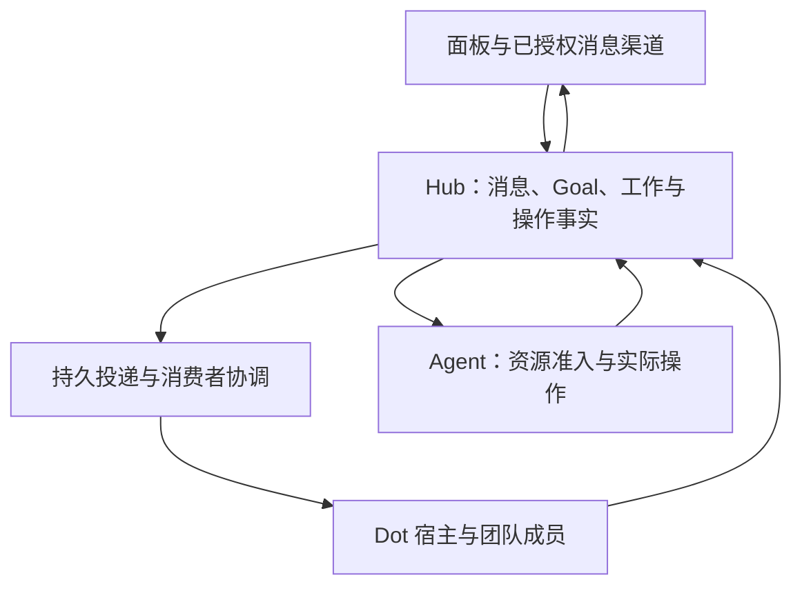
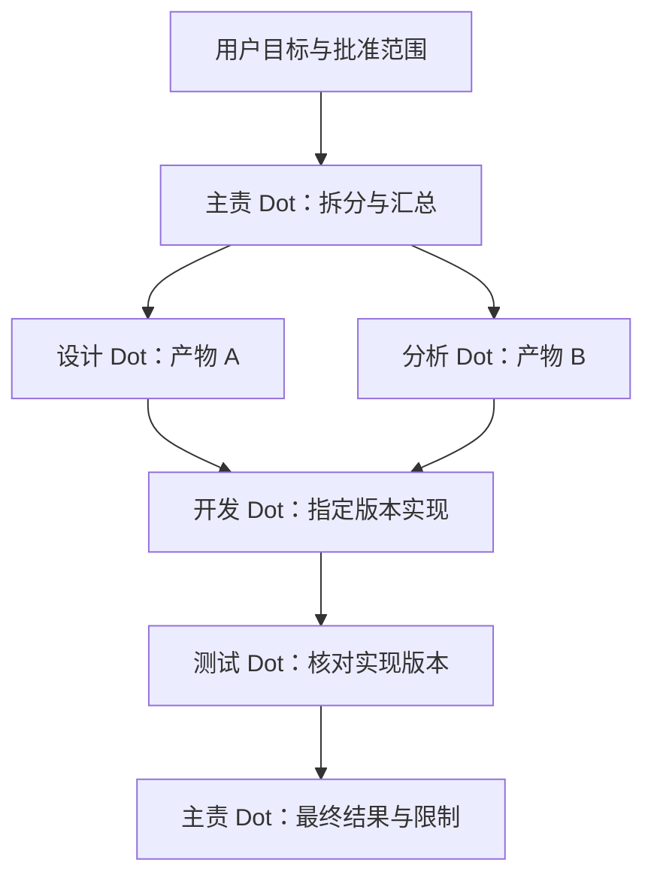

# CodePier MCP Events 与多 Dot 协作深化设计

> 历史记录的公开脱敏版；不代表当前部署或授权状态。内部标识、路径和回执已移除。

> 版本：0.3 · 设计、实施与扩展验收核对稿\
> 日期：2026-10-28（Asia/Shanghai）\
> 源码基线：`[已脱敏标识]`；README 标记 历史版本\
> 范围：MCP Events、Dot 双向通信、多 Dot 协作、恢复、性能和移动端体验。\
> 状态：新增机制已形成代码实现。首轮逐项落地见 [实施报告](MCP_EVENTS_MULTI_DOT_IMPLEMENTATION_2026-10-28.md)；新增修复、真实进程/旧二进制、移动浏览器和 15 分钟压力结果见 [扩展验收](MCP_EVENTS_MULTI_DOT_EXTENDED_ACCEPTANCE_2026-10-28.md)。历史环境核查与重新接入步骤见 [就绪审查](MCP_EVENTS_MULTI_DOT_LIVE_READINESS_2026-10-28.md)。本文基线诊断保留改造前视角；目标阈值不等同于生产指标。真实 Dot 宿主与物理手机仍需现场验收。

快速定位：[事件优化](#section-5) · [消费与恢复](#section-6) · [多 Dot 协作](#section-8) · [数据与接口](#section-11) · [实施顺序](#section-15) · [验收](#section-16) · [28 项问题与方案](#section-17)

## 1. 核心判断

**最值得优化的，是从“消息已经保存”到“Dot 确实接手”，以及从“多个 Dot 都能发言”到“同一件事有明确分工、可恢复地完成”。**

CodePier 已有持久消息、事件订阅与投递账本、阶段回复、逐输入处理、工作依赖、租约与 fencing、原操作恢复和资源调度。新方案应沿这些能力补齐缺口，不另建一套消息总线或多智能体平台。[R1–R10]

产品目标是：用户添加几个 Dot，在同一输入框说明目标；主责 Dot 自主拆分、向合适成员求助、汇总结果。用户能随时补充、改方向、暂停，并始终知道当前是否需要自己处理什么。授权范围内的常规步骤自动继续，不重复要求用户回 Dot 确认。

优先做六件事：

1. **让普通消息也能在事务提交后立即唤醒投递器。** 现有 operation 完成事件已有此路径，通用 `emit()` 尚未接入。
2. **消除慢回调对其他 Dot 的阻塞。** 从“每批两条、整批等待”改为有界、持续补位、公平调度。
3. **让一次唤醒处理一批真实待办。** 复用现有 inbox 与上下文包，增加可恢复的消费者所有权和“排空后休眠”握手。
4. **将多 Dot 协作绑定到同一个获准目标。** 复用 `coordination_work`、`goal_message` 和依赖关系；增加成员身份映射、交接包和主责汇总。
5. **把连续补充、结果过时和取消变成明确语义。** 不用一段提示词假装解决并发与意图更新。
6. **用真实链路数据验收体验。** 分开测量 CodePier 排队、Webhook、Dot 消费、执行与呈现，不把 HTTP 2xx 当成 Dot 已读。

本文延续 10 月 12 日生态设计和其实施记录，重点补充当前源码仍可见的延迟结构、多 Dot 产品入口、消费并发和宿主验收。旧文档已落地的能力不重复列为新开发工作。[R1]

## 2. 当前实现与真正的增量

### 2.1 证据边界

本次通过 MCP 项目入口读取代码与文档，核对 Git 基线及当前未提交文件。工作区另有 Agent、安装器和工作区探测相关改动；它们不属于本设计，也未纳入改动范围。

源码事实可以说明路径和约束，不能证明线上已经运行该版本。既有报告中的测试数量也不能作为本次通过证明。尤其是原生订阅、宿主调度、模型是否理解消费者契约，以及真实手机体验，需要独立验收。

### 2.2 能力对照

| 主题 | 当前已核对的能力 | 本轮增量或待验证项 |
| --- | --- | --- |
| 双向聊天 | `dot_message`、主动话题、原线程回复；普通聊天不要求工作租约 | 一次接入的可用性检查、团队入口与统一结果呈现 |
| 连续输入 | `dot_handle` 支持输入版本、最终回复覆盖关系、等待状态 | 意图 revision、执行前补充检查与结果过时处理 |
| 阶段回复 | `complete=false`、`dot_update`、最终态保护 | 节制更新、主责 Dot 的单一进度呈现 |
| 事件可靠性 | 订阅、outbox、delivery、签名、重试、游标、fence | 通用提交后唤醒、持续补位、限流隔离、可观测排队 |
| 断线恢复 | Inbox、工作恢复、原 operation、恢复提醒 | 消费者回合的持久所有权与排空握手 |
| 上下文成本 | `dot_wake_context` 有界包，最多 64 KiB，附分页入口 | 增量 revision、稳定契约缓存、交接包，而非传全历史 |
| 多人协作 | Goal、批准快照、参与 grant、工作依赖、指派、peer message | Dot 成员身份、自然语言团队授权映射、主责汇总与交接 |
| 并发执行 | Hub/Agent 资源准入、项目公平、路径锁；Gateway 有条件并发 | 将 Dot 消费公平性接到已有执行预算；不重做调度器 |
| 前端 | 增量 DOM、输入法/选区保护、批回执、`relay-sync` | 事件提示驱动增量同步及真实移动端性能门禁 |

### 2.3 源码直接暴露的优化点

| 编号 | 证据 | 影响与判断 |
| --- | --- | --- |
| G1 | `service.py::emit` 只写 outbox；`operation_events.py::queue` 才注册 `after_commit(wake_events)` | 普通消息和目标事件可能等待周期扫描；可复用已有唤醒设施。不是所有事件都没有即时唤醒。 |
| G2 | `events.py` 网络 Semaphore 为 2，`reserve` 最多取 2，`tick` 对整批 `gather` | 一条慢请求会延后下一轮补位；慢端可能拖住无关 Dot。影响需压测，不能从代码直接声称提速比例。 |
| G3 | `reserve` 对每个订阅只取最早未完成 delivery；未到重试时间便跳过该订阅 | 同订阅的旧失败可挡住新消息。应按事件语义决定保序或有限越过，不能直接扩大并发。 |
| G4 | `finish` 固定退避 30/120/600/1800 秒，最多 5 次；调用只传回 HTTP 状态 | 可增加有界抖动、经校验的 Retry-After、端点冷却；永久拒绝仍停止自动恢复。 |
| G5 | 当前订阅最长一天；`ttlMs=null` 仍返回有限 `refreshBefore` | 不是协议错误；需要验证宿主续订，避免让用户每天重连。不能将服务端自行延长视为宿主已续订。 |
| G6 | `dot_chat.enqueue` 对 connector 发言直接返回，不生成 bot-to-bot 收件 | 正确的防循环基础；团队协作应走目标内通信，不放开所有聊天 @。 |
| G7 | `coordination.py::message` 已能对批准参与者发 `peer_message`；工作按 grant 指派 | “Dot 之间完全不能通信”不成立；缺的是自然入口、交接语义及同 grant 多 Dot 的确定身份。 |
| G8 | `dot_wake_context` 已包含线程、工作与恢复首页；读取不消费 | 无需新建大而全的上下文工具；重点是消费者遵循契约及减少重复读。 |
| G9 | `relay-sync` 前台活跃约 1.5 秒、空闲约 5 秒核对 | 单纯缩短轮询会增大成本；更合适的是提示驱动、只读增量补齐。 |

## 3. 用户应该感受到什么

### 3.1 首次接入

房间内“添加助手”只要求名字、职责和一份简短的范围说明。高级的项目、执行位置、只读限制留在展开区。沿用已有 CPD 加入流程：目标 Dot 宿主完成自己的原生订阅，CodePier 自动核对绑定、回调、消费能力。

连接状态按证据推进：`待绑定 → 待宿主订阅 → 回调已验证 → 待首次消费 → 可对话`。任务能力单独标记为“可执行”或明确限制；不把 callback 成功当成全部就绪。诊断测试必须是 `test=true`，不制造用户任务、不推进真实工作。

已有 Dot 增加到团队时，复用有效连接和批准范围。需要补充范围时展示本次差异；不让用户复制 delegation_id、checkpoint、工作 ID，也不以新建高权限连接解决工具目录缓存。

若宿主有经验证的原生连接入口，可导航；没有则沿用复制加入指令。CodePier 不承诺替用户在任意私人 Dot 会话中安装订阅。

### 3.2 日常单 Dot 对话

用户发送后立即看到自己的消息，服务端保存后显示轻量确认。Dot 实际接手才显示“正在处理”。短问题直接回复；较长工作在一条阶段回复或一张进度卡内更新。

允许用户连续说：“先改首页”“移动端优先”“不要动报价页”。三条消息保留各自 ID 和来源，Dot 可以用同一份方案或结果覆盖，但必须明确登记覆盖关系。服务端不能靠相同文本或“谢谢”等关键词自动丢弃输入。

### 3.3 多 Dot 对话

示例：

> “让设计 Dot 看手机布局，开发 Dot 改页面，测试 Dot 验证。你负责汇总。”

若团队及范围已获准，主责 Dot 将其转成一个 Goal 和若干工作项，自动在成员之间交接。用户看到一个目标卡：“检查布局 → 实现 → 验证”，以及必要的状态变化。展开后才查看成员、依赖、文件和操作证据。

前台默认由一个主责 Dot 回答。其他 Dot 的结果以工作产物或折叠协作记录呈现；只有用户明确邀请讨论或指定成员直接回答时，才在主时间线展开多人发言。这减少刷屏，不隐藏失败、分歧或关键决策。

### 3.4 等待与异常

用户不需要理解队列、租约和 webhook，但必须能看懂下一步：

| 真实情况 | 主界面文案 | 唯一主要操作 |
| --- | --- | --- |
| 本地尚未确认保存 | 正在发送 | 等待；失败后重试原消息 |
| 已保存，尚无消费证据 | 已送入助手收件箱 | 通常无操作；超时后查看连接 |
| 明确的消费者接手证据 | 正在处理 | 可继续补充 |
| 等待一个已登记的问题 | 需要补充一项信息 | 原处回复 |
| 宿主确实要求审批 | 需要在 Dot 中确认 | 打开可信入口，或说明返回原宿主 |
| 执行已完成，结果未发出 | 工作已完成，正在同步结果 | 恢复发送结果 |
| 命令结果未知 | 正在核对原操作 | 查看核对进展，不显示“重新执行” |
| 一个协作成员掉线 | 该步骤等待恢复 | 已获准时自动安排接替，否则提供范围明确的选择 |

“无感”指自动维护既有流程、减少无意义操作；不意味着静默扩大权限、掩盖未知状态或承诺模型永远在线。

## 4. 总体架构：一份事实记录，三条独立链路



逻辑上分清三条链路，部署上仍可保留当前 Hub 单体：

- **通信链路**：消息保存、事件投递、收件、回复发表、外部渠道回执。
- **工作链路**：意图、批准快照、Goal、工作依赖、尝试、操作、验收。
- **控制链路**：绑定、续订、撤权、取消、恢复与容量分配。

控制链路保留少量资源，不被长任务占满。对话不强制产生工作项；工作完成不取决于微信等外部渠道是否送达；恢复投递不触发原操作重新执行。

MCP Events 是外部宿主的唤醒通道；面板 SSE 是用户界面的更新通道；MCP 工具响应是本次调用的结果。三者不能互相冒充。事件只提示“状态发生变化”，权威内容由受权限控制的读取接口提供。

<a id="section-5"></a>

## 5. MCP Events：从可靠投递走向低延迟与公平

### 5.1 保留协议边界

官方 MCP Events 文档要求使用 `events/list`、`events/subscribe`、`events/unsubscribe`；由宿主提供回调，完成 challenge 和 Standard Webhooks 签名。一次请求发送一个事件；2xx 只证明 HTTP 接收。事件可乱序、可重复；重试保留 eventId，410/413 不自动重试。订阅需持久化、持续验权并按返回期限续订；游标不能越过仍待投递的记录。[E1]

下面的调度窗口、消费租约、团队交接和性能目标属于 CodePier 的设计选择，不是宿主已经提供的能力。当前 CodePier 的 12 KiB data / 16 KiB envelope 上限继续保留，全文、附件和长日志使用受控读取引用。[R3]

### 5.2 事务提交后的即时提示

在 `CollaborationService.emit()` 成功插入新 outbox 记录后，通过当前事务的 `after_commit` 注册合并唤醒：

1. 消息/工作事实和 outbox 必须同事务提交。
2. 回滚不唤醒；重复插入未产生新事件时不额外调度。
3. 唤醒只调用已有 `loops.wake_events`，不在事务内发网络请求。
4. 保留当前“扫描前清除 wake 标记”的竞态处理，以及周期兜底扫描。
5. 嵌套事务、多个 emit、Hub 关闭与重启必须有定向用例。

初期不改变 outbox 格式和公开事件名。此项影响面最小，优先于全面引入 WebSocket 或新队列。

### 5.3 持续补位，不等待最慢的一整批

将 dispatcher 拆成短事务的候选预留与有界网络 worker；仍复用现有 delivery lease/fence。任一 worker 完成，就允许其他可用订阅补位，不等待同批其他请求结束。

拟定初始配置：全局投递 4 个并发、单目标端点 1 个、单订阅 1 个；压力测试后再决定是否增大。订阅 challenge 使用独立的小容量控制通道。多租户按 owner/Space、公平轮转到 Dot，重试与新事件共享绝对容量但各有份额，防止重试风暴挤占新请求。

重要约束：

- 不为每个 outbox 记录无限 `create_task`；只维护与容量相符的在途集合。
- 用数据库 `next_at` 和有界 ready 集合推进，禁止积压时零延迟忙循环。
- 每次取 lease、发送前和写回都核对订阅版本、身份和 scope；旧响应只进入审计。
- 任一慢端点只占自身份额。端点分组使用服务器归一化的接收方标识/连接策略，不把完整回调 URL 写入指标。
- 多进程只在数据库 CAS/fence 已验证时启用；不能依靠进程内 Semaphore 证明跨进程上限。

### 5.4 保序与积压不能用同一条规则处理

区分“业务因果顺序”和“网络发送顺序”。所有业务写入仍按版本、依赖和权限检查；网络乱序不应破坏结果。

| 事件语义 | 调度策略 |
| --- | --- |
| 已发布 v1 的普通消息事件 | 先保留兼容行为；度量队头阻塞，不擅自丢掉逐消息通知 |
| 可协商的新 `inbox_dirty` 提示 | 同 Dot/绑定代际只保留待发送的最新 dirty revision；消费者读取所有待办 |
| 工作可领取、依赖就绪 | 根据当前工作版本重新验权，过时版本审计后放弃；只通知明确责任成员 |
| 原 operation 终态 | 保留每个原操作和终态证据，不能为了合并提示丢失可查回执 |
| 取消、撤权 | 服务器即时停止准入，不等待任何 Dot 收到通知；通知只改善呈现 |

如需允许同一订阅内有限越过失败记录，必须先验证消费者可处理乱序；建议窗口上限 4，且不增加默认单订阅网络并发。`ack_seq` 仍停在最早未处理缺口之前，后发事件 envelope 中的游标也只能表示安全连续水位，不能使用较大的 event_seq 伪装全部已送达。

`dead_letter`/`abandoned` 的审计与恢复状态独立保留。协议游标的前进不等于业务输入完成，Inbox 必须仍能找回未处理项。

### 5.5 合并唤醒，不合并用户意图

高频输入的优化分两阶段：

1. **兼容阶段**：保留 v1 事件；消费者每次醒来批读待办，服务端合并恢复提醒，减少重复上下文读取。
2. **团队基础阶段**：新增版本化 `inbox_dirty` 事件，payload 只含目标、binding generation、dirty revision、可选消费票据和受控读取定位。先建立统一订阅，不默认改变聚合延迟；服务器在后续压测通过后可增加 150–300 ms 短窗口。取消和权限变化不等待窗口。多个业务输入仍逐条持久化。

不可将已发送 eventId 的正文改写成更高 revision。发送前可以封装尚未发送的提示；发送后出现新输入，则形成新的提示记录。传输重试必须重用原 ID 和原正文；“此前已被 HTTP 接收但消费者未处理”的恢复提醒是新的提醒 generation，并受原恢复预算约束。

旧宿主不支持新事件时使用 v1，不自动重写既有原生订阅。也不将多个事件装进数组发往只接受单事件的回调。

### 5.6 每个 Dot 一个稳定订阅，而不是每个 Goal 一个订阅

当前 `WorkFilters` 包含 goal_id 和 approval_id，订阅还受房间数量上限约束。若每个新目标、成员和批准版本都要求用户再建立原生订阅，多 Dot 再快也不会无感。因此，**统一收件箱订阅是团队模式的基础项，不应推迟到规模优化阶段。**

拟新增 `codepier.collaboration.inbox_dirty.v2`。过滤器冻结 owner/Space 所属的已授权 conversation、environment、slot 和 binding generation；实际发现与订阅继续核验项目范围。事件只表示该成员的可读收件箱发生变化，不授权任何 Goal。

收件箱内的条目使用 `kind=message|work_ready|peer_handoff|result_ready|control_notice`，每一类都保留原 message/work/approval/operation 引用。`work_ready` 必须由当前批准产生，`control_notice` 不等待模型才能停止准入。普通用户消息和同伴资料在来源类型上严格区分。

新增 Goal 时，只向已获准参与者的 inbox 插入工作引用并提升 revision；不新增宿主订阅。团队中的 N 个 Dot 需要约 N 条主订阅，而不是 N×Goal 数量。跨项目内容仍逐条验权；统一订阅不能让单项目只读连接看到其他项目。

迁移由加入流程返回新的原生订阅说明，并在宿主实际完成后登记 `active_protocol=v2`。验证 v2 可消费、完成一次原 Inbox 对账后，停止旧任务/消息唤醒路由。重叠期用同一业务对象幂等，不生成两份工作；旧订阅是否取消由宿主执行，CodePier 只停止重复路由，不冒充宿主操作。

不支持 v2 的现有宿主仍可使用 v1 单 Dot 路径，或在明确的有限团队目标内建立已有 WORK_EVENT 订阅；界面说明该兼容路径需要额外接入。不得在未验证宿主能力前显示“团队已完全就绪”。

### 5.7 重试与订阅恢复

| 情况 | 设计行为 |
| --- | --- |
| 网络超时/连接失败/可重试状态 | 原 delivery 退避重试，加有界抖动；当前最多 5 次作为兼容初值 |
| 429 | 读取并限制 Retry-After；同时进入接收方冷却，避免多个 Dot 一起重试 |
| 410 | 该投递停止自动重试；连接呈现需要恢复，不能用新 ID 绕过 |
| 413 | 停止重试并检查摘要生成；修正契约后走明确恢复，不无限换键 |
| 401/403 或回调策略拒绝 | 标记对应连接问题，保留未处理工作；不回退不安全 URL 或凭据 |
| 2xx 但长时间无消费 | 复用 `dot_relay.recover` / `task_liveness` 的有界提醒；不再发送已完成输入 |
| 宿主主动暂停、撤销或订阅到期 | 不自动恢复其意愿；保留可见原因与原待办 |

在网络适配器内部只带回允许的状态与 Retry-After，不记录任意响应头、正文或回调地址。

续订继续由宿主原生机制发起；服务端保存原订阅身份和安全水位。有限 TTL 的自动续订必须真实验证。长期不失效订阅只有在协议、服务端策略和宿主均支持时才协商，不能把数据库到期时间改长来宣称解决。

<a id="section-6"></a>

## 6. Dot 消费：一次唤醒，有界排空，可随时恢复

### 6.1 把三种所有权分开

| 对象 | 解决的问题 | 绝不能代表 |
| --- | --- | --- |
| delivery lease | 哪个 worker 正在发送这一条事件 | Dot 已经处理任务 |
| consumer session（拟新增） | 哪个 Dot 回合负责读取、合并与回复当前待办 | 获得执行权限或可续期已有工作 |
| work lease + attempt/fence | 哪个成员可以推进当前工作尝试 | 原 OS 进程已经停止，或任意外部动作可重试 |

默认同一真实 Dot consumer 只有一个活跃消费回合。跨线程的工作按配额切片，长命令启动后保留原 operation 并让出消费回合；不同 Dot 可并行。执行量仍由现有 Hub/Agent 资源调度限制。

这控制的是本服务的接手与写入，不能保证宿主不同时启动两个模型回合。重叠宿主回合拿不到当前消费 fence 时，只读核对后退出；不能再发第二份回复。

### 6.2 消费回合契约

新增动作均为拟议契约，应在 `collaboration` / `collaboration_query` 现有工具族内扩展，避免再增加一组工具名：

```text
唤醒
  → 恢复原 Dot 绑定和订阅代际
  → consumer_begin：原子取得短期消费 session / fence
  → dot_inbox：一次返回输入、工作、恢复、增量上下文及分页
  → 显式收件；根据原请求回答、澄清或恢复/领取已有工作
  → 重要副作用前、最终回复前重新检查输入 revision
  → 提交阶段/最终回复、逐输入处理关系
  → consumer_yield：携带最后核对的 dirty revision 原子尝试休眠
```

`consumer_begin` 是有审计的写操作；`dot_inbox` 保持只读，不在读取时隐藏 ack、续租或领取工作。当前接口返回的可复用调用参数继续保留。

消费租期可从 90 秒、约 30 秒刷新开始试验，均受上层权限与总回合预算限制。不能以自动心跳模拟模型仍在思考；只有真实消费者调用续期。宿主没有后台心跳时，长推理可能让 session 到期，恢复时读取最新状态重新取得 session，而不是冒用旧 fence。

### 6.3 解决“刚读空，又来了消息”的竞态

为每个 Dot binding 持久化单调 `dirty_revision`，每次需要该消费者关注的变化都递增。在排空时，事务检查：

- 输入 revision 是否仍等于最后完整读取的值；
- 是否还有可处理输入、可领取工作或待恢复结果；
- 当前消费 session/fence 是否有效。

若有新变化，返回 `more=true`，不休眠；否则记录本代已排空并释放 session。提交新输入与释放 session 的竞态由同一数据库事务序列化：消息先提交则排空检查失败；排空先提交则新消息会创建唤醒。进程内通知只是加速，持久状态始终可恢复。

读取分页时不能把最大消息序号当成此前全部完成。沿用各集合分页和最终首页重扫；有界包被裁剪的部分必须保留读取入口。

### 6.4 防止一次唤醒无限工作

拟定每回合最多合并 20 条输入，沿用现有处理记录批量上限；例如最多推进 10 个受管步骤或连续占用 60 秒后重新评估是否让出。这是消费者调度建议，不能降低任务本身的验收完整性。

到回合预算时保存检查点：处理过哪些输入、已有回复 ID/version、工作 ID、operation ID、下一个读取入口。需要继续的工作留在同一工作项；是否再次唤醒由已批准策略和实际待办决定，不创建无限自触发消息。

租期已过且存在 pending/unknown operation 时，只能查询原操作。明确可归档的结果走现有 `archive_result` 路径；不能仅为发表结果重新执行工作，也不能替旧尝试补一张新批准。

## 7. 连续输入、改变方向与取消

### 7.1 意图版本，而非只看最新一条消息

同一工作保存 `intent_revision` 和对应的原输入集合。Dot 判断新消息属于以下哪一种，并通过结构化关系提交；服务端校验来源、线程、版本和有效授权：

- 补充事实：如尺寸、文件、约束，进入当前工作上下文。
- 修改目标：形成新 revision，并给仍未开始的步骤重新核对。
- 独立任务：新工作，仍可在原对话显示。
- 回答一个问题：绑定精确 response_request，沿用原工作。
- 取消/暂停：先确定明确目标，再触发控制动作。

不以关键词在服务器端替模型作语义判断；模型分类也不能自动扩大范围。当前 `OWNER_TASK_CONTEXT` 的原请求—方案—本人回复链继续作为权威依据。[R6]

### 7.2 执行屏障

准备开始有副作用的一步时，提交消费者已核对的 `expected_intent_revision`；服务端在准入事务核对当前版本。旧版本拒绝新步骤，并返回精确补读请求。

已经启动的操作不能靠修改 revision 撤销。对于已开始的文件/服务操作，核对原执行结果后由主责 Dot 决定继续、修正或请求必要决定；涉及不可逆影响时如实反馈。不要把“补充要求已收到”写成“正在运行的命令已按新要求调整”。

### 7.3 结果和回复的版本

结果绑定产物版本、输入 revision、工作 attempt/fence 和操作证据。最终汇总前再次比较当前意图；若用户已改变目标，原结果作为历史证据保留并标注适用版本，不能覆盖新目标。

对话层的“最终回复”不等于所有工作成功。回复可明确说明部分完成、失败或阻塞，但完整成功状态必须由必需工作、验收及产物一致性共同决定。

### 7.4 取消要先停止准入

“暂停全部”在已明确的当前 Goal 上设置控制状态并提高控制 epoch，阻止新 work claim/execute；向运行 operation 发取消请求，保留逐个真实回执。

状态依次可能是“已停止新增步骤”“正在停止已运行步骤”“已停止”或“部分操作仍在核对”。取消请求成功不是进程终止证明。恢复时也不能重新执行结果未知的操作。

<a id="section-8"></a>

## 8. 多 Dot 协作：复用 Goal，补齐成员和交接

### 8.1 默认采用“一个主责，多个成员”

| 角色 | 责任 | 不拥有的权力 |
| --- | --- | --- |
| 主责 Dot | 理解目标、拆工作、选择已获准成员、汇总进展与冲突 | 批准自身提议、增加成员权限、绕过宿主审批 |
| 专项 Dot | 在自己范围内完成明确工作，返回证据和可复用产物 | 将同伴建议当成新的用户授权 |
| 验证 Dot | 读取指定版本产物、执行获准检查、指出失败条件 | 仅凭主责声称就将工作设为通过 |
| Hub | 身份核对、DAG/预算/版本/租约/依赖与状态持久化 | 假装理解自然语言、生成未经模型确认的执行目标 |

小任务优先单 Dot；只有职责差异、独立工作或独立验证能带来收益时才拆分。默认不让所有 Dot 广播讨论，也不增加一个额外模型充当“路由大脑”。

角色规则在服务端执行：只有当前主责或原策略明确允许的协调成员可新增分工、改受让者和提交聚合结果；专项成员提交自己的结果或交接建议，不能凭普通 peer 正文改变工作图。验证成员只能给自己有权读取的准确产物版本出具验证结果。角色限制不会增加其底层 grant 权限。



### 8.2 当前已有的能力必须直接复用

`coordination_work` 已有依赖、责任描述、受让 grant、版本、attempt、fence 和 lease。`work_claim` 已检查依赖成功与原未完成操作；`goal_message` 已在批准参与者范围内生成 peer 事件，并受消息预算限制。它们是团队模式的基础。[R7]

本设计新增的是可用入口和更细的契约，不另建第二套 team task 表，不移除普通聊天的 bot-to-bot 禁止规则。

### 8.3 先解决 Dot 与 grant 的关系

当前工作分配与参与者集合使用 `grant_id`；它代表授权连接，并不天然等于一个 Dot。新的成员记录需要明确：

`participant_id → dot_id / slot_id → binding_generation → authenticated grant → host consumer identity（若可验证）`。

所有写入都从认证上下文与服务器绑定解析成员，不能相信请求正文里的 dot 名称、dot_id 或自报 consumer_id。callback challenge 证明对回调的控制，不自动证明每次工具调用来自那个 Dot。

这里区分两个需求：**同一用户的几个可信 Dot 要正确分工**，以及**互不信任的 Dot 要形成安全隔离**。前者可通过投递绑定和消费所有权解决；后者必须有独立认证和执行隔离，不能混为一谈。

给出三条明确路径：

| 路径 | 具体方案 | 能保证什么 |
| --- | --- | --- |
| A：原生可区分身份，优先采用 | 每个实际成员绑定可区分的已授权连接/宿主认证主体；冻结 grant→Dot→binding 的关系 | 由真实认证主体核对领取者；独立权限仍逐项检查 |
| B：同 owner、共用 grant，增加投递绑定 | v2 事件向原订阅发送短期 wake ticket；消费者凭 ticket 取得只属于该 slot 的 session proof/fence | 同一信任域内的确定路由、领取与去重；不是互不信任成员的安全隔离 |
| C：既无独立身份，也无法可靠传回票据 | 当前 Goal 暂只准一个执行成员；提供重新绑定独立连接的单一入口 | 保持已有可用路径；明确能力不足，不把多个名字假装成多个执行者 |

路径 B 让同一账号下多个可信 Dot 不必仅为分工反复配置宽权限凭据，但必须实现如下完整契约：

1. 票据由 Hub 生成不可猜测的随机值，绑定当前 grant、slot、订阅及绑定代际、目标消费用途和到期时间。它不能独立访问项目，也不能扩展任何批准范围。
2. 票据仅通过当前已验证的原生订阅投递；普通 dot_connection、成员列表、诊断、事件历史等读取不得返回其他成员的票据。数据库查找保存哈希；需要重传的 envelope 按已有密钥体系加密保存，工具日志对票据字段脱敏。
3. consumer_begin 要求当前认证 grant 与票据绑定一致，原子兑换为限定该成员的消费 session。相同兑换请求幂等返回原 session；不同回合不得重复领取。成员回复及受管执行同时校验 session proof、当前 fence 和原 work lease。
4. 消费 session 到期后拒绝旧写入。原票据已用尽或过期时，可请求“向原订阅补发恢复提示”，但接口不能直接把另一个 slot 的新票据返回给调用者；补发继续遵守暂停、撤权、永久拒绝和通知预算。
5. 票据有效期建议不超过 10 分钟且不超过上层有效期；到期只使该提示不可兑换，不丢弃业务输入。过期 delivery 记为 obsolete，符合恢复条件时新建恢复 generation，不能篡改已发 eventId 的正文。
6. 所有 v2 受管写路径都必须验证票据导出的身份，不能保留一个只凭 dot_id 的旧写入口绕过。通用项目工具的既有 grant 权限仍属同一个信任域，不能据此宣称两个 Dot 在账号层完全隔离。

签名 checkpoint 用于恢复状态，不能替代上述来源证明。若同 grant 的其他成员可以读取票据，或宿主不能把订阅事件稳定送到目标 Dot，路径 B 的前提失败，应回退 A/C。需要独立安全边界时直接选 A，并结合项目运行时隔离；不要求用户在普通协作中理解票据细节。

### 8.4 团队授权如何保持自然

新增团队策略绑定成员、项目、可执行位置、允许能力、预算和有效期。用户在添加团队时看懂范围并一次确认；后续明确请求由服务器核对这份批准，自动生成对应 Goal/approval 关联。

不能把若干单 Dot 的旧授权简单取并集，自动生成更大的团队授权。新增成员、跨项目、替换执行位置、提高风险或超过预算时，只展示差异。团队策略与授权证据不来自其他 Dot 的发言。

为避免 `@A @B` 导致两名 Dot 各自把同一句话转成完整任务，团队输入增加服务器验证的 `team_id` 和主责成员选择，不能只解析正文里的名字。拟新增 `team_from_message`：核对可信本人原消息、团队策略、成员绑定和输入版本，原子创建唯一 Goal；其他成员先收到参与信息，只有被指派的 work 才可领取。唯一键绑定原用户意图和已选择团队，用户有意发起的新请求仍使用新消息 ID。

若用户只选择了 A，又在正文提到一个尚未加入的 B，A 可以提出加入请求，不能凭名字自动扩大团队。若 B 已属于获准团队且自动协作策略覆盖本次范围，直接分配工作。已验证本人外部渠道要进入同一团队，需沿用明确的渠道→团队绑定；不能把原私人 Dot 对话默认共享给新成员。

已有 CPJ notification-only 连接继续只读/报告；已有 CPD task-only 和双向模式各保留原意愿。订阅消息不等于有权执行；创建 Goal 也不等于它已被批准。

### 8.5 结构化交接包

向成员交接时，复用 `goal_message` 及 work 创建，并在附加结构中提供：

```json
{
  "handoff_schema_version": 1,
  "goal_id": "goal_example",
  "approval_id": "approval_example",
  "work_item_id": "work_example",
  "from_participant_id": "participant_design",
  "to_participant_id": "participant_dev",
  "intent_revision": 3,
  "objective": "按已确认方案优化移动端输入区",
  "acceptance": ["中文输入法不被打断", "返回对话保留草稿与阅读位置"],
  "artifact_refs": [{"artifact_id": "artifact_example", "version": 2, "digest": "sha256-placeholder"}],
  "input_work_refs": [{"work_item_id": "work_design", "result_version": 1}],
  "open_questions": [],
  "expected_output": "变更说明、产物版本和对应验证结果"
}
```

以上是设计示例，不是当前接口可直接接收的参数。服务器生成接收者、权限范围与审计关系；模型填写目标、验收、事实摘要和问题。完整私人聊天和 Dot 记忆不进入共享包。

交接包正文是资料，执行权限来自原批准。引用必须核对当前可读权限、版本和来源；“某 Dot 说已批准”没有额外效力。

### 8.6 调度、冲突与验证

- 同一 Goal 的工作形成 DAG；创建依赖只允许引用已存在且属于同一有效批准的工作。后续若允许改依赖，增加环检测与版本 CAS。
- 读任务尽量并行。写任务先声明目录/服务资源，复用现有锁与资源准入。Shell 的声明不完整时按更大范围保守串行，不能声称任意命令已自动识别全部副作用。
- 代码工作可使用独立 worktree；集成由指定成员统一完成，记录共同基线、产物 commit/digest，解决冲突后才做最终验证。worktree 不绕过项目预算，也不是 OS 沙箱。
- 同一文件的写入使用当前 SHA；同一服务、设备或不可拆分外部资源保持独占。创建不同项目别名不能绕开实际同资源冲突。
- 验证结果绑定准确产物版本；被测版本改变便失效。审查意见和工具测试通过分开记录。
- 一名成员失败，只阻塞依赖它的分支。独立且仍获准的分支可继续；最终答复明确部分完成状态。

### 8.7 主责切换与防循环

主责身份保存 `coordinator_epoch`。交接必须 CAS 修改，旧主责的最终汇总与新分工写入被旧 epoch 拒绝；已有 worker 的有效工作不会仅因主责切换被重复启动。

仅当原团队策略允许且接替成员有原范围权限时自动交接，否则原处展示明确阻塞。交接前对账所有 pending/unknown operation，不能以超时认定原主责从未执行。

对协作消息增加 `causation_id`、`root_intent_id`、交接次数和已处理对象版本。默认建议最多 4 次连续机器交接、继承现有每 Goal 40 条消息预算；超过时合并说明，停止继续自发转发。具体数值需真实任务校准。

系统回执、自己的回复、重复结果和状态变动不自动生成新的自由讨论。新的用户输入可以开启新一轮；相同上下文不能在两个 Dot 之间来回“请再看一下”。

## 9. 上下文与工具调用成本

继续使用已有 `dot_inbox` 内的 `dot_wake_context`，不让 Dot 再逐条查询同一批线程、连接、工作与恢复记录。

建议把返回内容分为三层：

| 层 | 返回内容 | 更新方式 |
| --- | --- | --- |
| 稳定契约 | 消费协议版本、能力、当前工具名称、身份边界 | 带 hash/revision；变更才重新完整读取 |
| 当前上下文 | 新输入、问题关联、当前意图、工作与操作状态、已有回复 | 每次唤醒返回必要增量 |
| 大证据 | 完整文件、附件、日志、旧历史 | 授权引用、摘要及分页；按需读取 |

64 KiB 是当前上下文包上限，不是必须填满的目标。建议新消费者常见首包控制在 16 KiB 内；超出时保留准确补读入口和 `history_complete=false`，不能删掉失败、否定决定或权限限制来缩短上下文。

摘要保留源消息版本和 digest；授权、验收和写入前条件不能只用模型摘要替代。跨项目引用继续携带来源项目，撤权后失效。缓存按 owner/Space/grant/binding/scope revision 隔离，并有体积上限和撤权失效路径。

减少调用的目标是省掉重复获取，不是把 claim、execute、审批和读查询塞进一个不可审计的“智能执行”接口。

## 10. 前端：一个对话面，按需展开协作

### 10.1 呈现原则

沿用现有主题和组件，实色内容面、清晰文字和克制状态色。移动端优先，避免把技术回执铺满屏幕、大弹窗挡住输入，或用假 token 动画制造进展。

主界面只保留原消息、主责回应、目标进度和确实需要用户的事项。成员工作放在可展开区域；底部输入框始终可用。后台状态变化不得抢焦点、结束中文组合输入、重建选中文字或强制滚到底部。

### 10.2 提示驱动的增量同步

在现有 `relay-sync` 上增加短小的“有变化”通知。优先复用并验证项目现有 SSE 基础设施；若不适用，再新增受权限控制的协作提示端点。

提示只携带当前授权会话的 revision/dirty IDs，浏览器合并后调用 `relay-sync` 取权威数据。保持 polling 作为网络、代理、后台恢复的兜底；SSE 断开不创建新消息、不重复工作。

关键约束：

- 重连携带可恢复位置；无法补齐时执行一次有界重新同步。
- 状态权限变更先清除不可见内容和旧缓存；前端过滤不能替代后端验权。
- 提示连接沿用有效登录与同源检查，不在 URL 中传授权令牌；Last-Event-ID 和恢复游标每次都按当前范围核验，不能恢复出已撤权历史。
- 保留原输入法、滚动锚点、选区、草稿与迟到响应隔离。
- 多标签可由一个标签负责连接并广播提示，但鉴权和读取仍各自有效；账号退出即清理。
- 后台标签不持续高频拉取，回前台立即核对；移动网络切换后先恢复原回执。

### 10.3 阶段更新与通知预算

初始可见反馈来自本地发送状态和服务端保存，Dot 阶段说明只在实际生成后显示。状态未变化不每秒刷新“正在处理”。

阶段发布可合并到约 0.5–1 秒一次；长任务只在有新证据时更新。重要阻塞、确认问题、最终结果立即发表。外部文字渠道采用更低频的里程碑回复；支持编辑的渠道才原位更新。

消息卡展示成员和真实阶段，不展示虚构完成百分比。原操作已完成但某渠道外发未知，只修复那条外发记录。

<a id="section-11"></a>

## 11. 数据与接口增量

### 11.1 保持现有事实表为主

现有 `mcp_event_subscriptions/outbox/deliveries`、`collaboration_dot_messages`、消息处理关系、`coordination_*` 与 `operations` 继续作为各自事实源。新增概念不得复制一套可相互矛盾的完成状态。

以下为建议新增或加法扩展，实施前再次核对实际 schema：

| 结构 | 核心字段/约束 | 作用 |
| --- | --- | --- |
| `dot_consumer_sessions` | binding、generation、session、proof hash、fence、lease_until、last_seen_revision；同 binding 只允许一个当前拥有者 | 重复唤醒下只由一个消费者推进回复 |
| `dot_wake_tickets` | ticket hash、grant/slot/subscription/generation、expires、redeemed session；原子单次兑换 | 同 grant 可信协作时，证明来自对应投递通道；不是更大授权 |
| `dot_inbox_revisions` | binding + generation 唯一，dirty_revision、drained_revision | 排空握手和增量读取；不替代逐输入账本 |
| `coordination_participants` | goal、approval、participant、dot/slot、grant、binding generation、身份能力 | 将产品成员映射到真实认证主体 |
| Goal 附加投影 | coordinator participant/epoch、intent revision、团队策略版本 | 交接与汇总的 CAS 条件 |
| 结构化 handoff | 原消息/工作关联、目标成员、源结果版本、causation、交接深度 | 有证据的成员协作，不是新执行授权 |
| 聚合 publication | goal + intent revision + result digest 唯一，发布状态 | 主责崩溃后不重复发表相同结果 |
| 投递调度元数据 | endpoint cooldown、next eligible、错误分类、队列年龄 | 公平与背压；不保存敏感 URL 到指标 |

消费者 revision 与消息处理关系属于不同维度：排空不等于已经回答；等待用户的输入仍可保留处理记录但不持续触发唤醒。

### 11.2 幂等键与版本条件

| 动作 | 唯一性/恢复键 |
| --- | --- |
| 用户重复发送请求 | 当前身份和会话范围内的原 `client_message_id`；同文新键仍是新输入 |
| 事件重试 | subscription + eventId；原 body 不改变 |
| 消费取得 | binding generation + session request key；重试返回原 session |
| 原消息转工作 | 原可信消息 ID/version 与已有 work 关系，沿用原实现 |
| 交接 | goal + approval + 原工作/结果版本 + 目标 participant + 类型 |
| 回复更新 | reply ID + expected reply version + 当前 consumer fence |
| 执行操作 | work + attempt/fence + 原操作请求键；未知结果先查原 ID |
| 最终发表 | goal + intent revision + 经核验的 result digest |

新增幂等记录保存参数摘要；相同键不同参数必须冲突，不能无条件返回旧成功。对于超时提交，先按原键查询，只有权威确认尚未提交才重用原请求。

### 11.3 工具契约演进

| 接口 | 当前职责 | 拟议增量 |
| --- | --- | --- |
| `collaboration_query(dot_connection)` | 恢复绑定与消费者说明 | protocol/capability revision、成员映射与可用性证据 |
| `collaboration_query(dot_inbox)` | 只读待办、线程、工作和恢复 | dirty revision、当前意图、可选增量游标 |
| `collaboration(consumer_begin/consumer_yield)` | 当前不存在 | 明确消费 session 生命周期，不暗藏执行 |
| `collaboration_work(team_from_message)` | 当前不存在 | 从明确团队输入建立唯一 Goal，避免多 @ 重复开工 |
| `collaboration(dot_message_v2/dot_update/dot_handle)` | 回复、更新、逐输入处理 | 在新协议下核对 consumer fence 与输入 revision |
| `collaboration_work(create/assign/claim/execute/result_v2)` | 获准工作流 | 新版成员定位、意图屏障、产物版本关系 |
| `collaboration(goal_message)` | 批准目标内的 peer 通信 | typed handoff、causation、结果引用与循环预算 |
| `collaboration_query(dot_receipt)` | 原请求/回复回执 | 聚合 publication 恢复，不重复写入 |

这里的新增 action/字段仅为 RFC。发布前统一到 public contracts、服务校验、工具目录、消费者说明与兼容测试；不先在提示词里要求调用不存在的动作。

同一 binding 启用新消费协议时，旧写路径必须同步进入明确兼容策略：只能维持单个旧消费者，或完成真实能力确认后切换为必须带 fence。不能一边强制新 fence，一边保留可绕过的旧回复写口。切换由版本状态控制，不能仅靠客户端自报协议版本。

## 12. 性能目标与观测方法

### 12.1 拆开可控制延迟

记录下列真实时刻：本地点击、Hub 提交、delivery 可调度、发送开始、回调响应、消费者首次实际调用、工作领取、operation 起止、回复提交、客户端呈现。

Hub 内时长用单调时钟和同节点时间计算；跨机没有可靠时钟校准时记录各段，缺失值为 unknown，不相减出一个虚假的“模型思考耗时”。当前 `dot_wake_context` 已将宿主唤醒时间标为未知，继续保留这一诚实边界。[R5]

### 12.2 拟定工程门槛

以下条件：同版本候选构建、8 个已验证独立消费者、50 ms RTT 的受控网络、20 条/秒输入突发持续 30 秒，随后恢复常态；慢端点另注入 10 秒延迟。负载是测试输入，不代表当前配置或服务承诺。

| 指标 | 初始门槛 | 适用范围 |
| --- | --- | --- |
| 点击到本地消息呈现 | p95 ≤ 100 ms | 目标手机/浏览器；不等待网络 |
| 消息保存 API | p95 ≤ 300 ms | 定义负载与网络下，分开报服务器耗时 |
| 已提交到首次投递尝试 | 无积压 p95 ≤ 100 ms | CodePier 内部，不包含宿主处理 |
| 慢 Dot 对其他健康 Dot 的影响 | 其他 Dot 的内部投递排队 p95 增量 ≤ 250 ms | 慢端点隔离实验 |
| 回复提交到前台可见 | 提示通道正常时 p95 ≤ 300 ms | 不包含模型生成，断线降级单独统计 |
| 交互性能 | 实机关键交互 p75 INP < 200 ms | 同时检查中文输入、长历史和焦点 |
| 空闲对话成本 | 提示通道正常时无持续高频 relay-sync | 心跳/恢复流量单独计数 |
| 业务正确性 | 故障注入中重复副作用为 0；每条输入有可追踪去向 | 测试样本结论，不表述为全球 exactly-once |
| 用户成功率 | 已接入可用消费者的有效请求中，完成或明确阻塞 ≥ 99% | 灰度窗口先收集；宿主不可用另报，不能悄悄剔除 |

Dot 唤醒和首次有意义回答分别记录 p50/p95/p99，先建立真实样本分布，不在未验证前承诺“秒回”。各类排除项、超时、取消和未知都必须出现在报告分母里。

### 12.3 指标与追踪

建议指标：outbox oldest age、ready queue age、delivery inflight/retry/dead-letter、callback latency、accepted-to-consumer gap、未覆盖输入数量、session 冲突、工作租约过期、未知 operation、恢复后完成率、每目标工具调用数和重复读取字节。

Trace 串联 message → event → delivery → consumer session → goal/work → operation → result → publication。普通监控只存枚举、耗时与受控标识，不记录正文、令牌、私有路径、回调或其他 Dot 私人记忆。

## 13. 故障恢复矩阵

| 故障 | 必须保留的事实 | 自动恢复与用户体验 |
| --- | --- | --- |
| 消息提交成功，响应丢失 | 原 client_message_id 与保存记录 | 查原回执，恢复同一气泡；不重复保存 |
| Outbox 提交后 Hub 崩溃 | 消息/工作与 outbox 同事务 | 重启扫描；丢失内存 wake 不丢工作 |
| Webhook 已接收，Hub 未记成功 | 原 eventId、body、delivery fence | 允许重复投递；消费者幂等且只处理原待办 |
| 宿主重复/乱序唤醒 | dirty revision、逐输入状态、session fence | 旧回合退出；新回合读当前事实 |
| 消费者 ack 后崩溃 | ack 非完成、输入仍待处理 | 下一回合恢复；不因 read 状态漏掉任务 |
| 最终回复保存后，覆盖关系提交失败 | 已有 reply ID/version | 只补处理关系；不发表第二份最终答复 |
| 工作执行中 Dot 离线 | 原 operation、attempt/fence、执行预算 | 查原操作；是否允许已开始命令继续由原不可变预算决定 |
| 工作租期已过，执行结果刚到 | 原执行证据与当前授权 | 允许的结果归档走现有恢复接口；不伪造仍有效租约 |
| 用户补充与下一步执行并发 | intent revision 和准入时核对 | 旧版本停止新步骤，已运行步骤据实核对 |
| 两个 Dot 同时写同文件 | SHA、资源锁、工作与操作来源 | 一方等待或产生明确冲突；不覆盖别人修改 |
| 主责掉线 | coordinator epoch、工作 DAG、产物引用 | 获准候选接替并对账；无候选则清楚等待 |
| 接替主责后旧主责返回 | 旧 epoch 与尝试证据 | 拒绝旧最终发表；合法历史结果仍可归档 |
| 订阅到期/撤权 | 原绑定、订阅状态、权限变更 | 停止新投递/准入；有效待办保留，界面说明恢复入口 |
| 外部渠道发送未知 | 原外发记录和平台回执 | 仅核对/恢复该渠道，不重做项目工作 |
| UI 提示断线/移动端回前台 | 本地稳定消息键、同步 revision | 立即一次增量核对，必要时有界重新同步 |
| 事件保留期已过 | truncated 标记、业务 Inbox/工作记录 | 从业务记录核对；已清理的证据明确缺失，不声称完整恢复 |

“至少一次投递 + 幂等写入 + 版本/fence”是可实现的语义。对任意 Shell、外部服务与网络不确定性，不宣称端到端 exactly-once。

## 14. 权限、边界与无感授权

正常工作复用用户已经给出的明确授权，不因为从聊天转成工作、读文件或调用插件额外问一次。需要用户介入的情况集中为：关键目标缺失、扩大既有范围、实际宿主审批、不可逆新动作或无法安全判断的冲突。

所有新团队和消费能力保持下列约束：

- 当前 owner、Space、project、环境、房间、绑定代际与批准快照共同确定范围；名称或文件内容不能授予权限。
- 宿主原生审批独立存在。没有可信精确链接时，提示回原宿主，不编造“点击一键批准”。
- 同伴消息、附件、网页与日志属于资料，不提升为用户命令。结构化交接不能清洗来源可信度。
- 取消、撤权及项目映射变更影响新步骤；排队任务发送前再次核对。缓存不延迟撤权。
- 共享上下文只包含用户发送到当前房间的内容及获准项目证据，不同步完整私人聊天或私人记忆。
- Dot 数量、工作数、peer 消息、事件重试、附件和工具步骤均有预算，无法靠拆 Goal 或 worktree 绕过原项目限制。
- 项目 clean runtime 是环境整理，不是 OS 隔离。互不信任成员的实际执行隔离沿用容器/独立账号等已验证能力，不由本方案降低边界。

<a id="section-15"></a>

## 15. 实施顺序与迁移

### 15.1 按可验收增量推进

| 阶段 | 工作 | 主要代码落点 | 完成门槛 |
| --- | --- | --- | --- |
| P0.1 | 链路量测、通用 after_commit 唤醒 | service、lifecycle、events、dot_wake_context | 事务竞态通过；普通消息不再仅靠 2 秒扫描 |
| P0.2 | 持续补位、公平与慢端点隔离 | events、network、投递查询/索引 | 慢回调实验及无重复投递所有权证明 |
| P0.3 | 单 Dot 真实宿主闭环与续订检查 | joining、dots、消费者说明、可用性投影 | 原生订阅、实际消费、原处回复与重启恢复有证据 |
| P1.1 | consumer session、排空握手、意图屏障 | dot_chat、message_handling、owner_task_context、contracts | 重叠唤醒、连续补充、断线与最终回复竞态通过 |
| P1.2 | 统一 Inbox 订阅、团队成员、批准映射、交接与主责 | events、joining、coordination、delegation、working_scopes、contracts | 两个真实 Dot 完成同 Goal 的分工、交接和验证；身份路径有明确证据 |
| P1.3 | 提示驱动 UI、单一进度与移动端 | relay、workspace、experience_projection | 手机实测、重连、选区/输入法与部分失败呈现通过 |
| P2 | dirty 提示聚合、更大规模、可选长期订阅 | 宿主适配、配置与监控 | 宿主能力明确、兼容与负载收益可证明后再开放 |

P0.1/P0.2 不依赖先完成大型团队 UI。P1 团队功能不能以模拟消费者代替真实 Dot 验收后直接全量开放。长期订阅与原生身份能力有宿主前置条件；按第 8.3 节选择可验证的身份路径，不用日期承诺替代能力验证。

### 15.2 迁移原则

1. 仅加法迁移，保留原消息、批准、工作、operation、delivery 和幂等证据。
2. 历史 grant→Dot 映射只有唯一可证实关系时才回填；歧义保留 legacy，不能猜。
3. 新消费者能力先发现、后验证、再切换；旧 CPJ/CPD 不被升级权限或重写原生订阅。
4. 新事件版本与 v1 并存时，每个 binding 指定一个消费协议；不能双路创建同一工作。
5. 新视图先做只读影子对照，再选择少量房间灰度，按证据扩大；不是影子执行实际副作用。
6. 数据保留期分别管理：事件可清理，未结束工作、幂等键和副作用证据不能随事件 TTL 一起消失。

### 15.3 回滚

关闭新的调度或 UI 提示路径可以退回既有扫描/relay-sync；不得删除新产生的工作与发布记录。已切入新 fence 协议的 binding，回滚前需停止新准入、排空或明确冻结消费，再使用兼容读取/恢复路径，不能直接开启无 fence 的旧写入。

数据库不靠恢复旧快照回滚已产生副作用。某项新数据旧程序无法理解时保持该功能冻结，读取与原 operation 查询继续可用。功能开关须有独立范围和默认值；本文列出的新开关为拟议能力，不代表已经存在。

<a id="section-16"></a>

## 16. 验收矩阵与真实宿主门禁

### 16.1 保留并扩展现有测试

| 类别 | 核心场景 | 当前可复用入口 |
| --- | --- | --- |
| 协议 | 发现、签名/challenge、重复订阅、轮换、过期、游标缺口 | `test_mcp_events_protocol_compat.py`、`test_collaboration_events.py` |
| 投递调度 | 一慢多快、429 冷却、队头失败、公平、重启接管、旧 fence 响应 | 上述模块新增定向用例；不能只测 Semaphore 数值 |
| 普通对话 | 先阶段回复再执行、重复消息、同文新意图、连续补充 | `test_collaboration_dot_chat.py`、`test_collaboration_dot_seamless.py` |
| 逐输入关系 | 同回复覆盖多输入、版本过时、部分提交、等待不算完成 | `test_collaboration_message_handling.py` |
| 消费会话 | 两宿主回合抢占、租期过期、排空/新输入竞态、旧协议切换 | 新增 consumer session 契约测试 |
| 上下文 | 首包有界、分页完整、权限过滤、原请求回读 | `test_dot_wake_context.py`、owner task context 系列 |
| 团队工作 | 身份冲突、跨目标拒绝、依赖、结果版本、主责切换 | `test_collaboration_coordination.py` 及 HTTP 模块 |
| 操作恢复 | pending/unknown、失联、迟到终态、归档、不重复执行 | `test_dot_task_liveness_recovery.py`、operation event 系列 |
| UI | 输入法、手机键盘、历史滚动、迟到响应、断线 | relay flow、fluid UI/cache、WebKit/Chromium 系列 |
| 安全隔离 | 撤权、同 grant 歧义、scope 变化、恶意同伴正文 | 原安全测试 + 新成员身份对抗用例 |

### 16.2 五个必须跑通的真实场景

1. **真实单 Dot 双向闭环**：用户在面板发消息，真实宿主 Events 唤醒，Dot 自主读取并回复；继续追问无需换模式。
2. **真实授权工作**：在已批准测试项目内，由真实 Dot 发阶段回复、执行可恢复文件操作、核对回执、回原话题发表结果；不要求额外的 CodePier 重复确认。
3. **真实双 Dot 协作**：A 接手用户目标，向 B 交接一个独立工作，B 返回指定版本的产物/检查，A 汇总；身份、Goal、操作和发布关系完整。
4. **中断恢复**：消息响应丢失、Hub 重启、一个 Dot 回合中断或网络断开后，从原 ID 恢复，实际副作用与最终回复都不重复。
5. **失效与停止**：至少验证一次订阅续订，以及暂停/撤权后不再准入新步骤；新输入与取消均可见、可追踪。

每个场景记录候选源码 commit、Hub/Agent/宿主版本、真实/模拟消费者标记、原消息/工作/operation 关系、开始结束时间、失败和限制。不得记录凭据。Mock、隔离浏览器、真实宿主、生产灰度四种结果分开报告。

### 16.3 完成定义

必须同时满足：每条输入有明确去向；接收、处理、执行、验收、发表语义不混淆；两名真实 Dot 可在同一获准目标下协作；重复/乱序/掉线/取消不导致重复副作用；同 grant 的逻辑路由与安全隔离边界明确；移动端关键指标达标；回滚和兼容路径验证完成。

“文档写完”“测试消费者跑通”“HTTP 回调 200”或“页面显示绿色”都不能单独代表以上目标完成。

<a id="section-17"></a>

## 17. 逐问题闭环与实现补充

### 17.1 已识别问题必须有处理落点

下表是实施时的关闭清单。“宿主不支持”不能作为无动作的结论；必须进入表中指定的兼容路径，并给出真实状态。

| 问题 | 解决方案 | 条件不满足/发生失败时 | 关闭证据 |
| --- | --- | --- | --- |
| 01. 普通消息等待周期扫描 | 通用 emit 注册事务提交后合并唤醒 | 保留 2 秒扫描恢复；回滚不触发 | 提交/回滚/崩溃竞态测试及排队样本 |
| 02. 慢回调挡住其他 Dot | 网络 worker 独立完成、持续补位；每端点配额 | 端点冷却与有界超时，工作仍留 Inbox | 一慢七快与多端故障实验，分别报告 |
| 03. 旧失败挡住新输入 | v2 level-triggered Inbox；v1 保序兼容；受控窗口不跳游标缺口 | 暂停该连接的投递并保留业务输入，不无限换 ID | 新输入不会丢失，安全水位可回放 |
| 04. 多 Dot 重试风暴 | owner/Space 与端点公平、Retry-After、抖动、统一通知预算 | 消耗完预算进入可诊断状态，禁止子任务绕限额 | 429/5xx 风暴下健康成员仍能推进 |
| 05. 每任务重新订阅 | 每 Dot 稳定 v2 Inbox 订阅；Goal 仅增加 Inbox 条目 | 使用明确的有限 v1 目标兼容路径 | 创建 50 个 Goal 不新增 50 组原生订阅 |
| 06. 订阅一天后失效 | 原生续订试验、到期前健康检查、原 cursor/generation 恢复 | 尚未过期可向原订阅发一次受预算约束的维护提示；已过期显示“一次恢复连接”入口，不伪造续期 | 跨到期窗口真实宿主回执及无重复工作 |
| 07. 回调 2xx 但没处理 | 显式 consumer receipt、handling 与 session；有界恢复提醒 | 原处显示等待宿主，保留待办；不能显示正在执行 | 2xx 与实际收件分开计时 |
| 08. 重复宿主回合重复回复 | session proof/fence、回复 CAS、稳定 publication key | 旧回合只读对账并退出 | 双回合只产生一份相同最终回复 |
| 09. 排空后恰好漏新消息 | dirty revision 与 consumer_yield 同事务 CAS | 新变化返回 more；重启从持久 revision 恢复 | 穷举“新消息先/后提交”两种次序 |
| 10. 同 grant 无法区分 Dot | 优先独立认证；同信任域使用回调定向票据 | 票据通道不能可靠隔离则限定一个执行成员并提供独立绑定入口 | A 不能通过读取接口取得 B 的票据；跨 slot 兑换拒绝 |
| 11. 多 @ 创建两份完整工作 | team_from_message 绑定明确团队和主责，原意图唯一 Goal | 不明确团队时只讨论，不由所有被 @ 者各自执行 | 同消息不同重试键仍返回同一 Goal |
| 12. 多 Dot 无限互聊 | 只允许目标内 peer、causation、交接深度和消息总预算 | 达限输出一次可理解的阻塞/分歧摘要 | 双 Dot 反复转发不会持续自唤醒 |
| 13. 三条补充只处理一条 | 原输入逐条记录；最终回复原子登记覆盖集合 | 覆盖提交失败只补登记，不重发正文 | 每条输入可追到回复/工作/等待状态 |
| 14. 用户改目标，旧任务继续 | intent revision + 副作用准入屏障 | 已开始步骤核对原结果；后续修正单独记录 | 并发输入后旧 revision 无新操作 |
| 15. 取消后进程还在跑 | 先阻止新准入，再按原进程所有权取消；逐操作对账 | 保留“仍在停止/核对”，不强行设为成功取消 | 进程/Agent 终态证据，而非取消 ACK |
| 16. 工作租期短于命令 | 原不可变 bounded execution budget；消费与执行 lease 分开 | 到期不准入新步，原命令按原预算完成或由 Agent 取消 | 长命令中断消费者后无重复启动 |
| 17. 租约过期后旧进程继续写 | 资源占用跟随原 operation，直到真实终态；不因 Dot lease 释放 | unknown 资源保持隔离，只允许读取核对和不冲突分支 | 旧进程未终止时新 writer 不能准入 |
| 18. 多 Dot 写冲突/验证旧版本 | worktree/资源锁/SHA，指定集成人；验收绑定产物 digest | 冲突回主责协调，旧验证失效后重验相关范围 | 覆盖与版本过时用例，不用“最终有文件”代替 |
| 19. 主责掉线，工作无人汇总 | 原政策候选 + coordinator epoch + 持久 DAG/发布记录 | 无获准候选时原处提示接替范围，不重做成员成果 | 接替后旧主责回归也不会双重发表 |
| 20. 结果发了一半 | 权威结果先入库，各渠道独立 outbox/receipt | 恢复结果发表，不恢复已结束执行 | 面板成功、外部失败时 operation 数不增加 |
| 21. 上下文越来越大 | 增量 revision、契约 hash、结构化交接、按需证据引用 | 预算不足保留分页，不裁掉限制和失败事实 | 首包字节、重复读、分页完整性样本 |
| 22. 数据库线程成为新瓶颈 | 定向索引、短事务、批回执、定向 v2 路由，先量 Store 等待 | 受控降低准入；达明确迁移阈值后才规划外部队列/数据库 | SQL 次数/查询计划、Store p95/p99 与队列年龄 |
| 23. 手机输入和滚动卡顿 | 增量 DOM、提示驱动拉取、原位卡片、保护输入法/焦点 | 回退现有 relay-sync；不回退整页重绘 | 真实 iPhone/目标手机的 IME、键盘、滚动与 INP |
| 24. 宿主无法 token 流式或强制唤醒 | 真实阶段回复+操作进展，不绑定 token 推送能力 | 显示已保存/等待宿主；只有实际变化更新 | 无假 token、假在线、假完成状态 |
| 25. 阶段提示刷屏、协作成本失控 | 主责汇总、后台成员记录、阶段节流、Goal/工具预算 | 到预算保留检查点并提示下一项必要决定 | 每目标消息/工具成本及用户可见消息数 |
| 26. 工具目录陈旧 | 稳定工具族、protocol revision、原宿主 Rescan 后恢复原绑定 | 明确缺少动作；不通过新高权限连接绕开 | 新旧目录兼容、原键恢复和版本拒绝测试 |
| 27. 撤权与缓存延迟 | 发送/领取/执行前实时验权，缓存按 scope revision 失效 | 停止新步骤并清理不可见 UI；原结果按当前权限可查 | 排队期间撤权与项目映射变化测试 |
| 28. 升级后回滚重复工作 | 加法迁移、冻结新准入、保留 ledger、旧版兼容读 | 无法兼容的 binding 保持冻结，不恢复旧 DB 快照 | 新写入产生后回滚，operation 与发表均不重复 |

### 17.2 数据库和队列的具体优化顺序

当前不要因担心扩展而先迁移 Kafka、Redis 或 PostgreSQL。优先测量：Store 排队时间、写事务时长、每次 inbox/relay-sync SQL 数、每条消息触达的订阅数，以及 outbox 扫描/实际匹配比例。

首先给 v2 增加可索引的目标路由字段，避免对每个订阅反复扫描整间房的历史再解析 JSON。候选索引包括 delivery 的 `(state,next_at,subscription_id,event_seq)`、Inbox 的 `(binding_generation,recipient_slot_id,state,seq)`；字段名需按现有 schema 调整，用 EXPLAIN 与真实分布验证，不能只添加索引后假定变快。

v2 对当前活跃订阅采用定向路由，绑定/订阅刚完成时执行受控 Inbox 对账，补上“写入发生在订阅建立期间”的竞态。业务 Inbox 保留真实待办；事件保留期、路由游标与 Inbox 完成状态独立。

写事务只做验证、状态更新和 outbox 插入；网络、Markdown 渲染、文件读取与模型摘要都不在事务中。已存在的 receipts_many 和请求内权限复用继续使用，不能因为加了新团队卡又引入逐成员 N+1 查询。

若优化后在目标负载下 Store 排队 p95 连续 15 分钟超过 100 ms，或投递 ready 队列 p95 超过 1 秒且 CPU/网络不是瓶颈，再启动存储扩展评估。阈值是初始运维门槛；先压测和灰度，不自动触发在线数据库迁移。多读连接、WAL checkpoint 和远端队列须分别验证一致性、撤权与故障恢复。

### 17.3 超时、未知副作用和人工介入如何收敛

“不知道是否成功”不能永久只显示等待。给原 operation 建立有界恢复状态：先读原 journal/回执，必要时检查已获准的进程状态和目标产物；按稳定 business key/digest 查询外部效果。所有检查均为恢复原工作，不能产生第二次业务动作。

可自动核验成功则保存证据并完成归档；可证明未开始则允许原键恢复；确认失败则报告失败及可重做的具体范围。仍无法判断时进入 `needs_review`，同时呈现已知影响、已检查证据、被隔离资源，以及用户可选择的下一步。只对这一个有歧义步骤介入，独立分支继续。

外部服务若支持原生幂等键，贯穿使用同一个业务键；若不支持，就不能保证无条件重试安全。补偿也是新的有副作用工作，必须在原已批准范围内或获得精确的新授权；不能自动通过“回滚一下”制造更大影响。

### 17.4 资源锁必须跟随真实操作寿命

Consumer lease 到期只停止该模型回合的推进权，work lease 到期只停止该尝试的新步骤。已经发给 Agent 的原操作拥有自己的不可变预算、锁和回执，不因主责切换或心跳中断而自动释放资源。

Hub 与 Agent 在恢复时对账原 operation 的持有者。没有可信终态前，不把同一个服务、文件写域或设备重新发给第二个 writer。一个旧 fence 无法让任意 OS 进程瞬间停止，因此 fencing 必须配合准入检查、原进程所有权和持续占用记录；它不是“强制杀死旧任务”的替代品。

设备断线后，其他不冲突项目和读任务仍可推进。长期无法确认的资源进入局部隔离并提示具体步骤，而不是锁住整个协作房间。

### 17.5 原生续订和工具能力的上线前检查

接入向导内部保存能力报告：事件目录发现、签名回调、首次实际消费、原生续订、消费者身份路径、阶段更新、受管执行、工具版本。报告带观察时间与具体失败项，不只存一个 ready 布尔值。

一期至少做一次短 TTL 的隔离续订试验，再在真实生产配置的有效期边界观察。短 TTL 试验不能替代一天后的真实运行。宿主不能续订时，平台不宣称“永不掉线”；用户只需使用一个恢复入口重建同范围原生订阅，服务端自动接回原 Inbox 和原工作，无需再次发任务或复制 ID。

恢复入口的优先级是：已有可信宿主导航 → 一条预填原范围的加入/恢复指令 → 只读诊断预览。没有已知导航能力时不生成虚构链接。相同原因的失败通知合并，不每天多端刷屏。

## 18. 关键架构决策

| 决策 | 理由 | 暂不采用的方案 |
| --- | --- | --- |
| 复用 Hub 的消息、工作、操作事实 | 保持恢复和授权链唯一 | 再叠一套独立 agent 平台与数据库 |
| 事件是提示，Inbox/工作记录是事实 | 重复、乱序、断线仍可对账 | 一次 callback 等于一次必须执行的命令 |
| 一个主责 Dot 对用户汇总 | 减少噪声，有明确责任 | 所有 Dot 同时向主时间线刷回复 |
| 团队通信走获准 Goal | 现有 peer 能力可复用且有预算 | 全面放开 bot-to-bot @ 唤醒 |
| 消费 session 与 work lease 分开 | 聊天去重不应变成执行授权 | 一个全局锁横跨模型推理与所有工具调用 |
| 有限并发、按端点与成员公平 | 减少慢回调干扰，保留背压 | 只将 Semaphore 从 2 改到很大 |
| 共享最小交接包与版本化产物 | 降低泄漏、成本与结果过时风险 | 同步所有 Dot 私人记忆和完整历史 |
| 宿主能力实测后才开放条件项 | 避免靠服务端假设制造“已接入” | 假定永久订阅、真实 token 流式或可强制唤醒 |

建议先用单 Dot 消除事件调度与恢复中的摩擦，再以两个身份与消费路径经核验的真实 Dot 验证团队闭环。规模扩展依据排队、成本与任务成功率推进，而不是以 Dot 数量作为完成指标。

## 19. 证据与核验索引

所有行号均基于本文记录的源码基线；未列出的实现不据此推断不存在。正式实施前应重新比较当前树，尤其避免覆盖其他正在进行的工作。

| 编号 | 来源 | 支持的事实 |
| --- | --- | --- |
| R1 | [生态设计](DOTS_ECOSYSTEM_ADOPTION_DESIGN_2026-10-12.md)、[实施对照](DOTS_ECOSYSTEM_IMPLEMENTATION_2026-10-12.md) | 已有基础与历史验收边界；本稿为增量 |
| R2 | [双向通信](DOT_BIDIRECTIONAL_CHAT.md)、[无模式对话](DOT_SEAMLESS_CONVERSATION.md)、[传话体验](DOT_RELAY_EXPERIENCE.md) | 当前聊天、阶段回复、原处继续与恢复契约 |
| R3 | `hub/collaboration/events.py:47,144,202,333,339,431,477`；SHA `[已脱敏标识]` | Semaphore/批量预留、TTL、游标、重试和 tick 路径 |
| R4 | `hub/collaboration/service.py:217`、`lifecycle.py:19,46,72`、`hub/operation_events.py:89`；[operation 事件](OPERATION_EVENTS.md) | 通用 emit 与 operation 提交后唤醒的差异 |
| R5 | `hub/collaboration/dot_wake_context.py:12,17,78`；SHA `[已脱敏标识]` | 64 KiB 包、分页、只读语义与宿主时间未知 |
| R6 | [本人任务上下文](OWNER_TASK_CONTEXT.md)、`hub/collaboration/message_handling.py` 的实施对照 | 原渠道确认、精准问题关联、版本与批量覆盖 |
| R7 | `hub/collaboration/coordination.py:42,101,392,440,757,783`；SHA `[已脱敏标识]` | grant 参与者、依赖、lease/fence、peer_message |
| R8 | `hub/collaboration/coordination_schema.py`、`shared/collaboration_contracts.py:585–705` | 当前持久数据及 Goal/Work/通信预算约束 |
| R9 | `hub/collaboration/dot_chat.py:101`、`dot_relay.py:300–344,423` | 普通聊天防循环、恢复预算、relay-sync |
| R10 | [调度](ADAPTIVE_SCHEDULER.md)、[Gateway 并发](GATEWAY_CONCURRENCY.md)、[交互优化](COLLABORATION_FLUID_UX_2026-10-12.md) | 复用现有资源、并发和输入保护；历史测试不是生产承诺 |
| R11 | [执行环境实施](DOT_ENVIRONMENT_IMPLEMENTATION_2026-10-19.md)、[开发验证](DEVELOPMENT.md) | 原执行预算、环境边界及验证分层 |
| E1 | [OpenAI 官方 MCP Events](https://developers.openai.com/plugins/build/mcp-events)，2026-10-28 核验 | 官方订阅、投递、签名与恢复边界；第 5.1 节为紧凑摘要 |

本文没有引用真实凭据、回调地址、用户私人消息或生产运行数据。所有 API/JSON 示例均为设计示例，不应直接当作当前已部署契约执行。
