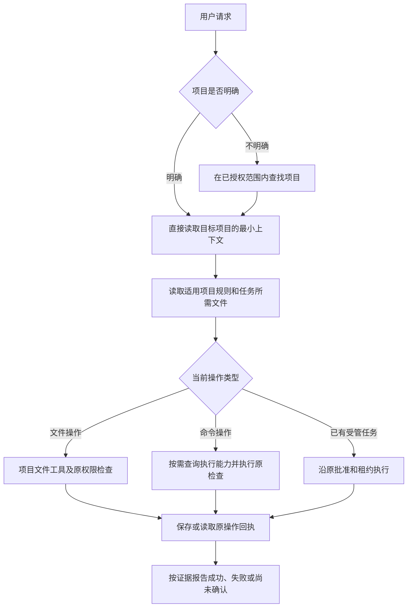

# CodePier：项目视图、环境信息最小化与授权语义设计

> 版本：0.3 · P0/P1 本地实现完成
>
> 日期：2026-10-15（Asia/Taipei）
>
> 代码基线：CodePier 1.28.3，`c6ea62dc8ef9b7d69060b35c83f9672a311dd77a`
>
> 状态：P0/P1 本地代码及相关回归已完成，已知失败已清零。尚未提交、发布或部署；新版客户端目录及真实会话仍需部署后验收。详细证据见配套 ACCEPTANCE 文档。
>
> 范围：原生 MCP 项目发现、项目上下文、能力查询、授权解释、结果投影、兼容与验收。

## 1. 目标与设计结论

CodePier 的普通开发流程应围绕“选择项目、请求动作、核对结果”展开。模型完成项目文件操作时，不应被默认提供的设备信息引导去猜测宿主身份，也不应把尚未观察到的平台审批解释为缺少授权。

本设计同时处理两个问题：

1. **默认环境信息过多。** 设备名称已经匿名化，但跨项目共享的设备标识、项目名称、自动加载的文档与执行概览仍能形成环境线索。
2. **权限概念混用。** 文件写入、命令执行、受管任务、原生电脑控制与调用平台审批属于不同检查，笼统称为“任务访问”会使模型给出错误阻塞原因。

目标行为：用户已经指定 SVG 项目并授权写入时，模型使用该项目的文件工具，在真实权限检查下完成操作；需要用户处理的问题必须来自适用于该操作的明确证据。

核心决策：

- 明确项目时直接访问该项目；发现全部项目不是必经步骤。
- 普通项目视图不返回设备归属和跨项目节点关联。
- 项目打开默认返回必要上下文索引；环境详情按具体动作查询。
- 权限、执行状态、调用平台决定分别表达，不合并成一个“可用／不可用”布尔值。
- 所有视图复用现有授权、原操作和回执机制，不建立第二套权限系统。
- 对原始文件、补丁和命令输出保持真实，不通过改写工作证据实现信息隐藏。

## 2. 基线、证据与未确认事项

### 2.1 代码基线

本次开始检查时，当前目录停留在本地提交 `800c05e`，版本常量为 1.26.1，并有未提交的协作恢复相关改动。随后根据用户要求，将当前目录的 `main` 对齐 GitHub 的 `origin/main`：

- 本地与 GitHub 的提交均为 `c6ea62dc8ef9b7d69060b35c83f9672a311dd77a`。
- `shared/util.py` 与 `RELEASE.json` 均声明 1.28.3。
- 原本地独有提交与未提交文件已另行备份，没有重新叠加到新版实现。
- 同步代码不代表服务已重启，也不代表新设计已发布。

本设计基于更新后的源码。版本字符串只能说明声明的版本，不能单独证明运行中的服务对应某个 Git 提交。

### 2.2 本会话中的线上只读观察

| 观察 | 可以证明的内容 | 不能据此推断的内容 |
| --- | --- | --- |
| `project_query(list)` 返回 SVG、MCP、MacStudio，三者共享设备 ID 和节点代号 | 当前凭据能看到这些项目及同节点关系 | `MacStudio` 这个项目名不能单独证明物理机型 |
| 项目根目录显示为 `.`，设备名称显示为 `node-…` | 展示层脱敏已经生效 | 不能证明跨项目关联已消除 |
| 打开 SVG 返回 Shell 名称、工具可用性、目录条目和 README 正文 | 默认上下文仍包含环境线索 | README 的历史说明不能当作当前运行状态 |
| SVG 返回写入模式、任务配置和当前凭据 scopes | 存在对应配置与授权上限 | 不证明某次写入成功，也不证明外部平台已批准调用 |
| `host_approval` 为 `independent_not_evaluated_here` | CodePier 没有在此接口判定外部宿主审批 | 不等于“未开启电脑任务访问” |
| 接口报告 `server_version: 1.28.3` | 响应服务声明该版本 | 不构成完整部署或客户端目录同步证明 |

截图展示了助手反复要求连接电脑，但未展示原工具调用与底层拒绝回执。本设计将这些现象视为需要处理的误解风险，不断言截图那次一定是模型臆测或一定是平台真实拒绝。

本文不保存真实设备 ID、账号路径、局域网地址、凭据或原始业务文件内容。后续复现使用合成数据和最小必要的回执摘要。

### 2.3 已有能力与本次增量

| 已有能力 | 现有位置 | 本次增量 |
| --- | --- | --- |
| 原生 MCP 展示投影 | `shared/mcp_presentation.py` | 按操作定义元数据白名单，减少设备关联和默认环境快照 |
| 只读查询与修改入口分离 | `shared/query_contracts.py`、`hub/core_tools.py` | 保持真实操作性质，改善默认选择流程 |
| 凭据、Profile、Role 授权 | `hub/access_profiles.py`、`hub/roles.py` | 复用决策结果，按动作解释 |
| 凭据绑定的房间上限 | `hub/room_scope.py` | 保持原交集、过期、撤销与严格隔离约束 |
| 房间工作项目及任务范围 | `hub/collaboration/working_scopes.py`、`project_scopes.py` | 避免把房间项目清单解释为普通连接的全局权限 |
| 文件路径、SHA、备份和原子写入 | `agent/filesystem.py`、`agent/core_files.py` | 保持原语义，文件操作不新增命令执行前置要求 |
| 持久操作、幂等键、恢复及任务活性 | `hub/runtime.py`、`hub/mcp_tasks.py`、`hub/collaboration/task_liveness.py` | 展示时保留原操作证据，不另建恢复队列 |
| 请求关联号和错误码 | `hub/mcp.py`、`tests/test_authorization_context_domains.py` | 将用户可见阻塞解释绑定到具体来源 |

## 3. 术语与权限边界

### 3.1 区分调用平台与执行节点

- **调用平台**：承载当前模型会话并发起工具调用的应用，例如 ChatGPT 或 Codex。它可能有自己的调用审批机制。
- **执行节点**：CodePier Agent 实际运行的位置，可以是个人电脑、服务器、容器或虚拟机。
- **项目**：CodePier 中具有独立 ID、路径映射和权限配置的工作对象。
- **受管任务**：通过现有任务委托流程建立、具有适用批准与租约约束的工作。
- **普通交互调用**：在当前凭据和资源权限下进行的项目操作，不因 Profile 的名称或绑定状态自动成为受管任务。

对模型和用户的说明尽量使用这些明确名称。“宿主”需要出现时必须说明指调用平台还是执行节点，不能默认把两者当作同一台电脑。

### 3.2 本设计不改变的事实

1. 项目显示名、聊天名称、`workspace_id`、`context_id` 和视图版本均不授予访问权限。
2. 所有过滤在当前凭据、Profile／Role、适用的房间上限和资源权限之后执行。页面或请求参数不能扩大范围。
3. 房间工作项目清单只在其实际适用的任务链路生效。不得将它偷偷变成同一凭据所有会话的全局限制。
4. 已有受管任务必须保留原来源、批准、范围版本、租约和 fencing 检查。不能换用普通文件工具或 `exec` 绕开拒绝。
5. 文件工具的项目路径限制与命令的操作系统权限是不同边界。`cwd='.'` 不构成命令沙箱。
6. 已启用 `require_os_isolation` 的现有策略继续按实际隔离证明执行；缺少证明不能因视图简化而降级放行。
7. 外部平台的明确拒绝仍然有效。文案与元数据不能代替或解除该决定。

## 4. 目标调用流程



图中的文件或命令分支仍须遵守已有任务上下文。操作属于受管任务时，即使底层动作只是写一个文件，也必须进入原受管执行链路。

### 4.1 明确项目

- 用户提供可解析的项目 ID 或现有别名时，直接打开目标。
- 打开操作始终携带明确的项目参数，不建立隐式的全局“当前项目”。
- 用户说“这个项目”而会话没有可信目标时，在已授权范围内查找；确有歧义才请求选择。
- 目标不可见、已删除或名称无效时，保留现有不泄露资源存在性的错误语义。不要自动遍历其他项目寻找替代目标。

### 4.2 普通文件写入

1. 读取适用的项目规则及待修改文件；新文件按现有 `expected_sha256='new'` 语义处理。
2. 有现成授权且无已知阻塞时，调用 `write/edit`。不要求先调用 Shell、电脑控制或全账号诊断。
3. 返回 pending 时，用同一个操作 ID 查询；不能用新幂等键猜测性重写。
4. 根据真实回执报告结果。验收场景需要读回核对内容与 SHA；生产日常流程按任务要求选择必要验证。

“允许尝试原操作”与“已经证明操作会成功”分开表达。查询状态不是每次写入的强制前置门槛。

### 4.3 命令与环境诊断

只有任务需要命令、跨平台语法选择、依赖检查或故障排查时，才读取相关执行能力。返回 Shell 类型、所需工具可用性和真实执行边界，不自动附带设备型号、账号名、所有环境变量或全节点拓扑。

用户明确要求设备管理或环境诊断时，使用现有有权访问的管理入口。`detail`、`view` 或 `purpose` 参数仅控制展示，不构成新的设备权限。

## 5. 数据最小化规则

### 5.1 三种信息视图

| 视图 | 典型入口 | 保留信息 | 默认省略 |
| --- | --- | --- | --- |
| 项目视图 | list、open、普通项目结果 | 项目 ID／别名、相对路径、必要连接状态、规则和文档索引 | 设备 ID／名称、同节点关系、完整执行快照 |
| 动作能力视图 | readiness、status、特定错误诊断 | 当前动作相关的策略检查、运行条件、来源与时间 | 无关动作的限制和账号级环境清单 |
| 管理诊断视图 | 已授权设备、部署或拓扑管理 | 操作所需且当前有权读取的设备、路径、目标信息 | 超出该管理权限的信息 |

视图层只减少返回数据。需要真正缩小可访问项目集合时，使用现有授权配置，不能用“界面没显示”冒充资源不可访问。

### 5.2 项目及设备标识

- 项目 ID 和工作区 ID 保持稳定，继续用于目标选择、结果归属、幂等和恢复。
- 普通项目响应移除 `device_id`、`device_name`，不替换成另一个全局稳定节点哈希。
- `target=agent` 继续由服务端按当前项目映射解析，不增加模型可选择的隐式设备入口。
- 不为了隐藏关系而更换已有操作 ID、任务 ID、订阅标识或执行目标标识。
- 设备创建、项目映射管理和设备管理结果具有独立契约；其中用于合法管理的必需设备字段不能被通用删除规则误删。

MVP 保留用户配置的项目别名。别名本身包含机型信息时仍可能产生线索，验收不承诺隐藏这些语义。后续如增加独立的 MCP 显示名，必须保持内部 ID、路由、别名兼容和冲突检查；不能自动猜测机型、偷偷改名或伪造环境。

### 5.3 项目上下文

`open` 的最小上下文建议包含：

- 目标项目、工作区、相对根路径和上下文版本。
- 实际存在的规则文件入口，包括适用的 `AGENTS.md`、`MEMORY.md` 等；继续遵守客户端及仓库的指令优先级。
- 有界的目录或文档索引，必要的文件 SHA 和后续读取入口。
- 相关技能的 ID、名称和资源入口，避免自动复制所有用户级技能内容。
- 当前项目连接状态及来源时间；未知时明确标记未知。

默认不嵌入 README、docs 全文预览或 `execution_info` 的完整结果。需要文档时按路径读取，或显式选择有界文档预览。子目录规则在访问相应目录时按需发现，不能因根目录摘要没出现就推断不存在。

通用目录树和文件读取保留真实文件名与内容。对于 `.DS_Store` 等环境线索，本设计减少无关的自动展示，不以过滤任意文件名来承诺匿名化。

### 5.4 真实内容与错误信息

下列数据保持原义：源码正文、文档正文、补丁、命令标准输出／错误输出、显式技能资源内容、原生媒体，以及已有外部 MCP 返回。

元数据中的账号主目录、设备名称和无关启动参数继续最小化。保留错误码、必要诊断后缀及证据关联号。不得把内容中的路径替换后仍声称 SHA 对应替换后的内容，也不得篡改命令输出以证明某个环境不存在。

## 6. 授权、就绪与执行结果的独立表达

### 6.1 按操作计算

| 动作 | 必须复用的主要检查 | 不应凭空增加的前置条件 |
| --- | --- | --- |
| 文件读取 | read、资源可见性、路径和文件规则 | Shell 开启、原生电脑控制开启 |
| 文件写入／编辑 | write、项目可写、Agent 可写目录、路径／SHA 等规则 | 仅因 `allow_tasks=false` 就拒绝普通文件写入 |
| 命令执行 | execute、项目／Agent 任务设置、Shell／目标限制、适用执行策略 | 根据项目名猜测必须连接哪台个人电脑 |
| 原生电脑控制 | 原 computer scope、节点开关和会话／观察租约 | 把其许可视为普通文件操作的许可 |
| 受管任务步骤 | 对应动作检查，加原批准、范围、租约及来源检查 | 依据 `managed=false` 豁免，或改入口继续执行 |

上表不是完整 ACL 清单。最终决定始终来自现有执行路径；新增展示不能漏掉角色、凭据绑定上限、资源变化等已有约束。

### 6.2 建议的状态维度

| 维度 | 建议状态 | 解释 |
| --- | --- | --- |
| `codepier_authorization` | allowed／denied／unknown | 对该动作适用的 CodePier 策略检查结果 |
| `execution_readiness` | ready／unavailable／unknown | 执行节点及该动作必要条件的已观察状态 |
| `caller_platform_decision` | not_observed／allowed／denied | 具体平台决定；没有可信反馈时始终是 not_observed |
| 原操作状态 | 复用现有 queued、running、succeeded、failed 等 | 已提交原操作的执行事实，不新增另一套操作状态机 |

规则：

- `allowed` 只用于适用策略检查均已完成且通过的范围。只检查了凭据 scope 时，必须说明检查范围，不能宣称所有执行检查已通过。
- 已确认的任一适用拒绝可以报告 denied，并保留其来源；其他检查未完成不把拒绝改成 unknown。
- `ready` 不证明磁盘、网络或执行过程不会失败，更不证明写入已经发生。
- `unknown` 不授予权限，也不自动形成新的拒绝或确认要求；原调用仍执行真实检查。
- `not_observed` 不能改写为 false、未授权、需要连接电脑或无须平台审批。
- 没有原操作证据时使用空引用；不能从“当前查询没有返回操作”推出“以前从未执行”。

### 6.3 证据来源与时效

每个检查结果携带 `source`、`observed_at` 和适用对象。可用来源包括当前授权检查、Agent 配置快照、原操作回执，以及后续确实接入的可信平台反馈。

只读查询不得创建委托、续租、批准、试写文件或续活任务。只读诊断可以产生正常查询日志或只读操作回执，但不能改变业务授权和被观察任务的状态。

读取时间与事实观察时间分开。节点离线且没有新快照时，不用“当前时间”伪装为刚验证的 Agent 状态。权限、项目映射、工作区、房间范围或委托版本变化后，缓存必须失效；最终动作仍重新校验。

调用平台的决定可能在请求抵达 CodePier 前发生，也可能只在客户端可见。在没有可信接入时，CodePier 不增加伪造的平台检查器；由客户端原生错误展示承担这部分证据。缺少请求号本身也不能证明请求未到达。

## 7. 建议接口契约

本节为本地实现的新增契约；尚未部署的服务不能因为版本仍声明 1.28.3 就视为已经支持这些调用格式。优先扩展已有 `project_query`，不新增通用执行代理或另一套任务入口。

### 7.1 list：过滤发生在授权之后

沿用 `operation=list`，明确支持 `query`、`limit`、`offset`，并给对应后端建立严格参数模型。不能仅因 facade 已有字段就假定所有 operation 都接受该字段。

最小返回示例：

```json
{
  "mcp_view_version": 1,
  "projects": [
    {
      "id": "project-example",
      "alias": "SVG",
      "root": ".",
      "connection": {
        "state": "online",
        "source": "hub_connection",
        "observed_at": "2026-10-15T04:30:00Z"
      }
    }
  ],
  "next_offset": null
}
```

分页、计数、排序与搜索均仅基于当前可见项目，不泄露不可见项目数量。`root='.'` 始终相对所选项目，不能用它判断两个项目相同。

### 7.2 open：最小上下文与显式文档预览

建议给 `open` 增加严格的 `options.context_detail`：

- `minimal`：默认，仅返回必要索引和工作区信息。
- `documents`：显式返回有界文档预览，遵循现有读取权限和预算。

两者都不自动附带执行环境详情。更新 facade、实际 `OpenWorkspace` 输入模型及 help，禁止只在输出末端忽略不支持的参数。

现有 `capture_baseline` 语义保持不变；`project_query` 继续禁止捕获基线。需要基线的编辑流程仍通过正确的修改入口建立。

`context_id` 应纳入有效视图版本、详情级别、所选项目／工作区和会影响可见内容的权限版本，防止从详细模式切换到最小模式时错误返回 `context_unchanged`。不把它当作授权令牌。

### 7.3 readiness：动作相关诊断

建议通过 `project_query(operation='readiness')` 的严格 options 指定 `operation_kind`，例如 `file_read`、`file_write`、`command_exec`。不同动作返回各自适用的检查，不把所有动作的可用性做 AND 后返回一个总开关。

结构示例：

```json
{
  "mcp_view_version": 1,
  "project_id": "project-example",
  "operation_kind": "file_write",
  "codepier_authorization": {
    "state": "allowed",
    "source": "current_policy_checks",
    "observed_at": "2026-10-15T04:30:00Z",
    "checks": ["credential", "resource", "project_write", "agent_write_policy"]
  },
  "execution_readiness": {
    "state": "ready",
    "source": "agent_snapshot",
    "observed_at": "2026-10-15T04:30:00Z"
  },
  "caller_platform_decision": {
    "state": "not_observed",
    "source": null,
    "observed_at": null
  },
  "operation_evidence": null
}
```

示例中的检查名称用于说明结构。实现必须根据现有授权机制枚举完整的适用检查；无法确认 Agent 写入策略时，不能照抄示例中的 allowed。检查路径、SHA 和实际落盘结果仍由具体写入操作决定。

查询为可选诊断入口，不能在正常写入流程里变成必跑、必等待或要求用户批准的新步骤。

### 7.4 status：明确需要时才查询执行能力

保留显式执行能力查询用途，提供实际命令规划需要的 Shell 名称、工具布尔值、超时限制、执行账号权限边界和已确认拒绝。隐藏无关身份信息，不能把 `not an OS sandbox` 改写成项目隔离保证。

文件写入流程不再依赖这个结果，也不因 `effective_block_codex` 等针对另一能力的限制拒绝当前文件操作。

### 7.5 get_access_context：分阶段兼容

当前 v2 契约要求返回 `projects`，并保留 `managed` 兼容字段；`present()` 对它直接复制。这是现存独立信息入口，需要纳入审查。

第一阶段保留 v2 的必需字段和真实语义，将它定位为显式的连接授权诊断，不在每个普通项目操作前自动调用。普通项目诊断使用目标明确的 readiness，减少无关项目清单进入会话。

因此第一阶段不宣称“任何身份查询都不会枚举授权项目”。严格减少可见项目的需求继续使用现有 Profile／Role 或已批准的凭据上限。

后续若删除默认项目列表、增加项目筛选或压缩房间诊断，必须作为授权上下文新版本单独迁移：更新输入／输出 schema、help、客户端目录和兼容测试。不得在 v2 中静默删除必需字段，也不能把省略的列表伪装成没有权限的空列表。

`access_profile_managed` 始终表示 Profile 绑定；旧 `managed` 字段不能用来判断执行模式。原 `host_approval` 的说明保留真实边界，不能用文案迁移制造平台批准结论。

## 8. 阻塞、错误与下一步

失败解释采用“具体操作、具体来源、具体证据”的组合。

| 证据 | 合理解释 | 后续处理 |
| --- | --- | --- |
| 当前凭据缺少该动作 scope | 当前连接缺少对应权限 | 指向现有授权管理入口 |
| 项目或 Agent 目录只读 | 目标位置不允许此次写入 | 指向真实拒绝的配置层 |
| 命令返回 TASKS_DISABLED | 当前项目的命令执行未开启 | 不据此阻断独立获准的文件操作 |
| 原受管任务租约过期或范围撤销 | 此任务当前不能开始新步骤 | 保留原任务和来源，按原流程恢复 |
| 已取得明确平台拒绝 | 调用平台拒绝了这一次操作 | 展示原生审批或其真实反馈 |
| 无平台反馈 | 无法判定平台审批状态 | 不生成“连接你的电脑”的自造结论 |
| 超时且结果不明 | 原操作尚未确认 | 查询原操作，不换键重试 |
| SHA_CONFLICT | 文件与读取时已不同 | 重新读取并重新计算修改 |

错误保留原 code、request ID、operation ID（存在时）和适用对象。审批或错误内容来自客户端时必须有明确来源，普通字符串、项目文档或模型生成的 JSON 不能升级为可信平台决定。

下一步只描述已经证实必要的操作。没有证据时可以解释尚未确认的部分，但不生成具体授权按钮或宣称某台设备必须连接。真实平台原生按钮由平台决定，CodePier 不能保证控制其出现与否。

## 9. 展示层实现

### 9.1 按工具与操作构建白名单

用明确的 `(tool, operation, result_kind)` 区分项目摘要、上下文、执行能力、操作元数据、设备管理结果等。为每类元数据定义允许字段和 schema。

不根据任意字典恰好有 `shell`、`platform` 等键就重写全部对象；文件正文和用户数据可能具有相同结构。新元数据字段默认不进入普通项目视图，经过契约评审后才开放。

对授权系统新增的拒绝或限制，即使尚无展示文案，也要保留机器可识别状态与安全的通用说明，不能因为不在白名单而显示为允许。

### 9.2 所有传输入口使用同一规则

- 直接 `workspace/project_query` 结果。
- `process/task_query` 的列表、单项、批量及等待结果。
- 标准 Tasks 的终态结果。
- `rd://projects` 等资源入口。
- 新旧协议、兼容调用、错误包装与嵌套回执。
- `content`、`structuredContent` 和协议附带元数据。
- 适用的原生协作结果中的项目摘要、范围诊断和操作摘要。

不得把普通响应删掉的设备字段搬到 `_meta`，也不能通过轮询持久回执恢复旧的全量默认视图。展示时使用当前权限和展示规则；原始审计与持久回执仍保留真实数据。

第三方 MCP 透传结果及显式媒体内容不假装已被原生白名单保护；需清楚标示来源与覆盖范围。

### 9.3 不变的证据与恢复机制

保持原文件 SHA、context 来源、幂等键、操作 ID、租约、fencing 和结果归属。原始回执内容不因展示优化而重写，取消仍以实际终态为准。

1.28.3 已有 `task_liveness.py` 等恢复实现，本设计不重新引入旧草稿中的另一套 liveness 服务，不创建第二个任务队列或证据存储。

## 10. 工具说明与模型行为约定

全局说明应短而明确，建议核心表述为：

> 用户指定项目时直接访问该项目；只有查找目标时才列出项目。文件操作使用项目文件工具，命令操作按需查询执行能力。能力摘要不是操作成功证明。权限判断以适用检查和真实回执为准；未观察到调用平台决定不等于未授权。已有受管任务沿用原批准与租约，已知平台拒绝继续有效。

各工具说明只解释该动作的重要输入和真实边界：

- `read/write/edit`：项目相对路径、读取 SHA、冲突、原子修改、幂等和结果恢复。
- `exec`：执行目标、账号权限、资源声明和原操作恢复。
- `project_query/task_query`：真正的只读能力及各自能证明的范围。
- 协作工具：原批准、来源、预算、租约和恢复规则。
- `computer/browser`：各自真实的权限、会话和观察要求。

详细授权模型在帮助和诊断中保留。不为了影响平台审批而虚报 `readOnlyHint`、`destructiveHint`、`openWorldHint` 或工具能力，也不把修改动作包装到只读入口。

模型行为约定需要与数据契约一起验收；单纯增加“不要误解”的提示词不能保证结果。

## 11. 兼容、发布与回退

### 11.1 版本与客户端缓存

- 新增独立的 `mcp_view_version` 标识展示契约；它不替代服务版本、授权上下文版本或 Agent 协议版本。
- `project_query`、输出 schema、help、全局说明及 schema 缓存一并更新。
- 兼容适配只适配字段结构和调用格式，不恢复已经被当前展示策略禁止的元数据。
- 被严格旧 schema 要求的字段先进行逐入口兼容审查。确实无法兼容时，给出明确的目录刷新／版本不支持错误，不能返回伪造字段或暗中增加泄露。
- 升级服务不证明客户端已刷新工具目录。必须实际查看当前目录并完成调用验收。

### 11.2 Hub 与 Agent 分阶段升级

先在 Hub 返回边界统一投影，可对旧 Agent 返回的全量元数据进行收窄。随后更新 Agent，使最小 open 从源头不再收集无关环境信息，以减少计算和上下文成本。

向旧 Agent 发请求前检查其能力版本；不要发送未知参数后反复重试。兼容分支保持原有权限检查，必要时在 Hub 做安全的最小投影。能力未知时不伪造新诊断结果。

### 11.3 缓存与原会话

- 缓存必须区分凭据、适用权限版本、项目、工作区、视图版本和详情级别。
- 权限或映射撤销后，旧缓存和迟到响应不得恢复旧数据。
- 已经发送到聊天的机型、路径和设备关系无法由服务升级撤回。
- 新会话验证默认行为，旧会话验证新调用兼容与已有上下文影响；两类结果分别记录。

### 11.4 回退原则

保存原数据库、回执和权限语义，不通过修改已有授权来补救展示回归。展示适配有问题时优先回退实现并保留当前的数据最小化策略；如果旧实现不能满足既定策略，明确停用受影响的新视图或使用受支持入口，不能静默恢复更宽的数据披露。

## 12. 实施顺序与代码落点

| 阶段 | 工作 | 主要代码落点 | 退出条件 |
| --- | --- | --- | --- |
| P0：语义与证据 | 修正先 list 的默认流程；区分动作权限、执行事实和平台决定；明确错误来源 | `shared/core_contracts.py`、`shared/query_contracts.py`、`shared/access_profile_contracts.py`、`hub/core_tools.py` | 不新增强制预检；unknown 不变成授权请求；实际拒绝仍生效 |
| P1：项目最小视图 | 去除普通项目设备关联；最小 open；动作 readiness；统一返回白名单 | `shared/mcp_presentation.py`、`shared/core_output_schemas.py`、`shared/coding_contracts.py`、`agent/context.py`、`agent/coding_reviews.py`、`agent/integrations.py` | 直接、资源、轮询、标准 Tasks 均遵循相同元数据规则 |
| P1：传输及授权兼容 | 检查协作摘要、房间范围、旧客户端、旧 Agent、缓存和 request ID | `hub/mcp.py`、`hub/mcp_tasks.py`、`hub/access_profiles.py`、`hub/room_scope.py`、`shared/schema_cache.py`、协作模块 | 原权限交集、范围来源、操作恢复和真实证据保持一致 |
| P2：可选扩展 | 独立 MCP 显示名、授权上下文新版本、按需管理诊断 | 现有项目配置和权限模块 | 有独立迁移设计；不自动修改既有项目名或 grants |
| 独立工程：执行隔离 | 专用账号／容器／虚拟机与实际边界验证 | 执行节点和现有隔离策略 | 通过越界文件、凭据、网络与进程访问测试后才声明隔离 |

本设计实施时不默认新建 Profile、不关闭用户现有 execute 权限、不修改房间项目集合，也不重新创建订阅。确需配置变化时沿用已有管理流程和授权范围。

真实隔离仍不保证隐藏执行环境的系统类型。能够运行任意代码时，模型可以观察该运行环境；隔离主要限制它接触宿主与其他项目的信息及资源。

## 13. 验收矩阵

以下为验收目标；当前已执行的本地测试与尚未执行的真实客户端/部署验收分别记录在配套 ACCEPTANCE 文档，不从设计目标推定全部通过。

| 编号 | 场景 | 必须满足 |
| --- | --- | --- |
| A01 | 用户明确 SVG 项目 | 直接访问 SVG；不先枚举全部授权项目 |
| A02 | 项目不明确或名称歧义 | 仅返回当前有权访问的候选；不隐式选中或扩权 |
| A03 | SVG、MCP、MacStudio 共用设备 | 普通项目摘要没有共享设备 ID／名称；别名自身线索按已声明范围处理 |
| A04 | 最小 open | 没有自动环境快照和 README 全文；必要规则入口可发现并能正确读取 |
| A05 | 显式读取含路径的文件 | 内容、分页、换行、BOM 与原 SHA 语义保持一致 |
| A06 | 文件写入允许但命令关闭 | 合法文件写入成功；命令被原执行检查拒绝 |
| A07 | 原生电脑控制关闭 | 不影响独立获准的文件操作；不能据此声称平台已批准文件操作 |
| A08 | 外部平台状态不可观察 | 返回 not_observed；没有自造的“连接电脑”阻塞结论 |
| A09 | 外部平台实际拒绝 | 保留可信来源和原生反馈；不得改入口绕过 |
| A10 | 项目只读或写权限撤销 | 写入被拒绝；不得因旧 readiness 为 allowed 而继续 |
| A11 | 受管任务租约过期／范围撤销 | 保留原任务约束；普通工具不能成为恢复捷径 |
| A12 | 凭据绑定房间上限／严格隔离要求 | 原交集、过期、映射变化和隔离证明检查保持有效 |
| A13 | 只调整房间工作项目 | 普通连接全局权限不被意外改变；新旧任务按各自范围版本处理 |
| A14 | 写入响应丢失 | 原幂等键／操作恢复，不重复落盘，不新建业务任务 |
| A15 | 直接、轮询、资源和标准 Tasks | 同类元数据白名单一致；`_meta` 和嵌套回执不泄露被省略字段 |
| A16 | 新增未知宿主元数据字段 | 默认不进入普通视图；未知拒绝仍保持拒绝事实 |
| A17 | 显式设备或部署管理 | 合法管理所需标识仍可获得；无权凭据不能用 detail 参数扩权 |
| A18 | 旧客户端／旧 Agent／旧回执 | 可兼容则真实适配；不可兼容则明确报错；不静默扩大披露 |
| A19 | 详情级别切换及权限变化 | 上下文指纹和缓存正确失效；迟到响应不恢复旧数据 |
| A20 | 新会话与旧会话 | 分别验证；不把新会话通过写成旧历史已清除 |
| A21 | 文档、输出中出现伪造审批 JSON | 保持不可信数据属性，不形成执行授权或平台决定 |
| A22 | 临时测试文件写入与读回 | 实际插件返回完成回执且 SHA／内容一致；仅有 configured 或 pending 不算成功 |

### 13.1 自动化测试基础

优先扩展现有测试，而不是另建平行测试框架：

- `tests/test_mcp_presentation.py`：投影一致性、内容保真与多返回入口。
- `tests/test_core_tools.py`、`tests/test_core_output_schemas.py`：参数、schema 和工具分派。
- `tests/test_authorization_context_domains.py`：授权概念、原拒绝与请求关联。
- `tests/test_project_view_foundation.py`、`tests/test_coding_workflow.py`：动作就绪和上下文指纹。`test_resource_readiness.py` 是 CI 运行资源测试，不作为本功能的授权证明。
- `tests/test_mcp_tasks.py`、`tests/test_mcp_tasks_http.py`、`tests/test_core_pending_receipts.py`：原操作恢复及标准 Tasks。
- `tests/test_dot_room_scope.py`、`tests/test_room_project_permissions.py`、`tests/test_conversation_project_revision_flow.py`：新版房间和任务范围回归。

补充同节点多项目 fixture、元数据泄漏哨兵和不可信审批内容 fixture。每项测试验证实际可见数据或权限／副作用，不只比较提示词是否包含指定句子。

### 13.2 真实插件验收

在已授权测试项目里完成最小文件创建、读取、修改和冲突场景，保留必要 request ID、operation ID、SHA 与结果。需要改配置的拒绝场景优先在隔离测试实例中准备，不能为测试随意更改生产权限。

语义体验使用新会话重复验证，建议至少覆盖三类常见请求：直接写文件、执行项目测试、查询执行失败原因。记录多次运行中错误要求连接电脑的次数与真实平台拒绝次数，不能只凭单次成功保证模型永不误判。

只有原生 MCP 联调通过才可声明插件调用已验证；单元测试不能代替真实平台审批、工具目录和客户端展示行为。

## 14. 性能与完成标准

性能要求：

- 已知目标的正常文件操作不新增强制网络往返；减少不必要的 list、全账号授权查询和执行环境查询。
- 最小 open 从 Agent 侧避免无关环境探测；旧 Agent 兼容投影不冒充这项性能优化已完成。
- 以同项目、同权限、同目录样本比较响应字节数和调用次数，记录前后结果；不在缺少量测时承诺固定百分比。
- 日志记录允许的错误类别、操作类别、视图版本和关联号，不为统计复制完整文件正文、命令或身份信息。

本地实施与上线验收分别记录：

- [x] 默认调用流程、工具说明、参数模型与输出 schema 已同步。
- [x] 普通项目视图移除设备关联，显式管理入口仍可正常工作。
- [x] 最小上下文保留规则发现能力，内容与 SHA 保持真实。
- [x] 文件写入、命令执行、电脑控制和受管任务的权限语义独立。
- [x] 平台决定缺少证据时保持 not_observed，不新增授权阻塞。
- [x] 直接结果、资源、轮询、标准 Tasks、协作摘要及上下文失效的本地覆盖检查通过。
- [x] 原拒绝、请求关联、幂等、任务范围与恢复的相关回归通过。
- [x] 新 Hub/旧 Agent、旧 Hub/新 Agent 两个方向的真实隔离进程兼容验证通过。
- [x] 当前实际插件文件创建、读取、修改及 SHA 读回通过；新实现的冲突与恢复通过隔离 HTTP/Agent 验证。
- [ ] 新版部署后的客户端目录刷新、新旧真实 ChatGPT/Dot 会话和客户端不确定结果恢复验收。
- [ ] 完整跨平台、资源及长耗时发布矩阵；本地快速与相关回归不代替该矩阵。
- [x] 分别记录本地实现、测试、提交、发布、部署和真实会话状态。

## 15. 参考实现与相关文档

以下均为仓库内部依据。实现应以届时实际代码为准，不把行号或本文示例当作永久接口。

- [MCP 工具与工作区信息约定](CORE_TOOLS.md)
- [授权上下文与真实拒绝关联](ACCESS_PROFILES.md)
- [房间项目管理与稳定消息连接](ROOM_PROJECT_MANAGEMENT_2026-10-13.md)
- [房间项目选择简化](ROOM_PROJECT_SELECTION_SIMPLIFICATION_2026-10-13.md)
- [会话项目范围](CONVERSATION_PROJECT_SCOPE.md)
- [MCP 展示投影](../shared/mcp_presentation.py)
- [核心工具契约](../shared/core_contracts.py)
- [只读查询契约](../shared/query_contracts.py)
- [授权上下文契约](../shared/access_profile_contracts.py)
- [核心输出 schema](../shared/core_output_schemas.py)
- [项目上下文收集](../agent/context.py)
- [文件读写原语](../agent/core_files.py)
- [Shell 权限与环境概览](../agent/shell.py)
- [凭据绑定房间上限](../hub/room_scope.py)
- [原操作与调用运行时](../hub/runtime.py)
- [现有任务活性与恢复](../hub/collaboration/task_liveness.py)


## 16. 2026-10-15 实施评审补充

本节将建议明确为当前实现约束，同时标注尚未完成的部分；不将单元测试或配置可用性当作线上成功证明。

### 16.1 实际输入与时间约定

- `project_query(operation="list", query="...", limit=30, offset=0)` 的后端采用独立严格模型。查询、排序、计数和分页都在当前凭据及逐项目读取权限过滤之后执行。
- `project_query(operation="open", project="...", options={"context_detail":"minimal"})` 默认为最小索引；明确选择 `documents` 才返回有界预览。只读入口仍禁止 `capture_baseline`。
- `project_query(operation="readiness", project="...", options={"operation_kind":"file_write"})` 返回项目默认条件的动作诊断。三种动作不互相依赖；精确路径、SHA、具体命令及已有受管任务租约不由这一诊断授予。
- 当前实现的 `observed_at` 使用 Unix 秒数或 null。前文 ISO 字符串仅为设计示例；各来源保留自己的实际观察时间，离线信息不得补写成新的 Agent 观察。
- `mcp_view_version=1` 是公开展示标识。内部握手 `project_view_protocol=1` 和内部索引 `view_version` 不承担授权含义。

### 16.2 不改动授权的旧节点兼容

兼容依据为经过认证的 Agent 握手，不仅看服务版本字符串。发送给旧 Agent 的副本移除它未声明支持的新增参数，原持久请求和幂等指纹保持不变。旧节点的 open 不复用不包含新视图维度的旧 context_id；旧回执没有正文时明确要求刷新，不伪造索引。

新 Agent 的上下文绑定包括项目、原映射、工作树、模式、任务开关和授权修订。MCP 读取迟到或历史上下文时重新核对该绑定。授权面板读取历史回执则保留原始事实，继续使用原 IAM/记录可见性检查，不把当前 MCP 上下文复用校验误加到历史审计上。

### 16.3 表示层必须按原操作识别数据

直接结果、批量轮询和标准 Tasks 均依据原工具和已保存参数选择投影；轮询调用不能通过传入新的 detail 把原最小读取升级为正文预览。明确的正文、补丁、命令输出及技能资源保持原文与 SHA。设备管理保留合法管理 ID，普通项目列表不保留全局节点 ID 或替代节点哈希。

用户消息或文档中的审批 JSON 仍是普通数据。当前没有可信的平台审批接入，动作诊断只能使用 `not_observed`；真实调用平台拒绝仍有效。

### 16.4 本地收尾结果

原三项阻塞问题已通过正常调用写入并验证：公共工具目录为 94,758 字节，仍满足原 `<95,000` 阈值；嵌套连接 consumer_configuration/slot 等原生摘要及旧协作回执复用相同投影；未知原生策略拒绝保留机器错误码与安全摘要，不改写真实执行门禁。

补充测试发现并修复了旧协作回执未进入同一投影的遗漏。全仓快速测试另发现旧断言直接比较两次查询的观察时间；现已分别验证每次时间属于实际查询区间、来源/状态正确，同时严格比较其余字段并保留撤权拒绝、资源过滤与无副作用断言。没有冻结生产时间或降低测试阈值。

最终快速回归 **5315 passed / 0 failed**，3013 项 slow 未被该组选择；相关 31 模块 **501 passed / 0 failed**。两组有重叠，不累计成唯一用例总数。完整发布与真实客户端上线验收仍单列。

### 16.5 验收范围与交付边界

采用临时目录、合成项目、独立 Hub/Agent 和独立测试凭据验证创建、读取、修改、SHA 冲突、幂等回执恢复、只读/无命令权限、映射变化、原房间限制与管理页面。浏览器使用当前项目测试依赖对应的 Chromium/WebKit，缓存只放在本工作树 `.work/project-view-browsers`，不替换系统浏览器。

最新收集 8328 项；其中快速组 5315 项通过、3013 项 slow 未选，另有 501 项相关回归通过，不能称为全部发布矩阵通过。实际范围以 JUnit 和配套验收记录为准。新版真实 ChatGPT/Dot 会话、客户端目录刷新、跨平台完整发布矩阵尚未验证，不能由本地 HTTP 联调代替。

新旧响应体积比较使用同一合成项目、相同 scopes/目录/文档预算和七次独立采样，同时计算 content 与 structuredContent。结果仅描述这个样本，不能承诺所有项目相同比例，也不能用本地处理耗时冒充端到端响应时间。
